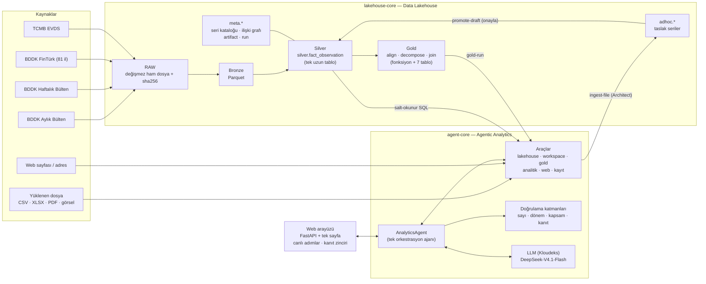
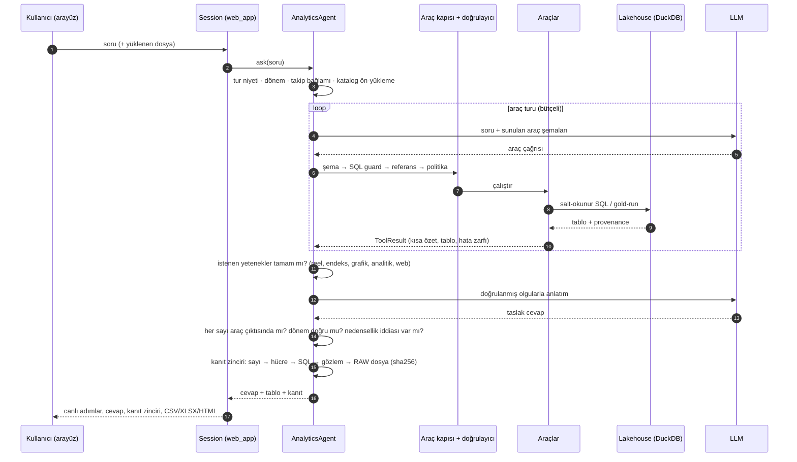

# 1. Genel mimari

Agent Smith iki bağımsız Python paketinden oluşur. **`lakehouse-core`** sıfırdan yazılmış bir veri gölü evidir (Data
Lakehouse). **`agent-core`** bu havuz üzerinde çalışan agentic analitik motorudur. İki paket arasında kod bağımlılığı yoktur:

- Ajan havuzu yalnız **salt-okunur SQL** ile okur.
- Havuza her yazma işlemi `python -m lakehouse …` komut satırı üzerinden, ayrı bir süreçte yapılır (ADR-0024).

Bu ayrım jürinin "yarın REST API, başka bir veritabanı ya da başka bir alan verirsek ne değişir?" sorusunun cevabıdır:
yeni bir kaynak adaptörü eklenir, orkestrasyon ve doğrulama katmanı değişmez.

## 1.1 Katmanlar

| Katman | Görev | Nerede |
|---|---|---|
| **Kaynak bağlayıcıları** | BDDK (aylık, haftalık, FinTürk) ve EVDS'den çekim | `lakehouse-core/src/lakehouse/connectors/`, `parsers/` |
| **RAW** | Kaynaktan gelen dosya bayt bayt, sha256 ile saklanır; hiç değiştirilmez | `storage/raw.py` → `data/raw/<kaynak>/<tarih>/` |
| **Bronze** | Ayrıştırılmış tablo, Parquet | `storage/parquet.py` → `data/bronze/source_id=…/dataset_id=…/` |
| **Silver** | Tüm kaynaklar tek uzun tabloda: `series_id, observation_date, value, unit, measure_type, quality_flag, artifact_sha256, run_id …` | `silver/`, `models/silver/fact_observation.sql` |
| **Katalog (meta)** | Her serinin anlamı: ad, birim, ölçüm tipi (stok/akım/oran/endeks), toplama kuralı, güven düzeyi, kapsam; seriler arası ilişki grafı | `catalog/series/*.yml` → `meta.series`, `meta.series_relation` |
| **Gold** | Anlamı kurulabilen dönüşümler fonksiyon olarak: frekans hizalama, kümülatiften akıma, dönem üzerinden birleştirme | `gold/` (`align_frequency`, `decompose_cumulative`, `join_on_period`) |
| **Ad-hoc** | Kullanıcının getirdiği veri önce taslak olarak ayrı tabloya yazılır, onaylanınca Silver'a alınır | `adhoc/`, `catalog/promotion.py` |
| **Ajan** | Soruyu anlar, araç seçer, sonucu doğrular ve anlatır | `agent-core/src/kkb_agent/core/agent.py` |
| **Arayüz** | Soru, canlı adım akışı, tablo/grafik, kanıt zinciri, dışa aktarım, sohbet kaydı | `agent-core/src/kkb_agent/web_app.py`, `static/index.html` |

## 1.2 Bir sorunun yolculuğu

Ayrıntılı karar akışı [`03-agent-karar-ve-gorev-isleme.md`](03-AGENT-KARAR-VE-GOREV-ISLEME.md) belgesindedir.

## 1.3 Tasarım ilkeleri

1. **Harness güçlü, modele en az iş.** Model hesap yapmaz, ham veriyi görmez. Hangi aracın hangi argümanla çağrılacağına
   karar verir ve doğrulanmış sonucu anlatır. Toplama, oran, hizalama, reel değer, endeks ve vade grupları deterministik
   kodda hesaplanır.
2. **Tek ajan + deterministik katmanlar.** Planlayıcı, arayıcı, doğrulayıcı ve anlatıcı ayrı LLM ajanları değildir; tek
   orkestrasyon ajanının mantıksal rolleridir (mentör kararı, 12 Eylül). Doğrulama kuralları kodda durur.
3. **Sayı kanıtsız yazılmaz.** Cevaptaki her sayı bir araç çıktısında bulunmalıdır; bulunmayan sayı taşıyan cümle
   cevaptan çıkarılır (ADR-0027, ADR-0066).
4. **Kaynak sadakati ve erişim sözleşmesi.** Kullanıcının belirttiği kaynağa erişilemezse bu gizlenmez, CAPTCHA ya da bot
   koruması aşılmaz. Durum açıkça söylenir ve seçenek sunulur (ADR-0028, ADR-0111).
5. **Jeneriklik.** Alan bilgisi kodda değil katalogda ve yapılandırmadadır. Havuz boşaltılıp başka bir alanın verisiyle
   kurulabilir (`bootstrap --catalog none`); ajanın alan profili katalogdan türetilir (ADR-0048, ADR-0056).
6. **Her karar kayıtlı.** Mimari kararlar gerekçe ve ölçümle `docs/adr/` altında tutulur (111+ ADR).

## 1.4 Modeller

| Rol | Model | Nerede ayarlanır |
|---|---|---|
| Metin ve araç çağırma | `deepseek-ai/DeepSeek-V4.1-Flash` (Kloudeks, OpenAI uyumlu uç) | `LLM_MODEL`, `LLM_BASE_URL` |
| Embedding (hibrit katalog araması) | `kkbhackathon2026/Qwen3-Embedding-8B` | `EMBEDDING_MODEL` |
| OCR / belge okuma | `kkbhackathon2026/Unlimited-OCR` | `VISION_MODEL` |

Dış LLM servisi kullanılmaz; bütün model çağrıları KKB'nin Kloudeks platformuna gider (ADR-0103). Tek istemci
(`llm/openai_compat.py`) OpenAI uyumlu protokolü konuşur; model yalnız `.env`'den seçilir.

## 1.5 Profiller

| Profil | Ne yapabilir |
|---|---|
| **Analyst** | Havuzu sorgular, analiz eder, dosya/web okur, grafik çizer. Yazma araçları kayıt defterinde hiç yoktur. |
| **Architect** | Analyst'in yapabildikleri + dosyayı havuza taslak seri olarak kaydetme (`ingest_from_url`), kayıtlı kaynaktan eksik dönemi çekme (`ingest_source`), kullanıcı onayıyla kataloğa alma (`promote_draft`), iki adımlı onaylı tam sıfırlama. |

Arayüzün üst çubuğundaki **Analyst | Architect** düğmesi profili tek tıkla değiştirir; sohbet ve tablolar korunur
(ADR-0112).
