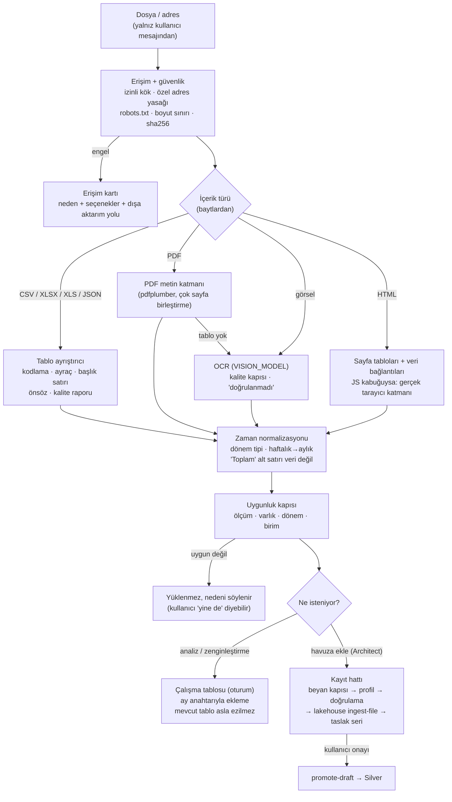

# 4. Doküman okuma yaklaşımı ve agent yapısı

Kullanıcı soruya bir dosya ya da adres eklediğinde okuma hattı devreye girer:
- **Tipler:** CSV, TSV, XLSX, XLS, JSON, PDF, görsel ya da web sayfası.
- **Kararlar kuralla verilir.** Tablo yapısı, zaman ekseni, uygunluk, erişim sınıflandırması ve kayıt eşlemesi
  deterministiktir; hiçbir karar adımında LLM yoktur. Model yalnız hangi aracın çağrılacağını seçer ve sonucu anlatır.
- **Tek istisna OCR.** Taranmış belgede tabloyu görüntü modeli okur; bu değerler "doğrulanmadı" diye işaretlenir.

## 4.1 Araçlar ve roller

| Araç | Profil | Ne zaman |
|---|---|---|
| `web_url` | Her ikisi | Kullanıcı bir adres ya da dosya verdiğinde. Önce tabloları listeler; seçilen tabloyu **yalnız oturumda** çalışma tablosu yapar, havuza yazmaz. |
| `web_search` | Her ikisi (anahtar varsa) | Adres verilmediyse ve veri havuzda yoksa. Arama sonucu veri değildir; yalnız açılacak aday adres üretir. |
| `ingest_from_url` | Architect | "Bu dosyayı havuza ekle / kaydet". Veriyi **taslak** (`adhoc:`) seri olarak yazar. |
| `ingest_source` | Architect | Katalogdaki bir serinin eksik dönemini kayıtlı kaynağından (BDDK, EVDS) çeker. |
| `promote_draft` | Architect | Kullanıcı açıkça onaylayınca taslağı kataloğa alır ve Silver'a kopyalar. |

**Niyet kapıları** (`core/intent.py`, ADR-0037):
- Açılacak adres yalnız kullanıcının mesajından (ya da onaylı arama sonuçlarından) gelebilir.
- Yazma yalnız kullanıcı "ekle / yükle / kaydet" dediğinde yapılır.
- Dosya içeriğindeki bir cümle yetki vermez; içerik veridir.

## 4.2 Tablo dosyaları: CSV, XLSX, XLS, JSON

`builder/read.py` ve `builder/tabular.py` bu dosyaları okur. Hücreler önce metin olarak okunur; tip çıkarımı ayrı ve
açıklanabilir biçimde yapılır.

- **Kodlama.** BOM varsa ona uyulur. Yoksa `utf-8`, `cp1254`, `cp1252`, `latin-1` sırayla katı biçimde denenir;
  "replace" kullanılmaz. Türkçe karakter skoru düşükse okuma reddedilir.
- **Ayraç.** `,` `;` `\t` `|` adayları satır genişliği tutarlılığıyla skorlanır; iki aday çok yakınsa kullanıcıya
  sorulur.
- **Başlık satırı ve rapor önsözü.** Başlık satırı benzersizlik, metinsellik ve dikdörtgenlik skoruyla bulunur.
  "Dışa Aktarım Tarihi", "Toplam Kayıt Sayısı" gibi üstteki satırlar veri sayılmaz; kanıt için `attrs["preamble"]`
  alanında saklanır.
- **Bozuk satırlar atılmaz.** Dikdörtgen olmayan satırlar ek kolonlarla korunur ve kalite raporunda sayılır.
- **XLSX güvenliği.** ZIP bombası sınırı var; makro içeren `.xlsm` reddedilir. Birden çok sayfa varsa net skor farkı
  yoksa sayfa sorulur. Eski `.xls` xlrd ile okunur.
- **Sınırlar.** Dosya 25 MiB, en çok 1.000.000 satır ve 10.000 kolon.
- **Kalite raporu** (`TabularQualityReport`). Şunları kaydeder:
  - kodlama, ayraç, başlık satırı;
  - boş oranları, tekrar eden satır ve başlıklar, bozuk satırlar;
  - çıkarılan tipler, şüpheli dönüşümler;
  - güven düzeyi, zaman frekansı.

**Sayı biçimi.** "1.234.567,89" ile "1,234,567.89" arasındaki belirsizlik tablo içi kuralla çözülür; çözülemeyen kolon
metin kalır ve not düşülür. Pandas tahmini kullanılmaz. Örnek hata: "31.51" sayısının 3151 okunması.

## 4.3 PDF ve görseller

| Adım | Ne yapılır | Nerede |
|---|---|---|
| 1. Metin katmanı | Sayısal üretilmiş PDF'in tabloları pdfplumber ile okunur. Aynı başlıklı ardışık sayfa tabloları tek tabloya katlanır. Hücreler dosyanın kendi metnidir. | `vision/pdf.py` `extract_pdf_tables` |
| 2. Metin | Tablo yoksa sayfa metni okunur. | `extract_pdf_text_layer` |
| 3. OCR | Taranmış belge ya da görselde tabloyu `VISION_MODEL` okur. Sayfa ve süre bütçelidir (5 sayfa, 90 sn). | `vision/ocr.py` `ocr_document` |
| 4. Kalite kapısı | OCR tablosunda başlık bozukluğu ve satır-toplam tutarlılığı ölçülür. "Düşük/belirsiz" kalitede tablo çalışma tablosu yapılmaz (`LOW_QUALITY_SOURCE`). Kullanıcı "doğrulanmamış olsa da kullan" derse geçilir. | `web/html.py` `extract_ocr_page` |

OCR ile okunan her sayı cevapta ve kanıt panelinde **"görüntüden OCR ile okundu, doğrulanmadı"** diye işaretlenir.
PDF okuyucu kurulu değilse OCR'a sessizce düşülmez, uyarı yazılır.

## 4.4 Web sayfaları ve erişim sözleşmesi

- **Güvenli çekim** (`web/fetch.py`):
  - Yönlendirmeler tek tek doğrulanır (en çok 5).
  - Özel ya da iç ağ adresleri engellenir (SSRF koruması).
  - `robots.txt` host başına bir kez okunur ve ona uyulur.
  - Sayfa sınırı 8 MiB, PDF için 32 MiB.
  - Her yanıtın sha256'sı ve çekim zamanı (UTC) tutulur.
- **Bütçeli tarama** (`web/crawl.py`): sabit derinlik yoktur.
  - Doğrudan veri bağlantıları (CSV/XLSX/PDF/JSON) önce ziyaret edilir.
  - Yalnız aynı alan adı taranır.
  - Sınırlar: en çok 5 sayfa, derinlik 1, 5–60 sn.
  - Tur başına 3 arama ve 5 benzersiz sayfa (ADR-0034/0096).
- **Erişim sonucu** (`core/access_policy.classify_access`, ADR-0028). Dört sınıf vardır:

| Sınıf | Ne demek |
|---|---|
| `ok` | Erişildi |
| `needs_credential` | Giriş, üyelik ya da yetki gerekiyor |
| `blocked` | Bot koruması, CAPTCHA, robots.txt, istek sınırı, ulaşılamayan adres |
| `not_found` | Böyle bir sayfa yok |

- **Sabit kaynakta değişiklik yapılmaz.** Kullanıcı "bu siteden" dediyse kaynak değiştirilmez; seçenekler sunulur ve
  sorulur. Serbest kaynakta alternatif kullanılabilir, ama değişiklik cevapta açıkça söylenir.
- **Gerçek tarayıcı katmanı** (`web/browser.py`, isteğe bağlı):
  - İçeriği JavaScript ile yüklenen sayfalar sistem Chrome'uyla işlenir.
  - Kaynağa özel form etkileşimleri bir adaptör kaydında durur; kurum adları yapılandırmadadır.
  - Sayfa açılır açılmaz engel denetlenir. Bot koruması ya da CAPTCHA görülürse **aşılmaz**: sonuç ~1 sn içinde erişim
    kartı olur, host 10 dakika yeniden denenmez.
  - Kart kaynağın dışa aktarım yolunu söyler, ör. "raporu CSV olarak indirip yükleyin" (`source_hints.json →
    manual_export`, ADR-0111).

## 4.5 Zaman normalizasyonu

`builder/temporal.py` kaynağın zaman eksenini çözer ve istenen frekansa güvenli kurallarla dönüştürür.

- **Tanınan dönemler:** hafta aralığı (`2021/02 (11.01.21-15.01.21)`), ISO hafta, çeyrek, `YYYY-MM`, `YYYYMM`, yıl, gün.
- **Alt toplam satırı dönem değildir.** "Toplam / Genel Toplam / Total" satırları eksen tahmininde ve dönüşümde
  dışarıda kalır.
- **Güvenli dönüşüm yalnız günlük/haftalık → aylık.** Diğer yönler reddedilir; tahmin yapılmaz.

| Ölçüm tipi (etiketten ya da katalogdan) | Aylığa iniş kuralı |
|---|---|
| Akım (hacim, tutar, işlem) | Dönem **başladığı aya** yazılır ve toplanır; günlere bölüştürülmez |
| Zaman başına ortalama ("günlük ortalama"), oran, faiz | İş günü ağırlıklı ortalama |
| Stok, endeks | Ayın en son biten döneminin değeri |
| Niteleyicili akım kelimesi ("işlem fiyatı", "ortalama tutar") | Güvenli kural yok → ham tablo gösterilir |

- Sayıya çevrilemeyen hücre sessizce atlanmaz; dönüşüm durur (`VALUE_PARSE_FAILED`).
- Kaynağın ilk ya da son ayı eksik kapsanıyorsa uyarı yazılır.
- Mevcut tabloya ekleme ay anahtarıyla, yalnız bire-bir eşleşmeyle yapılır. Eşleşme kurulamazsa mevcut tablo
  **korunur** ve `JOIN_MISMATCH` döner (ADR-0109, ADR-0110).

## 4.6 Uygunluk kapısı

Tablo çalışma tablosu olmadan önce soruyla karşılaştırılır (`core/fitness.py`, `builder/relevance.py`). Karşılaştırılan
boyutlar şunlar:
- ölçüm;
- varlık/segment;
- dönem;
- granülarite;
- birim;
- okuma kalitesi.

Sonuç `accept`, `partial` ya da `reject` olur. Reddedilen tablo yüklenmez; kart tabloda ne olduğunu söyler. Kullanıcı
"yine de kullan / doğru dosya bu" derse geçilir. Modelin tek başına "onaylandı" demesi yetmez; onay kullanıcının
metninde geçmelidir.

## 4.7 Havuza kayıt (Architect)

`ingest_from_url` şu sırayla çalışır:

1. **Okuma.** Bölüm 4.2–4.4'teki hat kullanılır. HTML sayfasındaki ekler seçilebilir; XLSX'te formül ya da dış bağlantı
   varsa kayıt reddedilir.
2. **Beyan kapısı.** Birim, ölçüm tipi, frekans, kolon seçimi ve dönem kullanıcının metninde geçmiyorsa model bunları
   uyduramaz; kullanıcıya sorulur. Veriden kanıtla çıkan ve beyanla örtüşen alan sorulmaz.
3. **Şekil düzeltmeleri.** Kaynak dosya değiştirilmez; türetilmiş bir CSV yazılır:
   - sondaki "Toplam" satırı atılır;
   - yıl, ay ve dönem aralığı kolonları tarihe çevrilir;
   - satır-ölçüm matrisi uzun tabloya dönüştürülür.
4. **Profil ve öneri** (`builder/profile.py`). Tarih kolonu ve biçimi, değer kolonu, ondalık ayracı, frekans, ölçüm tipi
   ve birim önerilir. Her alan bir kanıt satırı ve güven düzeyi taşır.
5. **Doğrulama** (`builder/verify.py`). Kontroller:
   - tarih ve değerler %100 ayrışıyor mu;
   - sessizce düşen satır var mı;
   - (tarih, varlık) tekil mi;
   - seri kimliği çakışıyor mu.

   Başarısızsa **"EKLENMEDİ — önce kullanıcıya sorulmalı"** kartı döner.
6. **Yazma.** `python -m lakehouse ingest-file …` komutu RAW (sha256) → Bronze → `adhoc.fact_observation` yazar ve
   seriyi taslak olarak kaydeder. Provenance şunları içerir: `artifact_sha256`, `run_id`, `fetched_at`.
7. **Kataloğa alma.** Kullanıcı o turda açıkça onaylarsa `promote_draft` çalışır. Taslak aktif seri olur ve Silver'a
   kopyalanır. Kısa "evet" yalnız bekleyen tek bir işlem varsa geçerlidir (ADR-0039, ADR-0068).

## 4.8 Belgelerin kanıtı

| Kaynak | Kanıt zincirinde görünen |
|---|---|
| Web sayfası / dosya | URL, HTTP durumu, sha256, çekim zamanı, seçilen tablo ve sayfa, çıkarım yöntemi |
| PDF metin katmanı | "PDF metin katmanından okundu (pdfplumber), OCR kullanılmadı", belge sha256, sayfa ve tablo numarası |
| OCR | Model, sayfalar, kalite düzeyi; **"sayılar doğrulanmadı"** işareti |
| Havuza kayıt | `artifact_sha256`, `run_id`, Bronze yolu, RAW dosya; kataloğa alınınca Silver gözlemi |

Kanıt paneli dört listeyi ayırır:
- tabloya seçilen sayfa;
- okunup kullanılmayan sayfalar;
- erişilemeyen sayfalar;
- arama bağlamı (veri değil).
