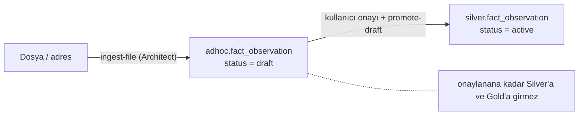

# 6. Veri ve katalog

## 6.1 Kaynaklar ve kapsam

| Kaynak | Ne | Katalogdaki seri | Silver'da yüklü | Dönem |
|---|---|---|---|---|
| BDDK Aylık Bülten | Bilanço, krediler, mevduat, mevduat vade kırılımı, sermaye yeterliliği… | 718 | 642 seri · 52.401 gözlem | 2016-01 → 2026-06 |
| BDDK Haftalık Bülten | Kredi ve mevduat haftalık | 37 | 34 seri · 9.807 gözlem | 2016-01 → 2026-06 |
| BDDK FinTürk | 81 il bazında kredi, mevduat, şube… (çeyreklik) | 4.536 | 4.536 seri · 99.792 gözlem | 2021-Ç1 → 2026-Ç2 |
| TCMB EVDS | Kur, faiz, TÜFE, para ve kredi göstergeleri | 1.548 | 1.237 seri · 93.413 gözlem | 2016-01 → 2026-07 |
| **Toplam** | | **6.839** | **6.449 seri · 255.413 gözlem** | |

Sayılar 23 Eylül 2026'daki canlı `data/lakehouse.duckdb` dosyasından alındı. Kaynak başına erişim ayrıntıları:
`lakehouse-core/docs/sources/*.md`.

## 6.2 Silver: tek uzun tablo

Bütün kaynaklar `silver.fact_observation` tablosunda aynı şemayla durur:

```text
series_id · entity_id · observation_date · period_start · period_end · value · frequency · unit · measure_type
quality_flag · source_id · dataset_id · artifact_sha256 · fetched_at · schema_version · vintage_id · run_id
```

- **Kaynak izi.** Her gözlem kendi RAW dosyasının sha256'sını ve çekim kimliğini taşır. Kanıt zinciri buradan kaynağın
  baytlarına kadar iner.
- **Geçersiz değer girmez.** Geçersiz tarih, sayı, NaN ya da Inf reddedilir. Kaynaktaki boş değer `missing_value`
  bayrağıyla saklanır; sıfır yazılmaz.
- **Kalite bayrakları:** `ok`, `source_warning`, `missing_value`.

## 6.3 Anlamsal katalog

Her serinin anlamı `lakehouse-core/catalog/series/<kaynak>.yml` dosyasında tanımlıdır ve `meta.series` tablosuna
yüklenir. Bir kayıt örneği:

```yaml
- series_id: bddk_monthly:520_BirAyUcAy
  name_tr: "TP Mevduat / Katılım Fonları - Yurt İçi Yerleşik - 1-3 Ay Arası (Mevduat Vade İtibarıyla, Sektör)"
  frequency: monthly
  unit: TRY_mn
  measure_type: stock        # stock | flow_periodic | flow_ytd | rate | ratio | index | count
  default_agg: last          # daha düşük frekansa iniş kuralı
  semantic_confidence: verified
  aliases: [...]             # katalog aramasının eşleştiği adlar
```

**Güven düzeyi.** `semantic_confidence` değeri `verified` ya da `derived` olur. `derived` bir seriyle Gold hesabı
yapılacaksa kullanıcının açık rızası gerekir (ADR-0039, ADR-0075).

**Katalog üreticileri.** Katalog elle yazılmaz; kaynağın kendi kalem listesinden üretilir:
- `lakehouse-core/scripts/generate_bddk_monthly_catalog.py`
- `generate_bddk_weekly_catalog.py`
- `generate_bddk_finturk_catalog.py`
- `evds_catalog_generator.py`

## 6.4 İlişki grafı

`lakehouse-core/src/lakehouse/catalog/relations.py` seriler arasındaki ilişkiyi kurar ve `meta.series_relation`
tablosuna yazar. İlişki türleri şunlar:
- `parent_total`
- `child_breakdown`
- `dimension_member`
- `variant`
- `derived`

**Vade kovaları (ADR-0108).**
- **Kapsam:** BDDK "Mevduat Vade İtibarıyla" tablosunun 24 kalemi (520–543) altışar açılış vadesi kovasıyla gelir:
  Vadesiz, 1 Aya Kadar, 1-3 Ay, 3-6 Ay, 6-12 Ay, 1 Yıl Üzeri.
- **Aralık bilgisi:** her kova ilişki grafında makinece okunur bir aralık taşır (`vade_ay=(1,3]`).
- **Gruplar hesaplanır, havuza yazılmaz.** "X aya kadar" ya da "X aydan fazla" gibi gruplar çalışma anında kovaların
  toplamıyla hesaplanır. "X aya kadar" Vadesiz'i de kapsar.
- **Yayımlanmayan sınır.** Kaynağın yayımlamadığı bir sınır (2 ay, 5 yıl) en dar kapsayan kova kümesine genişletilir ve
  cevapta söylenir.
- **Kalite kapısı:** 24 toplam × 126 ayda kovaların toplamı Toplam'a eşittir (`scripts/check_breakdown_sums.py`).

## 6.5 Gold: fonksiyonlar

Gold anlamı kurulabilen dönüşümlerin kütüphanesidir (`lakehouse-core/src/lakehouse/gold/`). Toplama kuralı katalogdan
okunur; anlamı kurulamayan dönüşüm sessizce yapılmaz, nedeniyle reddedilir.

| Fonksiyon | Ne yapar |
|---|---|
| `align_frequency` | Haftalık/günlük → aylık/çeyreklik (stok: dönem sonu, akım: toplam, oran: ortalama) |
| `decompose_cumulative` | Yıl başından kümülatif → dönemlik akım |
| `join_on_period` | Farklı frekanstaki serileri ortak dönem ekseninde birleştirme |

Katalogdaki Gold metrikleri (`catalog/gold/*.yml`) önceden 7 tablo olarak kurulur. Silver değişince bu tablolar bayat
sayılır ve kullanılmaz (ADR-0071).

## 6.6 Kullanıcı verisi: taslak → onay

Bilinmeyen bir dosya ya da adres havuza doğrudan girmez. Akış şöyledir:



- **Taslak.** Taslak seri aramada "(taslak)" diye görünür ve oturumda kullanılabilir.
- **Onay ve kopya.** Kataloğa alma kullanıcının açık onayıyla yapılır. Satırlar Silver'a kopyalanır ve Silver yeniden
  kurulsa da korunur.
- **Provenance tam.** RAW sha256, `run_id` ve çekim zamanı saklanır.

## 6.7 Veri dosyaları nerede

| Yol | İçerik |
|---|---|
| `data/raw/<kaynak>/<tarih>/` | Değişmez ham dosyalar |
| `data/bronze/source_id=…/dataset_id=…/` | Parquet |
| `data/lakehouse.duckdb` | Silver, meta, Gold, adhoc |
| `data/incoming/uploads/<sohbet>/` | Arayüzden yüklenen dosyalar |
| `data/conversations/<id>/` | Sohbet kayıtları |
| `data/cache/embeddings/` | Katalog embedding önbelleği |

`data/` git'e girmez. Veritabanı katalogdan ve betiklerden yeniden kurulur (`make demo-data`). Arayüzdeki Architect
**tam sıfırlama** yalnız `data/` altındaki bu hedefleri siler; iki adımlı onay kodu ister. Kod, kurulum dosyaları ve
`.env` kapsam dışıdır (ADR-0056, ADR-0069).
