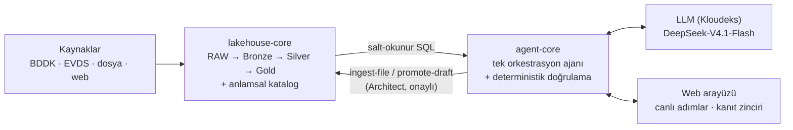

# Agent Smith — KKB Hackathon 2026

**Lakehouse Agent Builder and Data Analytics**

Agent Smith iki parçadan oluşur:
- **Data Lakehouse:** sıfırdan yazılmış bir veri gölü evi. Türkiye'nin kamuya açık bankacılık ve makroekonomi
  verisini (BDDK, TCMB EVDS) RAW → Bronze → Silver → Gold katmanlarında, kaynağın baytlarına kadar izlenebilir biçimde
  tutar.
- **Agentic analitik motoru:** bu havuzun üzerinde çalışır. Doğal dildeki soruyu anlar, analizi kendisi planlar ve
  yürütür. Cevaptaki her sayıyı kanıt zinciriyle kaynağa bağlar.



## Belgeler

Değerlendirme başlıklarının her biri ayrı bir belgede, diyagramlarıyla anlatılır:

| Başlık | Belge |
|---|---|
| Projenin genel mimari tasarımı (diyagram ve akış şemaları) | [01-GENEL-MIMARI.md](01-GENEL-MIMARI.md) |
| Projenin modüler kod yapısı | [02-MODULER-KOD-YAPISI.md](02-MODULER-KOD-YAPISI.md) |
| Agentic mimarinin karar alma ve görev işleme tasarımı | [03-AGENT-KARAR-VE-GOREV-ISLEME.md](03-AGENT-KARAR-VE-GOREV-ISLEME.md) |
| Doküman okuma süreçlerinde kullanılan yaklaşım ve agent yapısı | [04-DOKUMAN-OKUMA.md](04-DOKUMAN-OKUMA.md) |
| Kurulum ve çalıştırma | [05-KURULUM-VE-CALISTIRMA.md](05-KURULUM-VE-CALISTIRMA.md) |
| Veri, katalog ve Gold | [06-VERI-VE-KATALOG.md](06-VERI-VE-KATALOG.md) |
| Mimari kararlar (ADR) | [docs/adr/README.md](docs/adr/README.md) |

## Öne çıkanlar

- **Sıfırdan yazılmış lakehouse.** Bulut veya lisanslı ürün yok; DuckDB + Parquet + Python.
  - Havuzda 6.839 seri kataloglu, 6.449'u yüklü.
  - Silver'da 255.413 gözlem var (2016 → 2026).
  - Her gözlem kaynak dosyasının sha256'sını taşır.
- **Harness güçlü, modele en az iş.** Model araç seçer ve anlatır. Hesap, hizalama, reel değer, endeks ve vade grupları
  deterministik koddadır.
- **Kanıtsız sayı yok.** Cevaptaki her sayı bir araç çıktısında bulunmalıdır. Kanıt zinciri şöyledir:

  ```
  sayı → tablo hücresi → SQL → Silver gözlemi → RAW dosya (bayt özeti doğrulanır) → kaynak URL
  ```
- **Doküman okuma.**
  - CSV, XLSX, XLS, JSON, PDF metin katmanı ve OCR okunur; web sayfası da okunur.
  - Rapor önsözü ve "Toplam" satırı veri sayılmaz.
  - Haftalık → aylık dönüşüm yalnız güvenli kurallarla yapılır.
  - Erişim engeli aşılmaz; açıkça söylenir ve dosya yükleme yolu gösterilir.
- **İki profil.**
  - **Analyst:** salt-okunur analiz.
  - **Architect:** dosyayı havuza taslak olarak kaydeder, kullanıcı onayıyla kataloğa alır, iki adımlı tam sıfırlama
    yapar.
  - Arayüzden tek tıkla geçilir; sohbet korunur.
- **Jenerik.** Alan bilgisi katalog ve yapılandırmadadır. Havuz boşaltılıp başka bir alanın verisiyle kurulabilir.
- **Her karar kayıtlı.** 110+ ADR'nin her biri gerekçe ve ölçüm içerir; reddedilen kararlar da kayıtta durur.

## Hızlı başlangıç

```bash
make setup                   # iki paketin bağımlılıkları (uv)
cp .env.example .env         # MIA_API_KEY, EVDS_API_KEY (+ isteğe bağlı TAVILY_API_KEY)
make preflight               # salt-okunur ön kontrol
make demo-data               # veri havuzunu kaynaklardan kur
make serve                   # http://127.0.0.1:8765
```

Ayrıntılar, ortam değişkenleri ve komut satırı: [05-KURULUM-VE-CALISTIRMA.md](05-KURULUM-VE-CALISTIRMA.md).

## Neyin nerede olduğu

| Yol | İçerik |
|---|---|
| `agent-core/src/kkb_agent/core/` | Ajan motoru: döngü, tur niyeti, araç kapısı, doğrulayıcı, kurtarma, cevap doğrulama, kanıt zinciri, çalışma tablosu |
| `agent-core/src/kkb_agent/tools/` | 25 araç: lakehouse, çalışma tablosu, Gold, analitik, grafik, web, kayıt |
| `agent-core/src/kkb_agent/builder/` | Dosya okuma, zaman normalizasyonu, profil ve kayıt hattı |
| `agent-core/src/kkb_agent/web/`, `vision/` | Web erişimi (robots, bütçe, tarayıcı katmanı), PDF ve OCR |
| `agent-core/src/kkb_agent/web_app.py`, `static/` | Arayüz (FastAPI + tek sayfa) |
| `agent-core/src/kkb_agent/config_data/` | Kodun dışındaki alan bilgisi: kaynak ipuçları, kavram sözlüğü |
| `agent-core/tests/` | Ajan testleri (1168) |
| `lakehouse-core/src/lakehouse/` | Bağlayıcılar, ayrıştırıcılar, RAW/Bronze depolama, Silver, katalog, Gold, ad-hoc |
| `lakehouse-core/catalog/` | Seri kataloğu (`series/*.yml`) ve Gold metrikleri (`gold/*.yml`) |
| `lakehouse-core/scripts/` | Toplu çekim, katalog üreticileri, kalite kapıları |
| `lakehouse-core/docs/` | Lakehouse sözleşmeleri (katalog, Gold, jenerik alım, ad-hoc) ve kaynak notları |
| `docs/adr/` | Mimari karar kayıtları |
| `docs/calisma-notlari/` | Ekibin iç çalışma notları, ilerleme ve denetim raporları (arşiv) |
| `data/` | (git dışı) RAW, Bronze, `lakehouse.duckdb`, yüklemeler, sohbetler |

## Kurallar

Yarışma şartnamesinden doğan ve ihlali eleme sebebi olan kısıtlar:

- **Hazır ya da lisanslı bulut lakehouse kullanılmaz** (Snowflake, BigQuery vb.). Çözüm baştan sona bu repoda üretilir.
- **Dış LLM servisi kullanılmaz** (OpenAI, Anthropic, OpenRouter). Yalnız KKB'nin Kloudeks platformundaki modeller
  kullanılır.
- **Backend Python.** Açık kaynak kütüphaneler tercih edilir.
- **Anahtarlar repoya yazılmaz.** Hepsi `.env` içindedir ve `.gitignore` ile korunur.
- **Bot koruması ve CAPTCHA aşılmaz.** Erişilemeyen kaynakta ajan durumu söyler ve seçenek sunar (mentör kararı,
  12 Eylül).

## Çalışma düzeni

- **Dallar.** `main` korumalıdır; birleştirme PR ile ve ekip onayıyla yapılır. Bütünleşik geliştirme
  `feature/agent-engine` dalındadır.
- **CI.** Her PR'da iki paketin deterministik testleri koşar: `.github/workflows/tests-agent.yml` ve
  `tests-lakehouse.yml`.
- **Kararlar.** Her mimari karar gerekçesi ve ölçümüyle `docs/adr/` altına yazılır.
- **İlerleme kaydı.** Adım adım ilerleme `PROJECT_MEMORY.md` dosyasındadır.

## Takvim

| Tarih | Aşama |
|---|---|
| 5 Ekim 2026 | Finalist 10 takımın açıklanması |
| 17 Ekim 2026 | Final sunumları |
