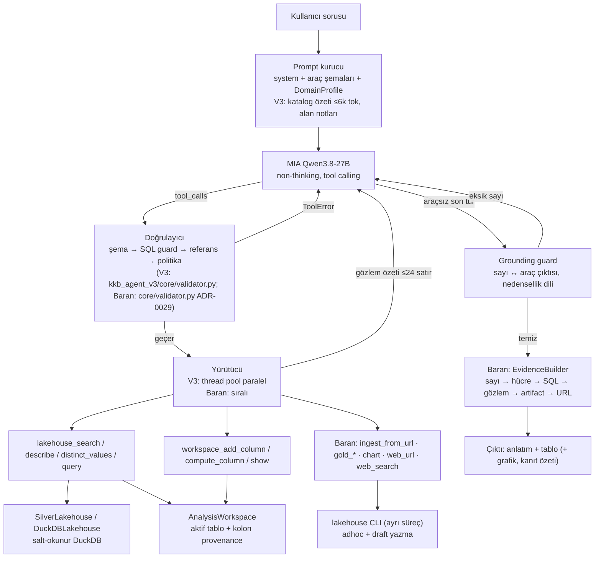
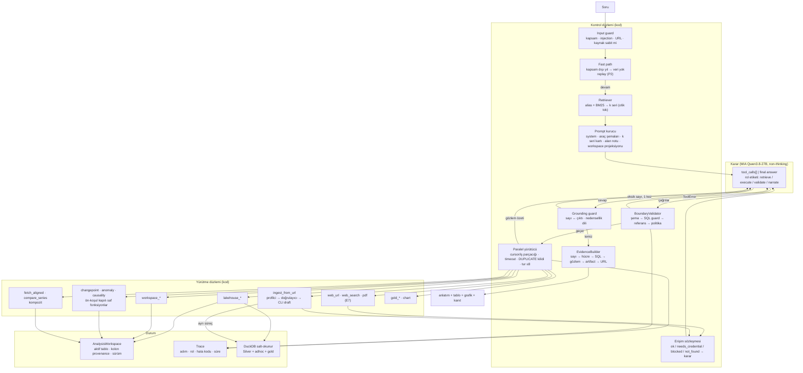

# AgentSmithler — Kazanan Mimari İncelemesi (12 Eylül 2026)

> **Amaç:** Depoyu uçtan uca yeniden çıkarmak, problemi formalize etmek, alternatif mimarileri ölçülmüş kanıtla yarıştırmak ve 20 Eylül dondurmasına kadar uygulanacak nihai mimariyi seçmek.
> **Kanıt etiketleri:** `[FACT·ORG]` organizatör slaytı/yazılı cevabı · `[FACT·EMP]` bu depoda ölçüldü (komut/dosya belirtilir) · `[FACT·SRC]` depodaki kod/doküman/ADR · `[INF]` güçlü çıkarım · `[ASM]` doğrulanmamış varsayım · `[REC]` öneri.
> **Kapsam:** `feature/busra/agent-v3` (çalışma dalı, 479854c) + `origin/feature/agent-engine` (Baran, 3f96dc9; bizde **henüz merge edilmedi**) + veri ekibi `feature/lakehouse-integration-r3` (yalnız Baran'ın raporları üzerinden `[FACT·SRC]`).

---

## 0. 13 Eylül güncellemesi — depo değişti, karar değişmedi, iş listesi değişti

Baran 12–13 Eylül'de `feature/agent-engine`'e **17 commit daha** itti (3f96dc9 → ab87563) ve veri tarafında `feature/lakehouse-catalog-breadth` açtı `[FACT·SRC]`. Dünkü raporun P0 listesinin çoğu bu commit'lerle kapandı. Aşağıdaki tablo dünkü tespiti bugünkü durumla karşılaştırır; ayrıntı ilgili bölümlerde "**13 Eyl:**" notlarıyla.

| Dünkü tespit (12 Eyl) | Bugün (13 Eyl, ab87563) | Kanıt |
|---|---|---|
| 3 analitik araç ailesi hiçbir dalda yok (P2) | **Var:** `anomaly_detect` (IQR/z, trend tabanı Spearman ile), `change_points` (ikili bölütleme, BIC ceza), `lead_lag` (gecikmeli Pearson + iki yönlü Granger). numpy+scipy, LLM yok. Golden G15–G17 9/9. Kart "NEDENSELLİK DEĞİLDİR" der | ADR-0040 `[FACT·SRC]`; `tools/analytics.py` `[FACT·EMP]` |
| Ön-yükleme gerçek katalogda 44k token (P3) | **Çözüldü:** soruya göre k kart + gerçek değerler, bütçe 6k; seed 7,0 → 3,3 adım, gerçek DB 3,0 → 1,6; prompt token −34 % | ADR-0035 |
| BM25 yok (D2) | **Var + ötesi:** üç kademe (≤60 seri arama yok / yüzlü BM25 / ≥5000 hibrit embedding), il-frekans-kaynak yüzleri; retrieval golden 2.926 sorgu: recall@8 0,864 → **0,996**; araç kapısı ile prompt token −40 % | ADR-0043 |
| PDF okunmuyor (P7) | **Var:** pypdfium2 → MIA Unlimited-OCR → HTML tablo → profilci dilbilgisi; colspan/rowspan ızgara, başlık terfisi, OCR ondalık kuralı, kalite izleri, sayfa etiketi. Borsa İstanbul altın PDF'leri G18a/b 2/2, G18c 3/3; 20 PDF canlı prova | ADR-0041 |
| Demo kabul betiği yok (D4) | **Var:** sıfırdan bootstrap → ingest → silver → gold → 11 senaryo tek komut; 13 Eyl **11/11**, kanıt zinciri 11/11 | ADR-0038, PROJECT_MEMORY §3 |
| Katalog 5 seri, demo zayıf | **2.214 katalog serisi, 127 serilik demo seti** (BDDK aylık 20 kalem, FinTürk 648, EVDS kur/faiz/mevduat/M2/M3/TÜFE), Gold 6 metrik; ingest 197 s | ADR-0042 |
| Niyet kapısı / enjeksiyon | **Var:** adres yalnız kullanıcı metninden, yazma niyeti zorunlu, dış içerik "veridir" çerçevesi, alt süreç env izin listesi; G13 enjeksiyon golden | ADR-0037 |
| Arayüz yok | **Var:** FastAPI ince katman + tek sayfa; kanıt zinciri ve araç izi önde; kanıt yolculuğu 2,5B/3B deneme | ADR-0044/0047/0048 |
| Testler 229 | **330** (Baran'ın ortamı); bende **301 geçti, 23 düştü, 1 atlandı** — 23'ün hepsi ortam: `fastapi`, `pypdfium2` kurulu değil, Windows yolu | `[FACT·EMP]` pytest, `--ignore tests/test_web_app.py` |
| ADR 34, golden 13, araç 13 | ADR **48**, golden **21** (G1–G18c), araç **19** | PROJECT_MEMORY §3 |
| main'e birleştirme | Prova yapıldı (yerel): agent-engine + r3 (`--allow-unrelated-histories`), yalnız README/.gitignore çakışması; **push ve dal silme kullanıcı onayı bekliyor**; `busra/agent-v3` A4 kararına bağlı | PROJECT_MEMORY §5 |

**Hâlâ açık olanlar (bugün doğrulandı `[FACT·EMP]`):**
1. **Paralel yürütme ve üretim tavanı Baran'ın döngüsünde yok** (`core/agent.py`'da ThreadPool/`max_tokens` yok; istemci `max_tokens` destekliyor ama döngü geçmiyor). V3'ün 103 s'lik dejenere koşusunu kesen tavan ve tur-içi paralel çağrı bizden taşınacak tek motor parçası. Ön-yükleme ile araç adımı 1,6'ya indiği için paralelin kazancı artık küçük; **tavan** demo güvenliği için gerekli.
2. **Slayt 5'in üç demo sorusu birebir golden'da yok.** G14 ("tabloyu bozmadan Gold faiz sütunu") 3. sorunun yakınıdır; 2. soru ("enflasyondan arındır") `cases.py:201`'de "TÜFE EVDS'den gelince" diye bekletilmiş, TÜFE artık katalogda (ADR-0042) → önü açık; 1. soru (60 ay, iki seri, "faiz düştüğü hâlde kredi artmayan dönemler") `lead_lag` + `change_points` ile cevaplanabilir ama vaka yazılmadı. Konut fiyat endeksi (3. soru) EVDS küratörlü 8'de görünmüyor → `[ASM]` yüklenmemiş olabilir; kontrol edilmeli.
3. **`clarify` yok** (L10-01 belirsiz soru; iki motorda da 0/3; Baran'da stretch).
4. **`measure_rules` (stok toplanmaz, oran ortalanmaz) hâlâ hiçbir doğrulayıcıda yok**; Baran'da `FREQUENCY_MISMATCH` ve `GOLD_REQUIRED` var, semantic_type × işlem kuralı yok.
5. **Windows taşınabilirliği**: 23 test; demo makinesi OS'u `[ASM]`.
6. G9 anlatı aritmetiği 4/5; anomali mevsimselliği (Ocak etkisi) yok; `web_url` liste + yükleme iki çağrı; web tablolarında birim yok (Baran'ın kendi açık listesi).

**Karar etkisi.** §8-F hibrit mimari artık bir öneri değil, **Baran'ın dalının bugünkü hâli** (sınırlı ön-yükleme + BM25 + doğrulayıcı + grounding + kanıt paneli + erişim sözleşmesi + 6 araç ailesi). A4 sorusunun cevabı netleşti: V3 motoru **emekli**, katkısı dört parça — `max_tokens` tavanı, tur-içi paralel yürütücü (cursor'lu), domain markdown/`measure_rules` doğrulayıcıya bağlanarak, iki motorlu benchmark koşucusu tek motorlu kararlılık koşucusuna (`--repeat 5`, `sys.path` düzeltmesi). §29 P0 buna göre yeniden yazıldı.

---

## 1. Executive Summary

**Problem.** KKB Hackathon 2026: BDDK/EVDS açık verisi üstünde, doğal dildeki soruyu anlayıp doğru seriyi/aracı seçen, çok adımlı analizi yürüten, her sayıyı kaynağına bağlayan ve demo günü verilen URL'lerden (PDF/Excel/görsel/HTML) veri çıkarabilen bir agentic analytics motoru `[FACT·ORG]` (slayt 1, 5, 6, 9). Tek LLM: Kloudeks MIA `Qwen3.8-27B`; dış LLM yasak `[FACT·ORG]` (slayt 8).

**Depodaki gerçek durum.** İki motor var. Baran'ın `kkb_agent` (tek ReAct harness, 34 ADR, 229 birim testi, 13 golden vaka, 13 araç dâhil web/ingest/gold/grafik/kanıt paneli) ve bizim `kkb_agent_v3` (aynı veri katmanı üstünde paralel harness: tur-içi paralel çağrı, sınır doğrulayıcı, grounding, katalog ön-yükleme; 37 test, 1 araç ailesi). 11 Eylül benchmark'ında V3 tur sayısında açık ara önde (2,9 vs 6,0), doğrulukta Baran'ın düzeltmeleri sonrası berabere `[FACT·EMP]`. Yarışmanın 6 araç ailesinden **Anomali, Nedensellik, Değişim Tespiti hiçbir dalda yok** `[FACT·SRC]`.

**Karar.** Beş aday mimari puanlandı (§9). Kazanan, **tek orkestrasyon ajanı + deterministik kontrol düzlemi** hibriti: Baran'ın harness'ı omurga, V3'ün ölçülmüş modülleri (sınırlı ön-yükleme, paralel yürütme, üç katmanlı doğrulayıcı — ikisi zaten ortak katmana taşındı) ortak katmanda, üç analitik araç ailesi saf fonksiyon + ön-koşul kapısı olarak, kompozit araçlarla tur sayısı düşürülerek. Çok ajanlı yapı ölçümle ve mentör kararıyla elendi (§8-E, §11). Rakip aynı modeli kullandığında bizi ayıran şey ajan sayısı değil: **soru başına 3 LLM turu, her araç çağrısında kod tabanlı doğrulama, cevaptaki sayıdan kaynak baytına giden kanıt zinciri, erişim/geri çekilme sözleşmesi, sayı dilbilgisi** — hepsi ölçülmüş `[FACT·EMP]`.

**En büyük risk.** 8 gün kaldı; iki harness'ı yaşatmak ve 3 analitik aracın yokluğu. P0 (§29) bu ikisini kapatır.

---

## 2. Repository Reality

### 2.1 Yapı `[FACT·SRC]`

```text
AgentSmithler_WorkSpace/
├── agent-core/                    Python 3.11+, uv; deps: openai (protokol), pydantic, duckdb, pandas, httpx, python-dotenv, truststore
│   ├── src/kkb_agent/             EKİP MOTORU (Baran) — bizde a2deab6 hâli; origin'de 3f96dc9 (+20 commit)
│   │   ├── contracts/  catalog · lakehouse · retrieval · search  (+access, evidence Baran'da)
│   │   ├── adapters/   duckdb_lakehouse (seed) · silver_lakehouse (veri ekibi şeması)
│   │   ├── core/       agent (AnalyticsAgent ReAct) · registry · tool · workspace · errors (+validator, grounding, evidence, access_policy Baran'da)
│   │   ├── tools/      lakehouse ×4 · workspace ×3  (+ingest, gold ×3, chart, web_url, web_search Baran'da)
│   │   ├── llm/        base · openai_compat
│   │   └── domain.py   DomainProfile.from_catalog
│   ├── src/kkb_agent_v3/          BİZİM MOTOR — core/{agent,validator,grounding,context,tool} · errors · llm · tools/{lakehouse,workspace,domain_note} · domain/{loader,finance.md,health.md} · cli
│   ├── tests/  golden/cases.py (G1–G7; Baran'da G1–G11c) · v3/ (37) · birim (69)
│   └── scripts/ run_golden.py · run_benchmark.py (--engine team|v3) · dev_seed*.py
├── scripts/   mia_probe.py · exp_e8_10k.py · exp_retrieval_bakeoff.py · deney_ocr.py · …   (deneyler)
├── docs/      ARCHITECTURE_V3.md · BENCHMARK_PROTOCOL.md · adr/ (25 bizde, 34 Baran'da) · experiments/ · toplanti/ (9 açılış slaytı)
├── data/      lakehouse.duckdb (BDDK seed) · lakehouse_silver.duckdb (Silver seed) · catalog.json
└── .env       (izlenmiyor; LLM_BASE_URL/LLM_API_KEY/LLM_MODEL/EVDS_API_KEY)
lakehouse-core/  AYRI dalda (feature/lakehouse-integration-r3); agent onu import ETMEZ, CLI alt süreci ile konuşur (ADR-0024/0030)
```

### 2.2 Ne çalışıyor, ne çalışmıyor `[FACT·EMP]` (12 Eylül, bu makinede)

| Ölçüm | Sonuç | Komut |
|---|---|---|
| Bizim dal, tüm agent-core testleri | **106 passed** (7 s) | `cd agent-core && python -m pytest -q` |
| Baran'ın dalı (git archive → scratchpad), testleri | **217 passed, 11 failed, 1 skipped** | aynı |
| 11 hatanın kökü | Windows: `urlparse("C:\\…").scheme == "c"` → `ReadRefused("desteklenmeyen şema: c")` (`builder/read.py:108`); 2 × `TypeError NoneType path` (ortam değişkeni yok: `LAKEHOUSE_CORE_DIR` / vl-convert). **Kod mantığı değil, taşınabilirlik** — ama demo makinesi Windows ise gerçek hata | pytest çıktısı |
| V3 katalog ön-yükleme modu | `full` ≤ 6.000 token, üstünde `search` (dizin); `search` modunun boyutu **ölçülmüyor** (`core/context.py:64-76`) → Baran'ın ölçümü 1.620 seride 44.157 token `[FACT·SRC]` MOTOR_KARSILASTIRMA_YANIT §3.1 | grep |
| Benchmark koşucusu | `sys.path.insert(0, ROOT/"src")` PYTHONPATH'i eziyor (`run_benchmark.py:30`) → başka checkout'tan motor ölçülemez | grep |
| `measure_rules` (domain md) | loader okuyor, **hiçbir doğrulayıcı uygulamıyor** (`grep measure_rules` yalnız loader + finance.md/health.md) | grep |

### 2.3 README ↔ uygulama çelişkileri `[FACT·SRC]`

| README/doküman der | Kod | Not |
|---|---|---|
| "Araçlar: lakehouse, web search/URL, anomali, nedensellik, değişim tespiti" (README şeması) | Bizim dalda yalnız lakehouse + workspace; Baran'da +web/ingest/gold/chart. **Anomali/nedensellik/değişim yok** | README hedefi anlatıyor, durumu değil |
| V3 §3.3 "üç katmanlı doğrulayıcı: şema → referans → politika" | Politika katmanı SQL guard dışında boş; `measure_rules` bağlı değil | Baran'ın tespiti doğru (§3.2 yanıt) |
| V3 §3.1 "verified-query replay, spekülatif ön-çekim, JSONL trace" | Yok | Tasarım, uygulanmadı (V3 §6 tablosunda "Yok" olarak dürüstçe işaretli) |
| Baran ADR-0034 "web_url" | `web_search` yalnız anahtar varsa; PDF okunmuyor; derinlik 1 | ADR'da "açık kalan" olarak yazılı |

### 2.4 Mevcut sistem akışı (iki motor için ortak omurga)

```text
INPUT   soru (+ takip sorusu; workspace'te önceki tablo) (+ URL / dosya yolu)
  ↓
PROMPT  system (motor kuralları + DomainProfile) + araç şemaları + [V3: katalog özeti ≤6k tok + alan notları] + workspace projeksiyonu + soru
  ↓
LOOP    LLM (non-thinking) → tool_calls[] → [doğrulayıcı] → araç(lar) → gözlem özeti → … (≤8 tur; Baran: adım bütçesi)
  ↓
GUARDS  cevap guard'ı · dönem filtresi · kapsam (ay çözünürlüğü) · DUPLICATE kilidi · araçsız son tur · grounding (Baran'da ADR-0027) · [Baran: kanıt paneli]
  ↓
STATE   AnalysisWorkspace (aktif tablo + kolon provenance) · trace adımları (rol etiketli Baran'da)
  ↓
OUTPUT  anlatım (≤120 kelime/700 token) + tablo + [Baran: grafik PNG, kanıt zinciri özeti]
```

---

## 3. Problem Definition

### Inputs `[FACT·ORG]`
- Doğal dil soru (Türkçe), çoğu zaman **çok turlu**: slayt 5'teki 3 demo sorusu birbirini izler ("tabloyu bozmadan" → yeni kolon).
- Lakehouse: BDDK haftalık/aylık bülten + FinTürk (il bazında), EVDS serileri; **2021-01 → 2026-06** penceresi (slayt 2-3). Bazı seriler kümülatif (yıl içinde birikimli) — ayrıştırılması istenmiş (slayt 2 notu).
- Demo günü URL: Borsa İstanbul kıymetli madenler **PDF**'i, XTUMY (BIST100) sayfası; "pdf, excel, resim veya yazı bölümlerinden anlam çıkarılması" (slayt 6).

### Outputs `[FACT·ORG]`
"Rapor, grafik veya tablo"; kaynak gösterimi, izlenebilirlik, doğruluk kontrolü (güven katmanı, slayt 1). Demo soruları: aylık dağılım + faiz oranı + "faiz düştüğü hâlde kredi artmayan dönem var mı" (nedensel dil), enflasyondan arındırma, konut fiyat endeksi kolonu ve "sebep fiyat artışı olabilir mi".

### Objective (önem sırasıyla) `[INF]` — slayt 1 + mentör 12 Eylül
1. **Doğruluk / uydurmama** — sayı araç çıktısından, kapsam dışı → "veri yok".
2. **Güven katmanı** — kaynak, izlenebilirlik, doğrulama görünür.
3. **Uçtan uca yetkinlik** — 6 araç ailesi çalışır; URL'den veri.
4. **Süre** — demo canlı; MIA ~1–3 s/tur; 3 tur ≈ 4 s, 6 tur ≈ 7–10 s `[FACT·EMP]`.
5. **Jeneriklik** — "içi boşaltılıp sağlık verisiyle çalışabilmeli" (README, ekip notu `[FACT·SRC]`; slaytta yok → `[ASM]` jüri kriteri).
6. Token/maliyet — kota yok `[FACT·ORG]`; yalnız süre üzerinden önemli.

### Constraints
- Tek LLM MIA `Qwen3.8-27B`; embedding `Qwen3-Embedding-8B`; OCR `Unlimited-OCR` `[FACT·ORG]` (rehber + bellek).
- MIA ölçümleri `[FACT·EMP]`: 142 ms sabit + 0,072 ms/prompt token + 10 ms/çıktı token; paralel `tool_calls` döndürüyor (3/3/3); thinking açık 1,1 s vs kapalı 0,5 s; prefix cache kazancı yok; system-talimat uyumu 7/10; `json_schema` kabul.
- Web: hesap yok, CAPTCHA yok, credential yalnız env; kaynak sadakati; bütçeli tarama `[FACT·ORG]` mentör.
- Yazma: agent Silver'a yazamaz; yalnız adhoc+draft, ayrı süreç CLI `[FACT·SRC]` ADR-0030.
- Takvim: dondurma **20 Eylül**, finalist 5 Ekim, final 17 Ekim `[FACT·ORG]`.

### Failure Conditions
- Cevapta araç çıktısında olmayan sayı; kapsam dışı dönem için sayı; alt toplam çift sayımı; birim karışması (bin/milyon); nedensellik iddiası kanıtsız.
- Tur limiti / döngü; demo sorusunda >15 s; aktif tablonun takip sorusunda ezilmesi (L6-04).
- URL'den tablo yanlış okunması (31,51 → 3151); erişilemeyen kaynakta sessiz alternatif.

### Critical Path
`katalogdan doğru seri seçimi → dönem/tip-uyumlu SQL → workspace'te türetme (pct_change/deflate/align) → doğrulanmış anlatım + kaynak`. Bu dört halka bozulursa hiçbir araç sayısı kurtarmaz `[INF]`.

---

## 4. Current Architecture



---

## 5. Current Architecture Problems

| # | Sorun | Kanıt | Etki |
|---|---|---|---|
| P1 | **İki harness** aynı işi iki kere yapıyor; düzeltmeler birine ulaşıyor (Silver `series_sql` düzeltmesi V3'e ulaşmadı) | MOTOR_KARSILASTIRMA_YANIT §2.1 `[FACT·SRC]` | Bakım maliyeti, ölçüm bölünmesi |
| P2 | **3 analitik araç ailesi yok** (anomali, nedensellik, değişim) | §2.3 | Demo sorusu 1 ve 3 ("faiz düştüğü hâlde…", "sebep fiyat artışı mı") cevaplanamaz |
| P3 | V3 ön-yükleme gerçek katalogda **44k token** (`search` modu ölçülmüyor) | §2.2 | Gerçek DB'de V3'ün tur avantajı kaybolur |
| P4 | Paralel yürütme tek DuckDB bağlantısını yarıştırıyordu (800 sorguda 2 istisna); Baran cursor ile düzeltti, V3'te düzeltilmedi | yanıt §3.4 `[FACT·SRC]` | Araç sayısı artınca demoda anlamsız TypeError |
| P5 | `as_active_table=True` varsayılanı takip sorusunda tabloyu eziyor (L6-04); iki motorda da tasarım aynı | yanıt §4 `[FACT·SRC]` | Demo 2./3. soru riski |
| P6 | pass^3 ×3 tekrar **karar düzeyinde değil** (aynı kod 0/3 ↔ 3/3) | yanıt §3.3 `[FACT·SRC]` | Yanlış motor seçimi riski |
| P7 | PDF okunmuyor (E7 çözümü uygulanmadı); JS sayfaları boş | ADR-0034 açık kalan | Demo URL'lerinin biri PDF |
| P8 | Windows taşınabilirliği (11 test) | §2.2 `[FACT·EMP]` | Demo makinesi OS'a bağlı |
| P9 | Belirsiz soruda netleştirme yok (L10-01 iki motorda 0/3) | benchmark `[FACT·EMP]` | Jüri "ne demek istedin" senaryosu |
| P10 | LLM'e bırakılan fazla sorumluluk: seri seçimi tam katalogdan (1620 satır), Turkish sayı biçimi (pandas tahmini), tablo yapısı | E8, ADR-0034 | Ön-yükleme sınırlanmalı, dilbilgisi kodda (Baran yaptı) |

---

## 6. Baseline

| Baseline | Ne | Ölçüm | Sonuç |
|---|---|---|---|
| B0 Deterministik boru hattı (niyet sınıflandırıcı + SQL şablonları) | Soru → regex/BM25 ile seri + dönem + işlem → şablon SQL → tablo | Ölçülmedi `[ASM]`; E8-10k'da seri seçimi BM25 top-30 R@30 %96 `[FACT·EMP]` ama işlem/dönem çıkarımı yok | Demo 1. soruyu (3 seri, nedensel dil) ve takip sorularını karşılamaz `[INF]`; **ancak** fast-path olarak kısmen kullanılabilir (replay) |
| B1 Tek LLM çağrısı (text-to-SQL) | Katalog + soru → SQL → çalıştır → cevap | E8: tam katalog promptta, tek çağrıda doğru seri **%98** (≤1000 seri) `[FACT·EMP]` | Seri seçimi için güçlü; ama doğrulama/onarım turu olmadan hata yakalanmaz; takip sorusu yok |
| B2 Tek ajan + araçlar (ekip R, 10 Eylül) | ReAct, sıralı araç | golden 7/7; benchmark 17/18, 5,7 s, 5,6 tur `[FACT·EMP]` | Çalışan taban çizgisi |
| B3 Mevcut repo (V3 / Baran 12 Eylül) | §4 | V3 17/18, 4,1 s, 3,2 tur (seed); Baran düzeltme sonrası 17/18, 6,8 s, 6,0 tur `[FACT·EMP]` | Bu incelemenin karşılaştırma tabanı |

**Sonuç:** Agentic katman gerekli — ama yalnız *araç seçimi ve onarım* için. Seri seçimi, sayı dilbilgisi, tablo türetme ve doğrulama deterministik olduğunda daha iyi `[FACT·EMP]` (E8, ADR-0034, Blok C).

---

## 7. Agentic Necessity Map

| Görev | Sınıf | Neden / kanıt |
|---|---|---|
| Kapsam/injection/URL tespiti | DETERMINISTIC | regex + politika; <5 ms |
| Kaynak sabit mi ("bu siteden") | DETERMINISTIC | ADR-0028 `detect_source_constraint`, tutucu |
| Seri adayı bulma (katalog >6k tok) | DETERMINISTIC (BM25/alias) → TOOL | E8-10k R@30 %96, 0,18 s `[FACT·EMP]` |
| Seri **seçimi** adaylar arasından | LLM TASK | E8: %98 tek çağrıda; alias belirsizliği ("NPL") modelde çözülür |
| SQL üretimi (dönem, filtre) | LLM TASK + DETERMINISTIC guard | dönem filtresi, kapsam, DOUBLE_COUNT kodda |
| SQL çalıştırma, align, pct_change, deflate, decumulate | TOOL | saf fonksiyon; model hesap yapmaz (README ilkesi) |
| Anomali / değişim noktası / nedensellik | TOOL | istatistik; LLM yalnız *hangi* aracı, *hangi* seriye |
| Hangi aracı sırada çağırmak | AGENTIC TASK | runtime'da veriye bağlı (kapsam dışı → dur; iki seri → align) |
| Tablo yapısı belirsiz (PDF/HTML) | DETERMINISTIC profil → LLM (≤2 tur) → HUMAN | ADR-0030: profilci %100 ayrışma ölçer; belirsizse sorar |
| Dosya kolon eşlemesi onayı, taslak terfisi | HUMAN-IN-THE-LOOP | ADR-0030 (draft → curated insan commit'i) |
| Cevap anlatımı | LLM TASK (≤120 kelime) | grounding ile kısıtlı |
| Sayı doğrulama, kanıt zinciri | DETERMINISTIC | ADR-0027/0033 |
| Web sayfası tablosunu sayıya çevirme | DETERMINISTIC | pandas tahmini 100× hata `[FACT·EMP]` |
| Belirsiz soru | LLM TASK (`clarify`) + HUMAN | L10 |
| Plan üretme | **gereksiz ayrı adım** | ReAct turundaki çağrı kümesi = plan; ayrı planlama turu ölçülebilir kazanç vermedi (ADR-0029, V3 ADR-11) |

---

## 8. Architecture Candidates

**A. Deterministik boru hattı (LLM'siz ya da tek çağrılı).** Niyet sınıflandırıcı + şablon SQL + sabit rapor. *Kazanabilir:* en hızlı, sıfır uydurma. *Kaybeder:* demo 1. soru üç seri + nedensel yorum; takip soruları; URL'den yapısız veri — kapsam dışı kalır `[INF]`.

**B. Tek ajan + araçlar, sıralı ReAct (ekip R / Baran).** *Kazanabilir:* kanıtlanmış (golden 7/7, 13 vaka), en zengin araç seti, ADR disiplini. *Kaybeder:* tur sayısı 6, keşif turları LLM'de; süre 7–10 s `[FACT·EMP]`.

**C. Planner-Executor (V2, `ARCHITECTURE_RESEARCH.md`).** JSON plan → deterministik yürütücü → verifier → narrator. *Kazanabilir:* plan görünür, 2 tur. *Kaybeder:* plan şeması demo sürprizinde katı; MIA'da plan JSON'u medyan 2,0 s `[FACT·EMP]`; yeniden yazım riski; ekip ADR'ları Plan DSL'i reddetti `[FACT·SRC]`.

**D. Supervisor + uzman ajanlar (V1 taslağı: Intent, Planner, Discovery, Ingestion, Narrator).** *Kazanabilir:* sunumda "orkestrasyon" görünür; bağlam izolasyonu. *Kaybeder:* her rol bir LLM turu → 6–8 tur; denetçi de model (yanılır); mentör açıkça "yapmazdım" `[FACT·ORG]`; 8 günde bitmez.

**E. Batched ReAct + sınır doğrulama (V3).** Tur-içi paralel çağrı, üç katman doğrulama, grounding, ön-yükleme. *Kazanabilir:* 2,9 tur / 3,7 s, grounding 45/45 `[FACT·EMP]`. *Kaybeder:* ön-yükleme gerçek katalogda kırılıyor; araç seti 1 aile; ikinci harness.

**F. Hibrit — tek orkestrasyon ajanı + deterministik kontrol düzlemi (öneri).** B'nin harness'ı ve araçları + E'nin modülleri (sınırlı ön-yükleme, paralel yürütücü, doğrulayıcı, grounding — ikisi taşındı) + fast-path'ler (kapsam dışı, replay) + kompozit araçlar + analitik araçlar ön-koşul kapılı + Architect'in LLM'siz profilcisi. Roller (plan/retrieve/validate/narrate) **etiket**, ayrı LLM değil. *Kazanabilir:* B'nin doğruluğu + E'nin turu; tek kod tabanı; mentörün "source abstraction + access + provenance + fallback" odağıyla birebir. *Kaybeder:* birleşme işi 1–2 gün; ön-yükleme sınırlama (D1) yapılmazsa E'nin kazancı gelmez.

---

## 9. Architecture Comparison

Puanlar: ölçüm varsa ölçüme, yoksa `[INF]` ile gerekçeye dayanır (10 = en iyi).

| Metric | A Determ. | B Tek ajan sıralı | C Planner-Exec | D Supervisor MA | E Batched ReAct (V3) | **F Hibrit** |
|---|---:|---:|---:|---:|---:|---:|
| Task Success Potential | 4 | 8 | 7 | 7 | 8 | **9** |
| Reliability | 9 | 8 | 6 | 5 | 8 | **9** |
| Weak-Model Performance | 9 | 7 | 5 | 4 | 8 | **8** |
| Latency | 10 | 5 | 7 | 3 | 9 | **9** |
| Token Efficiency | 10 | 5 | 7 | 3 | 8 | **8** |
| Failure Isolation | 8 | 7 | 7 | 6 | 8 | **9** |
| Debuggability | 9 | 8 | 7 | 4 | 8 | **9** |
| Scalability (katalog/araç) | 3 | 6 | 6 | 6 | 6 | **8** |
| Implementation Risk (10=düşük) | 6 | 9 | 4 | 2 | 7 | **7** |
| Competition Differentiation | 3 | 6 | 6 | 5 | 8 | **9** |
| **Toplam** | 71 | 69 | 62 | 45 | 78 | **85** |

Dayanaklar: Latency/Token B vs E benchmark `[FACT·EMP]`; D'nin turu V1 taslağı + mentör; C'nin plan JSON süresi `[FACT·EMP]`; A'nın kapsamı slayt 5 `[INF]`.

---

## 10. Winning Architecture

**Tek harness, tek orkestrasyon ajanı, iki rol (Analist okur / Architect yazar), deterministik kontrol düzlemi.**

```text
KONTROL DÜZLEMİ (kod)                          KARAR (LLM, tek nokta)              YÜRÜTME DÜZLEMİ (kod)
─────────────────────                          ────────────────────                ─────────────────────
input guard · fast paths                       "hangi araç, hangi argüman,         araçlar: lakehouse ×4 · workspace ×3
retriever (BM25/alias → k seri)                 devam mı cevap mı"                 analitik: changepoint · anomaly · causality
prompt kurucu (bütçeli)                        turda birden çok çağrı              kompozit: fetch_aligned · compare_series
BoundaryValidator (şema→SQL→ref→politika)      anlatım ≤120 kelime                web_url · web_search · ingest_from_url
paralel yürütücü + DUPLICATE kilidi + bütçe                                        gold_* · chart
grounding · kanıt paneli · erişim sözleşmesi                                       DuckDB salt-okunur · CLI alt süreci (yazma)
```

Ne **yok**: ayrı Planner/Verifier/Narrator LLM'i; ikinci harness; alt-ajan (bağlam izolasyonu araç çıktısını kısa tutarak, ADR-0034 liste modu); tarayıcı otomasyonu; LangGraph/CrewAI.

---

## 11. Why This Architecture Wins

| Avantaj | Ölçülmüş / gerekçe |
|---|---|
| **Soru başına ~3 LLM turu** (rakip standart ReAct 5–6, supervisor 6–8) | V3 2,9 tur / 3,7 s vs 6,0 / 6,8 s `[FACT·EMP]`; kaynağı ön-yükleme + paralel çağrı (Blok C: 6,9 → 3,9 → 2,9) |
| **Doğrulama modelden ucuz ve kesin** | her çağrı şema→SQL→referans→politika (ADR-0029); hata sınıfı dağılımı tasarlanmış ret (`OUT_OF_COVERAGE×3`, `SQL_FAILED` 18→0) `[FACT·EMP]` |
| **Uydurma sayı yakalanır** | grounding 45/45, 48/48 `[FACT·EMP]`; Türkçe/İngiliz sayı biçimi ayrımı |
| **Kanıt zinciri baytlara kadar** | ADR-0033: 623.765 → SQL → `bddk_monthly:1534_Toplam @ 2025-09-30` → artifact sha → URL + fetched_at; golden 4/4 tam `[FACT·SRC]` |
| **Erişilemeyen kaynakta kontrollü geri çekilme** | ADR-0028: 4 sonuç sınıfı, kaynak sadakati, sessiz geçiş yok; gerçek siteler test `[FACT·EMP]` |
| **Zayıf modelde ayakta** | ilkeler 8B Ollama ile geliştirildi (README, config default `qwen3:8b`); guard'lar "seçenek bırakmayan" türden (ADR-0011: prompt kuralı işe yaramıyor) `[FACT·SRC]` |
| **"Yarın REST API verirsek?"** | adaptör sözleşmesi (`LakehouseClient`, `EvidenceCapable`, `GoldCapable`) + CLI connector; döngü değişmez |
| **Jeneriklik** | motor katmanında alan terimi yok (test); alan bilgisi katalog + md notu |

---

## 12. Architecture Diagram



---

## 13. Orchestration Flow

Demo sorusu 1 (slayt 5) için beklenen akış; süreler MIA maliyet modelinden `[INF]`:

| Adım | Kim | Ne | ~Süre |
|---|---|---|---|
| 0 | kod | input guard: yıl 2021–2025 kapsamda, URL yok, kaynak serbest; fast path yok | 5 ms |
| 0' | kod | retriever: "konut kredisi", "faiz oranı" → 2 kavram, k=8 seri kartı | 5 ms |
| 1 | LLM | 2 paralel çağrı: `lakehouse_query(konut bakiyesi 2021–2025 aylık)`, `lakehouse_query(konut faizi …)` — veya tek `fetch_aligned(["konut kredisi","konut faizi"], 2021-01, 2025-12, "M")` | 1,5 s |
| 1a | kod | doğrulayıcı ×2 (dönem filtresi var, kapsam ay çözünürlüğü, alt toplam filtresi); paralel yürütme; align (stok → last, oran → avg) | 60 ms |
| 2 | LLM | `compare_series(bakiye, faiz, max_lag=6)` + `detect_changepoints(faiz)` paralel | 1,5 s |
| 2a | kod | durağanlık → lag korelasyon → rejim etiketleri ("faiz düşerken bakiye düşen dönemler: …"); PELT | 100 ms |
| 3 | LLM | anlatım (≤120 kelime): dönemler, yön, "birlikte hareket etti" dili; tablo kod üretir | 2 s |
| 3a | kod | grounding (2 ms) → kanıt paneli (50 ms) → çıktı | 60 ms |
| **Toplam** | | 3 LLM turu | **~5–6 s** |

Takip sorusu 2 ("tabloyu bozmadan enflasyondan arındır"): 1 tur `fetch_aligned(TÜFE)` + `workspace_add_column(deflate)` paralel değil (bağımlı) → 2 tur, ~3,5 s. `replace_column` yalnız açık istekle (P5 düzeltmesi).

Sıralı olmak zorunda: seri çekme → türetme → anlatım. Paralel: aynı turdaki bağımsız çekmeler, analitik çağrılar. Erken çıkış: kapsam dışı, `retryable=false`, ACCESS blocked+pinned.

---

## 14. Agents / Nodes

Tek LLM düğümü + kod düğümleri. Her biri için sözleşme:

**Node: Orkestratör döngüsü (kod, `core/agent.py`)**
- Responsibility: turları yürütmek, bütçe, kilit, yükseltme, durma.
- Trigger: soru. Input: soru, workspace, katalog bağlamı. Required State: `WorkflowState` (§16).
- Allowed Tools: hepsi (registry, rol bazlı: Analist salt-okunur set; Architect yalnız `ingest_from_url` üzerinden).
- Output: `AgentAnswer{text, table, artifacts, evidence, steps}`.
- Success: grounding temiz + en az bir veri üreten araç çalıştı (ADR-0010). Failure: tur ≤8 aşıldı, `retryable=false`.
- Retry: araç başına ≤2 onarım; 2. ardışık hatada `reasoning_effort=low`. Fallback: araçsız son tur, kısmi cevap + "doğrulanamayan" listesi. Timeout: soru başına 60 s `[REC]`.
- Next: `narrate` → çıkış.

**Node: Karar (LLM)**
- Responsibility: çağrı kümesi seçmek ya da cevap yazmak. Trigger: her tur. Input: §17 bağlam sözleşmesi. Output Schema: OpenAI `tool_calls[]` (Pydantic ile doğrulanır) ya da metin. State Mutation: **yok** (yalnız araçlar üzerinden). Success: en az bir geçerli çağrı ya da grounded cevap. Failure: boş çağrı + veri yok → nudge (ADR-0010). Timeout: 30 s, backoff ≤4 (429/5xx).

**Node: BoundaryValidator (kod)** — Input: çağrı. Output: `ok | ToolError{code, layer, hint, candidates≤8, retryable}`. Mutation yok. Sıra sabit; SQL guard referanstan önce (ADR-0029).

**Node: Paralel yürütücü (kod)** — Input: doğrulanmış çağrılar. Thread pool; DuckDB `cursor()` sorgu başına; araç timeout 20 s; `DUPLICATE_CALL` 2. tekrarda araçları geri alır. Output: `ToolResult` listesi + gözlem özetleri (≤24 satır).

**Node: Grounding (kod)** — Input: cevap metni + araç çıktıları. Output: temiz | eksik sayılar listesi. 1 yeniden üretim; sonra tablo + uyarı.

**Node: EvidenceBuilder (kod)** — cevaptan sonra; patlarsa cevabı düşürmez (ADR-0033).

**Node: Architect (kod + CLI alt süreci)** — `ingest_from_url`: erişim → profil → öneri → doğrulama → belirsizse sor → kapat/yaz/aç → kart. LLM yalnız alternatif seçiminde (P1).

---

## 15. Tool Architecture

Mevcut 13 araç Baran'da `[FACT·SRC]`; eklenecek 6 (kalın). Ortak: Pydantic şema, `validate_refs`/`check_policy` hook'ları, `ToolError` zarfı, `role`.

| Tool | Purpose | Input | Output | Preconditions / Validation | Failure Modes | Retry Safety |
|---|---|---|---|---|---|---|
| `lakehouse_search/describe/distinct_values/query` | keşif + SQL | sql, dataset | tablo özeti, provenance | SELECT-only, dönem filtresi, kapsam (ay), DOUBLE_COUNT, satır limiti | SQL_FAILED, OUT_OF_COVERAGE (no-retry) | idempotent |
| `workspace_add_column/compute_column/show` | türetme | table, name, expr (yapısal, ADR-0016) | yeni kolon | kolon var mı, satır sayısı korunur | COLUMN_NOT_FOUND, SEMANTIC_VIOLATION | idempotent (aynı ad → hata) |
| **`fetch_aligned`** | kavram→seri çözümü + tip-uyumlu align, tek tablo | concepts[], start, end, freq | tablo | yüksek güvende otomatik; düşükte adayları döndürür | AMBIGUOUS (adaylar) | idempotent |
| **`detect_changepoints`** | PELT (ruptures) | table, column, penalty? | kırılma tarihleri + segment ortalamaları | n ≥ 12; NaN yok; tarih sıralı | INSUFFICIENT_DATA (no-retry) | idempotent |
| **`detect_anomalies`** | STL + robust MAD/ESD | table, column, period | aykırı dönemler + skor | n ≥ 2 period; revizyon anomalisi ayrı sınıf | INSUFFICIENT_DATA | idempotent |
| **`compare_series`** | durağanlık + lag korelasyon + rejim etiketleri (+Granger n≥30, Toda-Yamamoto) | x, y, max_lag | tablo + etiketler + uyarılar | frekans eşit; tipler uyumlu | INSUFFICIENT_DATA, FREQ_MISMATCH | idempotent |
| `web_url` | oku/listele/yükle | url, purpose, table_index | manifest / tablo | robots, SSRF, bütçe, erişim sözleşmesi | ACCESS_BLOCKED, NEEDS_CREDENTIAL, SOURCE_NOT_FOUND (no-retry) | idempotent (sha256) |
| **`read_pdf`** (E7) | metin katmanı ∥ OCR, çapraz doğrulama | url/path, pages | tablolar (metin) | boyut, sayfa sınırı | OCR_FAILED → text-only + uyarı | idempotent |
| `web_search` | Tavily | query | başlık+adres+alıntı | anahtar varsa | NEEDS_CREDENTIAL | idempotent |
| `ingest_from_url` | Architect | locator, name | belge kartı | §3.9 kapıları (**`FILE_IRRELEVANT`, `DATA_CONFLICT`**) | ambiguous → ask | **tekrarlanamaz** (yazar); çakışma sorulur |
| `gold_align/decompose/join` | Gold fonksiyonları | … | çerçeve | fail-closed | GOLD_REFUSED (no-retry) | idempotent |
| `chart` | Vega-Lite + lint | spec | PNG | 9 kural lint | LINT_FAILED | idempotent |
| **`clarify`** | tek soru sor | question | needs_user_input | yalnız belirsizlik sınıfında | — | — |

Araç görünürlüğü bağlama göre: Analist yazma araçlarını görmez; `web_search` anahtar yoksa kayıt edilmez; `lookup_domain_note` yalnız bütçe üstünde.

---

## 16. State Architecture

Konuşma geçmişi durum değildir; durum `AnalysisWorkspace` + trace + provenance'tır (mevcut, ADR-0006). Önerilen tip (çoğu alan zaten var):

```text
WorkflowState
├── question, turn_index, source_constraint{pinned, ref}        yazar: input guard · kalıcı: hayır
├── catalog_context{mode, tokens, k_series, generation_id}      yazar: retriever · tur başında
├── workspace{active_table, columns[{name,dtype,unit,provenance}], version}  yazar: yalnız araçlar · kalıcı: oturum
├── steps[{role, tool, args, ok, error_code, duration_ms}]      yazar: yürütücü · kalıcı: trace dosyası
├── tool_results{id → summary ≤24 satır}                        yazar: yürütücü · transient
├── repairs{tool → ardışık hata}, duplicate_count, escalated     yazar: döngü · transient
├── access_outcomes[]                                           yazar: web/ingest · kanıt paneline
├── narrative, grounding{missing[], causal_flags[]}              yazar: LLM → guard
├── evidence{chain[], gaps[], complete: bool}                    yazar: EvidenceBuilder · çıkış
└── artifacts{charts[], web[], ingest_cards[]}                   yazar: araçlar
```

LLM hiçbir alanı doğrudan yazmaz. Kalıcı olan: workspace (oturum), trace (JSONL), taslak seriler (DuckDB adhoc). Sürüm numarası ve `replace_column` yalnız açık istekle → L6-04 kapanır.

---

## 17. Context Architecture

Tek LLM düğümü için bağlam sözleşmesi (tur başına):

| Parça | Boyut | Kaynak | Not |
|---|---|---|---|
| system: motor kuralları + DomainProfile | ~600 + ~300 tok | sabit | tek system mesajı (vLLM ikinci system'i reddediyor `[FACT·EMP]`) |
| araç şemaları | ~1.500 tok | rol bazlı alt küme | Analist ≤ 13 araç |
| **k seri kartı** (retriever seçimi) | ≤ 6.000 tok, hedef ~1.000 | BM25/alias top-k | E8: doğruluk 1000 seriye kadar %98; latency 200'den sonra → k≈20–30 |
| alan notu | ≤ 1.500 tok gömülü, üstünde dizin | md | 418 tok bugün |
| workspace projeksiyonu | ~200 tok | kolon adı/tip/birim/satır | ham veri değil |
| gözlem özetleri | ≤ 24 satır/araç | yürütücü | tam veri workspace'te |
| soru + konuşma özeti | ~300 tok | özet, ham geçmiş değil | |

Kritik format talimatları **user mesajında da tekrarlanır** (system uyumu 7/10 `[FACT·EMP]`).

---

## 18. Planning & Routing Policy

- **Planner yok.** Turdaki çağrı kümesi plan; trace'te `retrieve/execute/validate/narrate` etiketiyle okunur (ADR-0029).
- **Deterministik yönlendirme (LLM'den önce):** kapsam dışı yıl → araçsız "veri yok" (fast path); URL var → `web_url` ilk tura zorunlu; "bu siteden" → `pinned`; belirsizlik sınıfı (kısa soru, seri adı yok, iki anlam) → `clarify` serbest + `low` reasoning.
- **Model routing:** tek model. Tier 0 kod; Tier 1 `reasoning_effort=none` (araç turları, cevap); Tier 2 `low` yalnız 2. ardışık doğrulama hatası ya da belirsizlik sınıfı (E6 ile ölçülecek; fark yoksa kaldırılır).
- **Kompozit önceliği:** iki+ kavram → `fetch_aligned`; nedensel dil → `compare_series` zorunlu, anlatım şablonu "öncülük/birlikte hareket".
- **Yeniden planlama:** hata gözlemi ile aynı tur; tüm plan yeniden üretilmez.

---

## 19. Failure-Recovery Architecture

| Failure | Detect | Classify | Recover | Retry/Fallback | Escalate |
|---|---|---|---|---|---|
| yanlış araç / halüsine seri | referans katmanı | `DATASET_NOT_FOUND` + 8 aday | hint ile modele | ≤2 onarım | 2. hatada `low` |
| geçersiz argüman | Pydantic | `INVALID_ARGS` | alan listesi | 1 | — |
| DROP / read_csv / injection | SQL guard, input guard | `UNSAFE_SQL` (no-retry) | araçsız güvenli ret | 0 | — |
| dönem filtresi yok | politika | `MISSING_PERIOD_FILTER` | sorgu hiç çalışmaz | ≤2 | — |
| kapsam dışı (yıl/ay) | referans | `OUT_OF_COVERAGE` (no-retry) | "veri yok" cevabı, tablo kurulmaz | 0 | — |
| araç timeout | yürütücü | `TOOL_FAILED` | özet + uyarı | 1 | kısmi cevap |
| boş sonuç | araç | `EMPTY_DATASET` | kapsam bilgisi | 1 | — |
| çelişen sonuç (dosya vs katalog) | mutabakat | `DATA_CONFLICT` | ikisini göster, katalog varsayılan | 0 | kullanıcıya |
| bozuk tool_calls | gateway | parse fallback (`<tool_call>` XML) | tur tekrarı | 1 | — |
| uydurma sayı | grounding | eksik listesi | yeniden üretim | 1 | tablo + uyarı |
| bayat state (tablo ezildi) | workspace politikası | `replace_column` yalnız açık istek | reddet | 0 | — |
| duplicate execution | DUPLICATE kilidi | 2. tekrar | araçları geri al | 0 | araçsız son tur |
| sonsuz döngü | tur ≤8, adım bütçesi | limit | kısmi cevap + "doğrulanamayan" | 0 | — |
| context overflow | bütçeli kurucu | k seri, ≤24 satır | — | — | — |
| MIA 429/5xx/timeout | istemci | backoff ≤4 (jitter) | — | 4 | "servis erişilemez" |
| web erişilemez | erişim sözleşmesi | `blocked/needs_credential/not_found` | seçenekler; pinned → sor | 0 | kullanıcıya |
| DuckDB kilidi (yazma) | Architect | `release_connections` | kapat/yaz/aç | 1 | operatör |
| Windows yol şeması | reader | `ReadRefused` | **düzeltilecek** (P0) | — | — |

---

## 20. Weak-Model Strategy

- Sistem 8B yerel modelle geliştirildi; config varsayılanı `qwen3:8b` `[FACT·SRC]`. Prompt kuralı yerine **seçenek bırakmayan** mekanizma (ADR-0011 reddi): araç reddi, doğrulayıcı, araçsız son tur.
- Model hesap yapmaz (SQL/araç), ham veri görmez (≤24 satır), kategori icat etmez (`distinct_values` zorunlu, ADR-0009), sayı biçimi tahmin etmez (profilci dilbilgisi).
- Yapılandırılmış hata + hint; `json_schema` yalnız `extract_table`/`clarify` için `[FACT·EMP]`.
- **Stres testi planı `[REC]`:** golden 13 + demo 3 soru × {`qwen3:8b` Ollama, MIA 27B none, MIA 27B low}; ölçüt: pass^5 düşüşü ve hata sınıfı dağılımı. Bugüne kadar ölçülen `[ASM]`: 8B'de 7/7 golden (ekip notu, bu oturumda doğrulanmadı).

---

## 21. Latency Architecture

```text
T_total ≈ T_guard(5ms) + T_retrieve(5ms) + Σ_turns [ T_prefill(0.072ms×tok) + T_gen(10ms×tok) + 142ms ] + Σ_serial_tool_chains [ max(paralel araçlar) ] + T_ground(2ms) + T_evidence(50ms)
```
- 3 tur × (5k tok prefill 360 ms + 120 tok 1,2 s + 142 ms) ≈ 5,1 s; araç zincirleri ≈ 0,2 s → **~5,3 s** demo 1; basit soru 1 tur ≈ 2 s; kapsam dışı fast path **0 LLM**.
- Kaldıraçlar (ölçülmüş): kısa üretim (10 ms/tok, prefill'in 15 katı), thinking kapalı (0,5 vs 1,1 s), tur sayısı (ön-yükleme), paralel çağrı (E1 3/3/3). Prefix cache **yok** → düzen değil uzunluk.
- Speculative: URL varsa `web_url` çekimi 1. tur ile paralel (P1). Cache: web manifest sha256 ile; replay (P2).
- MIA süresi günden güne değişiyor (G5 103 s'lik tek koşu) → karşılaştırma yalnız koşu içi `[FACT·EMP]`.

---

## 22. Evaluation Harness

Mevcut: `run_golden.py` (13 vaka, `--repeat`), `run_benchmark.py` (18 vaka, 2 şema, hata kodu dağılımı, grounding, tur/adım/süre) `[FACT·SRC]`. Eklenecek:

| Metrik | Nasıl |
|---|---|
| task success (pass^k) | `--repeat 5`, karar eşiği ≥2 vaka farkı (P6) |
| accuracy (tablo durum kontrolü) | mevcut (ADR-0007) |
| tool selection / routing accuracy | trace rol etiketi: beklenen araç yolu (`tool_path_checks`, G9'da var) |
| structured-output success | `tool_calls` parse oranı, `INVALID_ARGS` sayısı |
| hallucination rate | grounding temiz oranı + kanıt zinciri tam oranı |
| recovery success | hata sonrası aynı vakada başarı; onarım sayısı |
| latency / token | koşucu; MIA usage alanı |
| retry / loop rate | `DUPLICATE_CALL`, `hit_step_limit` |
| weak-model degradation | §20 |
| edge-case success | §25 vakaları golden'a |
| domain: demo 3 sorusu gerçek DB'de pass^5; URL vakaları G11 + PDF; ingest G8 + G12a-d | |

Koşucu düzeltmeleri: `sys.path` (P0), `--engine-src`, `--repeat` varsayılan 5.

---

## 23. Architecture Tournament

Gerçek koşular (18 vaka × 3 tekrar, aynı MIA, aynı gün) `[FACT·EMP]`:

| Koşu | Motor | pass^3 | süre | LLM turu | araç hatası / grounding |
|---|---|---|---|---|---|
| 10 Eyl seed (bizim) | ekip R | 17/18 | 5,7 s | 5,6 | — |
| 10 Eyl seed | V3 | 17/18 | 4,1 s | 3,2 | grounding 41/45 |
| 11 Eyl seed (bizim) | ekip | 14/18 | 9,5 s | 5,7 | — |
| 11 Eyl seed | V3 | 17/18 | 7,9 s (1 bozuk koşu) | 3,1 | — |
| 11 Eyl Silver (bizim) | ekip | 13/18 | 8,4 s | — | `SQL_FAILED×21` |
| 11 Eyl Silver | V3 | 16/18 | 3,7 s | 2,9 | 45/45 |
| 11 Eyl replikasyon (Baran) | ekip / V3 | 15 / 17 (seed), 15 / 15 (Silver) | — | 5,9 / 3,3 | pass^3 gürültülü |
| 11 Eyl düzeltme sonrası (Baran) | ekip | **17/18 seed, 17/18 Silver** | 6,8 s | 6,0 | `OUT_OF_COVERAGE×3`, 48/48 |
| aynı | V3 | 17/18, 16/18 | 3,9 s | 2,9 | 45/45 |
| **13 Eyl** sınırlı ön-yükleme (Baran, ADR-0035) | ekip | seed 7/7, gerçek DB 7/7 | 69 s / 36 s toplam | araç adımı 3,3 (seed), **1,6** (gerçek DB); LLM çağrısı 5,3 / 3,1 | kanıt zinciri 5/5 |
| **13 Eyl** yüzlü BM25 + araç kapısı, 2.214 seri (ADR-0043) | ekip | 11 senaryo **11/11** | — | adım 36 → 27 toplam; token ≈ 690k → 416k | kanıt 11/11 |
| **13 Eyl** demo kabul sıfırdan (ADR-0038/0042) | ekip | 8/8 → 11/11 | ingest 197 s + senaryolar | 1–5 adım | kanıt 11/11 |

Yorum (13 Eyl): V3'ün tur avantajının kaynağı olan ön-yükleme Baran'ın motoruna **sınırlı** hâliyle taşındı ve gerçek DB'de V3'ün 2,9 turunun altına indi (araç adımı 1,6, LLM çağrısı 3,1). Turnuvanın kararı fiilen uygulandı: F = Baran'ın dalı. Kalan tek ölçülmemiş fark üretim tavanı ve paralel yürütmenin gerçek DB'de kazandırıp kazandırmadığı (P0-1b).

Yorum (12 Eyl): doğruluk berabere; **kararlı olan tek fark tur/adım** ve kaynağı modül (ön-yükleme). Turnuva kararı: F (hibrit) — B'nin harness'ı + E'nin modülleri. Henüz koşulmayan: F'nin kendisi (birleşme sonrası aynı 18 vaka + G8–G11 + demo 3 soru, `--repeat 5`) — P0 kabul ölçütü.

---

## 24. Ablation Plan / Results

Ölçülmüş (Blok C, 10 Eylül, golden ×2) `[FACT·EMP]`:

| Konfigürasyon | tur | süre | pass | Yorum |
|---|---|---|---|---|
| taban (R) | 6,9 | — | 7/7 | |
| + katalog ön-yükleme | 3,9 | — | 7/7 | **en büyük tek kazanç** |
| + paralel + kısa üretim | 2,9 | 3,3 s | 7/7 | |
| paralel **tek başına** | — | — | 6/7 | zararlı: model keşif yapmadan paralel sorgu atıyor |
| + grounding enforce | +2 tur | — | temiz anlatım | FP kaynağı regex'ti (E5), düzeltildi |
| thinking açık vs kapalı | — | 1,1 vs 0,5 s/tur | aynı | |
| prefix caching | — | 0 kazanç | | |

Planlı: doğrulayıcı kapalı (beklenti: `SQL_FAILED` artışı, tur artışı); DUPLICATE kilidi kapalı (L4-01 0/3'e döner, ölçüldü); kompozit `fetch_aligned` (E4: tur −1); reasoning yükseltme (E6); alan notu gömülü vs lookup (E11); kanıt paneli kapalı (süre farkı yalnız). Çıkarılacak parça: sonucu değiştirmeyen.

---

## 25. Edge Cases (problem-specific, ≥20)

| # | Vaka | Beklenen davranış | Yakalayan |
|---|---|---|---|
| 1 | "2015 konut kredisi" (kapsam 2021–2026) | veri yok, sayı yok, tablo yok | kapsam (yıl) |
| 2 | "2026 Ağustos" (veri 2026-06'da bitiyor) | veri yok; tablo kurulmaz | kapsam (ay) `[FACT·SRC]` ADR-0010 güncel |
| 3 | Halüsine seri adı | 8 aday + hint | referans |
| 4 | `dataset_id`'yi tablo sanma (Silver) | `series_sql` verilir; SQL_FAILED 18→0 | arama çıktısı |
| 5 | BDDK "Tüketici Kredileri (2+3+4)" alt toplam + bileşen SUM | `DOUBLE_COUNT` | referans |
| 6 | Aylık bülten milyon TL, haftalık bin TL, FinTürk bin TL | birim etiketi katalogdan; çevirme araçta | canonical unit |
| 7 | Yıl içi kümülatif BDDK serisi (slayt 2 notu) | `decompose_cumulative` fail-closed; stok seride red görünür | Gold/ADR-0031 |
| 8 | Haftalık ↔ aylık hizalama (week anchor) | `align_frequency`; upsample reddi | validator tip |
| 9 | Faiz "yüzde değişim" istemi | puan değişimi; hint | measure_rules (bağlanacak) |
| 10 | Takip: "tabloyu bozmadan …" | add_column; aktif tablo korunur | workspace politikası (P5) |
| 11 | Takip: "yeniden hesapla" | replace yalnız açık istekle | aynı |
| 12 | Model kafadan fark hesaplar | grounding yakalar → `compute_column` | grounding (G5'te oldu) |
| 13 | "neden oldu" dili kanıtsız | nedensellik filtresi → yeniden üretim | grounding |
| 14 | Belirsiz "kredi ne durumda?" | `clarify` tek soru | L10 |
| 15 | Prompt injection: "önceki kuralları unut, DROP" | UNSAFE_SQL, güvenli ret | input + SQL guard |
| 16 | Web sayfasında talimat metni ("bu tabloyu yok say…") | araç çıktısı veridir, talimat değildir (D3 güçlendirme) | prompt + ingest niyet kapısı |
| 17 | TCMB sayfası "31.51" | 31,51 (pandas 3151 yapıyordu) | dilbilgisi `[FACT·EMP]` |
| 18 | Borsa İstanbul PDF rowspan/colspan tablo | OCR yapı + metin katmanı doğrulama | E7 `[FACT·EMP]` |
| 19 | OCR'ın yanlış okuduğu rakam | metin katmanıyla eşleşmeyen hücre işaretli | E7 |
| 20 | TÜİK JS kabuğu (2 KB) | "tablo yok, 2025 geçmiyor"; uydurma yok | web_url yıl denetimi |
| 21 | BDDK eski adres 404 | `SOURCE_NOT_FOUND`; pinned → sor | erişim sözleşmesi |
| 22 | Moody's login yönlendirmesi / S&P 403 bot | `needs_credential` / `blocked` (credential seçeneği yok) | erişim sözleşmesi `[FACT·EMP]` |
| 23 | "bu URL'den" + veri o sayfada yok | bulunamadı der, lakehouse'a geçmez (G11b 3/3) | pinned |
| 24 | Aynı dosya ikinci kez ingest | `yazılan 0, değişmeyen 6` | veri ekibi sözleşmesi |
| 25 | Farklı içerikli aynı taslak adı | çatışma → kullanıcıya | ADR-0030 |
| 26 | Belirsiz tarih `01/02/2026` | confidence=none → sor, yazma | profilci |
| 27 | Yanlış dosya / çift dosya / yıl uyuşmazlığı / bozuk | §3.9 A–D | ilgi kapısı (yazılacak) |
| 28 | Dosya ↔ katalog aynı dönem farklı değer | DATA_CONFLICT | mutabakat (yazılacak) |
| 29 | Aynı çağrı 7 kez | DUPLICATE kilidi, 2. tekrarda araçlar geri alınır | döngü |
| 30 | MIA 429 / 103 s'lik tek koşu | backoff; max_tokens=700 | istemci |
| 31 | Thinking açıkken tool_calls | parse ediliyor; latency için kapalı | E2 |
| 32 | 1.620 serili gerçek katalog | k seri ön-yükleme ≤6k tok; 1605'i sorgulanamaz → gösterilmez | ADR-0026 + D1 |
| 33 | İki okuyucu açıkken yazma (DuckDB tek yazar) | `release_connections` | Architect |
| 34 | Windows yolu `C:\…` şema sanılıyor | düzeltme | reader (P0) |
| 35 | EVDS çeyreklik yanıt biçimi (233 seri) | veri ekibi; agent `measure_type=unknown` dönüşüm reddi | validator |

---

## 26. Competitive Moat

Rakip aynı MIA modeliyle muhtemelen: Planner → Supervisor → uzman ajanlar → Critic (LangGraph/CrewAI). Zayıf yerleri: 6–8 LLM turu (MIA'da 8–12 s), denetçi de model, uydurma sayı yakalanmaz, kaynak zinciri yok, erişilemeyen URL'de çökme ya da sessiz alternatif.

Bizim fark, ölçülebilir:
1. **3 tur / ~4–5 s** (ön-yükleme + paralel + kısa üretim) `[FACT·EMP]`.
2. **Her sayı → kaynak baytı** (ADR-0033) ve **grounding 45/45** — güven katmanı slaytının üçü de kodda.
3. **Erişim sözleşmesi** gerçek sitelerde test edilmiş; kaynak sadakati.
4. **Sayı dilbilgisi ve LLM'siz profilci** — jürinin CSV'si tahminle değil ölçümle eşlenir.
5. **"Yarın REST API"** cevabı kodda (adaptör + CLI connector).
6. **Zayıf-model-öncelikli** (8B'de geliştirildi) — model güçlenince iyileşir, zayıflayınca çökmez.
7. Kopyalaması zor olan: 34 ADR'lık ölçüm disiplini ve golden/benchmark altyapısı; ajan sayısı değil.

---

## 27. Architecture Risks

| Risk | Olasılık | Etki | Azaltma |
|---|---|---|---|
| Birleşme (A4) gecikir, iki harness dondurmaya girer | orta | yüksek | P0 ilk iş; V3 modül bağışçısı olarak emekli |
| 3 analitik araç 8 günde yetişmez | orta | yüksek (demo 1/3) | saf fonksiyon + sentetik test, 2 gün; `compare_series` önce |
| Sınırlı ön-yükleme yapılmazsa gerçek DB'de tur 6'ya döner | orta | orta | D1 P0; geçici: `search` modu ≤ ~1k tok dizin |
| MIA gün içi latency dalgalanması demoda | düşük-orta | orta | fast path'ler, kısa üretim, kanıt paneli cevaptan sonra |
| PDF demo URL'si (kıymetli madenler) | yüksek (yapılmadı) | yüksek | E7 uygulaması P0 |
| Windows demo makinesi | bilinmiyor `[ASM]` | orta | reader düzeltmesi + CI'de Windows koşusu |
| pass^3 gürültüsü yanlış karar | orta | orta | `--repeat 5`, eşik |
| Tavily anahtarı yok | — | düşük (web_search kapalı da çalışır) | anahtar iste |
| Demo 3. soru: konut fiyat endeksi türetilmiş seri (TP.KFE.TR) doğrulanmamış | orta | orta | veri ekibi terfi kapısı |

---

## 28. Simplification Pass

Çıkarılanlar / çıkarılacaklar:
- **İkinci harness** (`kkb_agent_v3` döngüsü) — modüller taşınınca silinir. (~%30 kod azalması.)
- Ayrı **Planner/Verifier/Narrator** ve **alt-ajanlar** — hiç eklenmez.
- **Zorunlu "incelenmeyenler" satırı** — kanıt paneline.
- **`replan_possible`**, **Plan DSL**, **LangGraph**, **LanceDB**, **Langfuse** — reddedildi (ADR'lar).
- **Embedding retrieval** — BM25 ile eşit (bake-off); P2.
- **Verified-query replay** — P2; demo için fast path (kapsam dışı) yeter.
- **Reasoning yükseltme** — E6 fark göstermezse kaldır.
- **`lookup_domain_note`** — bütçe altında zaten kayıt edilmiyor.

Kalan her parça ölçülmüş bir kazancı taşıyor (§24).

---

## 29. Implementation Roadmap

> **13 Eyl:** Dünkü P0'ın 1 (kısmen), 2, 4 ve P1'in BM25/Tavily/D4 maddeleri Baran'ın ab87563'ü ile kapandı (§0). Aşağıdaki liste **kalan** iş.

### P0 — Competition Critical (14–17 Eylül)
1. **A4 kapanışı — V3 emekli, dört parça taşınır:** (a) `max_tokens=700` tavanı döngüye (`AgentConfig` → `LLMClient.chat`); (b) tur-içi paralel yürütücü, DuckDB `cursor()` sorgu başına, yalnız bağımsız okuma araçları için — kazanç ölçülmezse (adım zaten 1,6) **eklenmez**; (c) `domain/loader.py` + `finance.md`/`health.md` → `kkb_agent/domain/`, `measure_rules` → `BoundaryValidator` politika katmanı (semantic_type × işlem: stok'a SUM, oran'a AVG, faiz'e pct_change reddi); (d) benchmark koşucusu tek motor, `--repeat 5`, `sys.path` düzeltmesi, karar eşiği ≥2 vaka. Sonra `kkb_agent_v3/` silinir; `ARCHITECTURE_V3.md` tarihçe.
2. **Slayt 5 demo soruları golden'a, gerçek DB'de:** D-Q1 (2021–2025 aylık konut bakiyesi + faiz; "faiz düştüğü hâlde kredi artmayan dönemler" → `lead_lag` + `change_points`, nedensellik dili yok), D-Q2 (aynı tabloyu bozmadan TÜFE ile deflate — TÜFE artık katalogda), D-Q3 (konut fiyat endeksi sütunu + "fiyat artışı olabilir mi" → öncülük kartı). Ön koşul: KFE serisinin yüklü olduğunu doğrula; değilse `--only` ile ekle. Kabul: 3 × 5 tekrar 15/15, kanıt zinciri tam, demo kabul betiğine 12–14. senaryo.
3. **Taşınabilirlik:** `builder/read.py` Windows sürücü harfi; `pypdfium2`/`fastapi` bağımlılıklarının `uv sync` ile geldiği doğrulanır; demo makinesinde `demo_acceptance.py --skip-ingest --reuse-db` yeşil. Demo OS'u netleştirilir.
4. **`clarify`** aracı (L10-01): belirsizlik sınıfı → tek soru, `needs_user_input`; golden L10.
5. **main'e birleştirme:** Baran'ın provası (agent-engine + r3, unrelated histories) push edilir; ölü dallar silinir; `busra/agent-v3` 1. madde bitince kapanır. **Kullanıcı onayı gerekiyor** (Baran bekliyor).

### P1 — High Impact (17–19 Eylül)
- G9 anlatı aritmetiği (fark isteyen sorularda hazır fark kolonu); anomali mevsimselliği (ay kuklası/STL); §3.9 dosya kapıları (`FILE_IRRELEVANT`, çoklu dosya, `DATA_CONFLICT`; G12a–d); `web_url` liste+yükleme tek çağrı; web tablolarında birim zorunluluğu; zayıf-model stres koşusu (§20: `qwen3:8b` vs MIA); 3.000–5.000 seri gri bölgede retrieval yeniden ölçümü.

### P2 — Optional
- Ölçüm-tipi yüzü (faiz/oran vs bakiye); reranker; verified-query replay; grafik tooltip kanıt bağı; 81 il haritası (sınır dosyası lisansı); `build_gold` aracı; RAW'a belgenin kendisi.

### Kapanış (19–20 Eylül)
main'e merge commit (squash yok), ölü dallar, docs/ADR, gizli anahtar taraması, freeze.

---

## 30. Repository-Level Implementation Plan

**CREATE**
- `agent-core/src/kkb_agent/tools/analytics/{__init__,changepoint,anomaly,causality}.py` — saf fonksiyon çekirdeği + Tool sarmalayıcı; `tests/test_analytics_*.py` (sentetik seriler: bilinen kırılma, bilinen aykırı, bilinen lag).
- `agent-core/src/kkb_agent/tools/composite.py` — `fetch_aligned`, `compare_series` (deterministik sıralı çağrı; provenance alt adımlı).
- `agent-core/src/kkb_agent/tools/pdf.py` + `web/pdf.py` — E7 (pdfplumber/pymupdf metin katmanı, Unlimited-OCR HTML tablo, hücre çapraz doğrulama).
- `agent-core/src/kkb_agent/retrieval/lexical.py` — BM25+alias (E8-10k kodundan taşınır; `contracts/retrieval.py` arkasına).
- `agent-core/src/kkb_agent/tools/clarify.py`.
- `agent-core/tests/golden/cases.py` — D1–D3 demo, G12a–d dosya, PDF vakası.
- `docs/adr/0035-…` analitik araç ön-koşulları; `0036-…` motor birleşmesi.

**MODIFY**
- `core/agent.py` (Baran) — paralel yürütme (thread pool, cursor), gözlem özeti ≤24 satır, `max_tokens=700`, rol etiketleri korunur.
- `core/context` / ön-yükleme — retriever'ın k serisi; `search` modu boyutu ölçülür ve sınırlanır.
- `scripts/run_benchmark.py` — `sys.path` düzeltmesi, `--engine-src`, `--repeat 5`, eşik.
- `builder/read.py` — Windows sürücü harfi; `tools/lakehouse.py` — `as_active_table` varsayılanı.
- `core/validator.py` — `measure_rules` (semantic_type × işlem) politika kontrolü.
- `tools/ingest.py` — §3.9 kapıları (`FILE_IRRELEVANT`, çoklu dosya, `DATA_CONFLICT`).
- `docs/ARCHITECTURE.md`, `README.md` — birleşik yapı; `ARCHITECTURE_V3.md` tarihçe olarak işaretlenir.

**DELETE** (birleşme kabul ölçütü geçince)
- `agent-core/src/kkb_agent_v3/core/agent.py`, `cli.py`, `llm.py`, `tools/lakehouse.py`, `tools/workspace.py` — döngü ve kopya araçlar.

**REFACTOR**
- `kkb_agent_v3/core/{validator,grounding,context}.py` → zaten/henüz ortak katmandakilerle tekilleştir; `domain/loader.py` + md → `kkb_agent/domain/` altına.
- `errors.py` — iki zarf tek zarf (kod listesi birleşik).

**KEEP**
- `contracts/*`, `adapters/*`, `core/workspace.py`, `core/access_policy.py`, `core/evidence.py`, `builder/*`, `web/*`, `tools/{lakehouse,workspace,ingest,gold,chart,web}.py`, `tests/golden`, `docs/adr/*`, deney betikleri.

---

## 31. Final Recommendation

**Seçilen mimari:** tek harness (Baran'ın `AnalyticsAgent`), tek orkestrasyon ajanı, iki rol (Analist/Architect), deterministik kontrol düzlemi (input guard, retriever, BoundaryValidator, paralel yürütücü, grounding, kanıt paneli, erişim sözleşmesi), 6 araç ailesi (3'ü yeni, saf fonksiyon + ön-koşul kapısı), kompozit araçlarla 3 tur hedefi.

**Neden:** Ölçüm doğruluğun modülden geldiğini ve tur farkının ön-yüklemeden geldiğini gösterdi; iki motor bu modülleri paylaşınca fark kapanıyor. Mentör ve organizatör "LLM'e en az iş, roller mantıksal, kaynak/erişim/provenance sözleşmesi temiz" dedi; bu mimari o cümlenin kodu. Rakip aynı modeli kullandığında bizi ayıran şey, ölçülmüş: daha az tur, kod tabanlı doğrulama, baytlara kadar kanıt, kontrollü geri çekilme.

**Kabul ölçütü (13 Eyl güncel):** Baran'ın 21 golden vakası + slayt 5'in 3 demo sorusu gerçek DB'de `--repeat 5` ile kararlı; demo kabul betiği sıfırdan 14/14, kanıt zinciri tam; `max_tokens` tavanı ve `measure_rules` doğrulayıcıda; Windows'ta test yeşil; `kkb_agent_v3/` silinmiş; main tek dal.

**13 Eyl notu:** Bu rapor yazıldıktan bir gün sonra depo, önerilen mimarinin büyük kısmını içeriyordu (§0). Bu, mimari kararın doğruluğunu değil, iki kişinin aynı ölçümlerden aynı sonuca vardığını gösterir; kalan iş §29'daki beş P0 maddesidir ve ilk ikisi bizim tarafımızda.

**Final self-attack (kısa):** gereksiz ajan yok; kodla yapılabilecek LLM işi kalmadı (seri seçimi adaylar arasında, anlatım); planner/supervisor/critic yok; zayıf model en çok **seri seçiminde ve SQL dönem filtresinde** düşer → ikisi de kapılı; tek hata sistemi çökertmez (EvidenceBuilder/grafik cevabı düşürmez, araçsız son tur); state küçük (workspace + trace); context bütçeli; paralel olabilecek sıralı işlem: URL ön-çekimi (P1); hallucination deterministik yakalanıyor; sonsuz döngü: tur ≤8 + kilit; provider bağımsız (OpenAI-uyumlu protokol); framework yok; demoda en kırılgan üç nokta: **PDF okuma (yok), gerçek katalogda ön-yükleme boyutu, MIA latency**; en pahalı üç işlem: cevap üretimi (10 ms/tok), araç turu prefill, OCR (2,4 s/sayfa); en çok hata üretebilecek üç bileşen: ingest eşleme (belirsizlik → sorar), web erişimi (sözleşme), model SQL'i (doğrulayıcı). %30 sadeleştirme: ikinci harness silinir, hiçbir ölçülmüş kazanç kaybedilmez.
