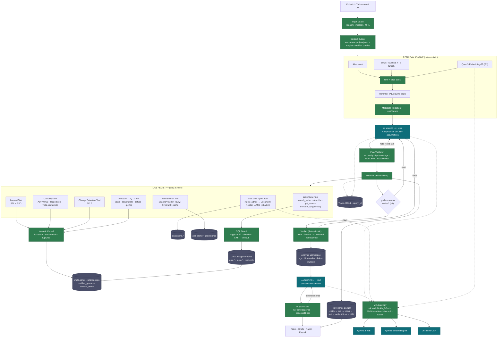

# KKB Agentic Data Analytics — Araştırma, Kanıt ve Mimari Karar Dokümanı (V2)

> **Tarih:** 10 Eylül 2026 · **Geliştirme dondurma:** 20 Eylül 2026 (10 gün) · **Final:** 17 Ekim 2026
> **Amaç:** Yarışmayı kazanabilecek sistemi buzzword ile değil, kanıt ve mühendislik mantığıyla seçmek.
> **Okuma sırası:** Acelesi olan PART 10 (karar), PART 24 (roadmap) ve PART 29 (V2) ile başlasın.
>
> **Güncelleme (10 Eylül, akşam):** Ekibin önceki oturumdaki MIA ölçümleri (native tool calling çalışıyor, `reasoning_effort=none` çalışıyor, ikinci system mesajı reddediliyor, tur maliyeti 142 ms + 0.072 ms/prompt token + 10 ms/çıktı token, golden 7/7 pass^3) bu dokümandaki PART 4 "hiç deney yok" ifadesini ve PART 10'daki JSON-plan omurgasını eskitti. **Nihai tasarım `ARCHITECTURE_V3.md`'dedir**; bu doküman araştırma tabanı ve ADR arşivi olarak kalır. V2'de değişen kararlar V3 §7'de listelidir.

## Kanıt etiketleri

Her önemli iddia şu etiketlerden birini taşır:

| Etiket | Anlamı |
|---|---|
| `[ORG]` | Organizatörün (KKB / Coderspace / açılış slaytları) yazılı ifadesi |
| `[DOC]` | Resmî dokümantasyon (model kartı, framework/kütüphane dokümanı) |
| `[EMP]` | Bizim yaptığımız gerçek deney (bugün itibarıyla **hiçbiri MIA üzerinde yapılmadı**) |
| `[SRC]` | Akademik yayın veya güvenilir ikincil kaynak |
| `[INF]` | Kanıttan türetilmiş çıkarım |
| `[ASM]` | Doğrulanmamış varsayım — test edilmeli |
| `[REC]` | Mimari öneri |

Kaynak hiyerarşisi: organizatör > şartname/slayt > Kloudeks rehberi > MIA deneyi > model dokümanı > framework dokümanı > akademik > mühendislik > community.

---

## PART 1 — Competition Intelligence

### 1.1 Ne var elimizde?

- Açılış toplantısı slaytları (9 adet) `[ORG]`
- Coderspace etkinlik sayfası `[ORG]`
- Organizatör Q&A (senin prompt'unda aktarılan) `[ORG]`
- Repo'daki iki ekip arası contract dokümanları (`docs/LAKEHOUSE_CONTRACT*.md`) — ekip kararı, organizatör kaynağı değil
- Önceki oturumdan çıkan `Claude outputs/architecture.mmd` — **hipotez**, kanıt değil
- Elimizde **olmayanlar:** Kloudeks MIA Hackathon Rehberi'nin kendisi, jüri rubriği, MIA üzerinde tek bir API deneyi

### 1.2 Explicit requirements `[ORG]`

Slayt 1 beş sütun tanımlıyor; slayt 9 altı tool ailesini **isimleriyle** sayıyor:

| Sütun | Slayttaki ifade | Bizim okuma |
|---|---|---|
| 01 Veri Keşfi & Temini | Açık veri kaynakları, tarihsel derinlik, kaynak ve kapsam kaydı | BDDK haftalık/aylık/FinTürk + EVDS "tüm seriler", 2021-01 → 2026-06 |
| 02 Veri Temizliği & Hizalama | Kalite/eksik kontrol; tarih, frekans, birim uyumu; ilişkilendirilebilir veri seti | Kümülatif ayrıştırma açıkça uyarılmış: "bazı veriler paylaşım başlangıcından itibaren kümülatif, bazıları yıllık bazda kümülatif" |
| 03 Agentic Analytics Motoru | Doğal dil anlama, doğru veri+araç seçimi, çok adımlı analitik, gerçek zamanlı hesaplama | 6 tool: Lakehouse, Web Search, Web URL Agent, Anomali, Causality, Change Detection |
| 04 Verinin Analiz Edilmesi | Anomali, değişim tespiti, korelasyon/nedensellik, karmaşık bağlantılar | İstatistik çekirdeği deterministic olmalı |
| 05 Doğrulama & Sonuç | Web aramasıyla destekleme, kaynak ve kanıt gösterme, istenen formatta çıktı, rapor/grafik/tablo | Provenance ve format esnekliği |
| Güven katmanı | "Kaynak gösterimi – İzlenebilirlik – Doğruluk Kontrolü" | Ayrı bir kesitsel katman olarak vurgulanmış |

Alt yazı: *"Katılımcılardan yalnızca analiz yapan değil; soruyu anlayan, analizi planlayan, uygun araçları kullanan, sonuçlarını doğrulayan ve karar destek çıktısına dönüştüren uçtan uca bir agentic çözüm geliştirmeleri beklenmektedir."* `[ORG]`

Örnek demo süreci (slayt 5) `[ORG]`:
1. "2021-2025 yılları arasındaki 60 aylık veriden Türkiye'de kullanılan toplam konut kredilerinin dağılımını aylık olarak gösteriniz. Buna ek olarak konut kredisi faiz oranlarını da gösteriniz. Faiz oranlarının düştüğü dönemlerde kredi miktarı nasıl değişim göstermiş, faiz oranı düştüğü halde kredi miktarının yükselmediği dönemler olmuş mu?"
2. "Konut kredisi ve faiz oranları tablosunu **bozmadan** sadece konut kredisi tutarlarını enflasyondan arındırır mısın?"
3. "Bu tabloyu **hiç bozmadan** yeni bir sütun olarak konut fiyat endeksini getirebilir misin? Faiz oranlarının düştüğü halde kredilerin artmamasının sebebi fiyat artışı olabilir mi?"

Demo günü (slayt 6) `[ORG]`: prompt içinde URL verilecek; PDF, Excel, resim veya yazı bölümünden anlam çıkarma istenecek. Örnekler: Borsa İstanbul Kıymetli Madenler Piyasası altın işlemleri PDF'i; XTUMY (BIST TÜM-100) günlük/aylık değişim.

Kurallar `[ORG]`: Bulut yapay zekâ servisleri **hayır**; "Geliştirme süreçlerinde yalnızca Kloudeks platformu üzerinden erişilebilen açık kaynaklı dil modelleri kullanılmalıdır." Python backend. Coderspace sayfası örnek olarak LangChain, LangGraph, CrewAI, Milvus, Qdrant, Weaviate, Chroma, FastAPI'yi sayıyor (zorunluluk değil, örnek). Takım 3–5 kişi. Online geliştirme 20 Eylül'de biter; fiziksel final 17 Ekim İstanbul. Ödül 200k/150k/100k TL.

### 1.3 Implicit requirements `[INF]`

| Gereksinim | Neden çıkarıyoruz |
|---|---|
| **Stateful analiz çalışma alanı** | Demo soruları 2 ve 3 "tabloyu bozmadan sütun ekle" diyor. Her soruyu sıfırdan cevaplayan bir sistem burada düşer. |
| **Enflasyon deflatörü + baz dönem seçimi** | Soru 2 TÜFE gerektirir; "hangi ay 100" kararı sonucu değiştirir. |
| **Dış kanıtla açıklama** | Soru 3'teki "sebebi fiyat artışı olabilir mi?" sorusuna doğru cevap yalnızca "evet/hayır" değil; makroihtiyati kredi büyüme sınırları ve LTV kuralları gibi **veri setinde olmayan** nedenleri web kanıtıyla getirmek. Bu, "Web aramasıyla destekleme" sütununun somut karşılığı. |
| **Genericlik** | Ekip notlarında geçen "içi boşaltılıp bambaşka bir sağlık verisiyle de çalışabilmeli" ifadesi (README) — organizatör kaynaklı olarak aktarılmış; slaytlarda birebir yok → `[ORG?]` doğrulanmalı. |
| **"Harness güçlü, LLM'e en az iş"** | README açılış toplantısı yönlendirmesi olarak aktarıyor `[ORG?]`. Literatürle uyumlu (PART 5). |
| **Ad-hoc kaynak için ingestion yolu** | Demo günü bilinmeyen URL; önceden hazırlanmış katalogla çözülemez. |

### 1.4 Jüri sinyalleri `[INF]`

1. Soru → plan → araç → doğrulama → karar desteği zincirinin **görünür** olması.
2. "Bu rakam nereden geldi?" sorusuna tek tıkla cevap (provenance).
3. Kümülatif/birim/frekans tuzaklarına düşmemek (slaytta özellikle uyarılmış; jüri büyük ihtimalle kontrol edecek).
4. Nedensellik dilinde disiplin (korelasyon ≠ nedensellik).
5. Demo günü URL'den PDF/Excel'i canlı okuyabilmek.
6. Takip sorularında tabloyu bozmamak.

### 1.5 Failure traps (rakiplerin düşeceği yerler) `[INF]`

- BDDK YTD kümülatif seriyi düz bakiye gibi toplamak; stok seriye `diff()` uygulayıp "akım" üretmek.
- Tablo 5 "bin TL" ile Tablo 3/4 "milyon TL" karışması (ekip canlı doğrulamış).
- Haftalık faizi aylığa çevirirken `last` vs `avg` seçimi; ratio serilerini ortalama almak.
- Alt toplam satırlarını (Tüketici Kredileri = 2+3+4) alt kalemlerle birlikte toplamak.
- LLM'e aritmetik yaptırmak (PART 6.4).
- Faiz düştü → kredi arttı türü nedensellik iddiaları.
- Enflasyondan arındırırken baz dönemi söylememek; nominal/reel karışıklığı.
- Demo günü SSL/PDF/Excel parse hataları (BDDK sertifika zinciri eksik — ekip gözlemi).
- Tool calling'in MIA'da olmaması durumunda çöken framework-bağımlı agent.
- Seri kodlarını tahmin etmek (contract açıkça yasaklıyor).

---

## PART 2 — Confirmed Constraints

| # | Kısıt | Kaynak | Mimari sonucu |
|---|---|---|---|
| C1 | Ana LLM MIA `kkbhackathon2026/Qwen3.8-27B`, `/v1/chat/completions`, ≤5 görsel/prompt | `[ORG]` | Tüm reasoning MIA üzerinde; dış LLM yok |
| C2 | Embedding `kkbhackathon2026/Qwen3-Embedding-8B`, `/v1/embeddings` | `[ORG]` | Dense retrieval adayı; benchmark ile karar |
| C3 | OCR `kkbhackathon2026/Unlimited-OCR`, ≤3 görsel, `<image>` + "document parsing" prompt, özel inference parametreleri; PDF → sayfa görseli | `[ORG]` | Yalnızca taranmış/görsel belge için; core'a bağımlılık yok |
| C4 | Takıma özel request/token limiti yok; kapasite artırılabilir; retry/backoff önerilir | `[ORG]` | Kota korkusuyla küçültme yok; reliability layer zorunlu |
| C5 | External web search/scraping serbest (Tavily, Firecrawl örnek); provider-bağımsız tasarım önerilir | `[ORG]` | `SearchProvider` arayüzü |
| C6 | Local helper modeller (sentence-transformer, reranker, BM25, klasik ranking) retrieval/ranking katmanında serbest | `[ORG]` | Hybrid retrieval mümkün |
| C7 | Ana LLM MIA kalır; yerel modeller reasoning engine'in yerine geçmez | `[ORG]` | Yerel LLM sadece geliştirme/test (bkz. O6) |
| C8 | Cloud warehouse (Snowflake, BigQuery) yasak; local/application-owned çözümler "yasak" denmemiş | `[ORG]` | DuckDB/Parquet aday; O2 ile teyit |
| C9 | MIA / Search / Retrieval katmanları ayrılmalı | `[ORG]` | First-class mimari ilke |
| C10 | API key frontend/repo/slayt/screenshot'ta olmaz | `[ORG]` | `.env` + backend proxy; `.gitignore` mevcut |
| C11 | Backend Python; frontend serbest | `[ORG]` | — |
| C12 | Repo 20 Eylül'de dondurulur | `[ORG]` | 10 günlük P0 |
| C13 | Veri kapsamı 2021-01 → 2026-06; BDDK haftalık/aylık/FinTürk; EVDS tüm seriler | `[ORG]` | Coverage guard'ın sınırı |
| C14 | 6 tool ailesi isimleriyle bekleniyor | `[ORG]` | Tool registry'de bu isimlerle görünür olmalı (jüri eşleştirmesi için) |

Upstream model gerçekleri (deployment'ta **doğrulanmadı**):

| Model | Özellik | Kaynak |
|---|---|---|
| Qwen3.8-27B | 14 Ağustos 2026, 27B dense, native multimodal (görsel+video), 262K native context (YaRN ile 1M), Apache 2.0 | `[DOC]` HF model kartı, vLLM recipe |
| Qwen3.8-27B | Thinking **varsayılan açık**; `chat_template_kwargs.enable_thinking=false` ile kapanır; `reasoning_effort` low/medium/xhigh | `[DOC]` |
| Qwen3.8-27B | Önerilen örnekleme: thinking T=1.0/top_p .95; non-thinking T=0.7/top_p .8/presence 1.5 | `[DOC]` |
| Qwen3.8-27B | vLLM recipe: `--reasoning-parser qwen3 --enable-auto-tool-choice --tool-call-parser qwen3_coder` | `[DOC]` — MIA'nın bu bayraklarla başlatıldığı **bilinmiyor** |
| vLLM genel | Tool calling **varsayılan kapalı**; bayrak gerekir. Structured outputs (xgrammar) OpenAI sunucuda varsayılan açık; reasoning modelde `enable_in_reasoning` gerekir | `[DOC]` — MIA'nın vLLM olduğu bile `[ASM]` |
| Qwen3-Embedding-8B | 4096 boyut (MRL 32–4096), 32k context, instruction-aware (+1–5%), 100+ dil, MTEB-multilingual 70.58 | `[DOC]` |
| Qwen3-Reranker 0.6B/4B/8B | Instruction-aware pointwise generative reranker; MIRACL ort. 68.97 vs bge-reranker-v2-m3 67.64 | `[DOC]`/`[SRC]` |
| Unlimited-OCR | Baidu, 3B VLM, MIT, 32K, R-SWA; prompt tam olarak `<image>document parsing.`; T=0, max_tokens 8192, `skip_special_tokens=False`; çıktı markdown + `<\|ref\|>`/`<\|det\|>` grounding token'ları | `[DOC]` vLLM recipe |

---

## PART 3 — Open Questions (organizatöre sorulacak)

| # | Soru | Neden kritik | Varsayılan (cevap gelmezse) |
|---|---|---|---|
| O1 | Jüri rubriği ve ağırlıkları nedir? Provenance/doğruluk kontrolü puanlanıyor mu? | Öncelik sırası | Slayt "güven katmanı" vurgusuna göre puanlanıyor kabul |
| O2 | DuckDB + Parquet (uygulama içi, dosya tabanlı) "hazır bulut Lakehouse" sayılır mı? | C8 | Sayılmaz `[INF]`; yazılı teyit iste |
| O3 | MIA hangi inference sunucusunu kullanıyor (vLLM/SGLang/TGI)? `tools`, `response_format`, `chat_template_kwargs`, `stream` destekleniyor mu? | PART 4 | Hiçbirini varsayma; probe ile ölç |
| O4 | Qwen3.8-27B MIA'da thinking açık mı? `reasoning_content` ayrı alanda mı dönüyor? | JSON parse ve latency | Probe |
| O5 | Concurrency limiti var mı (aynı anda 5 istek)? | Paralel retrieval/plan | Probe; 2 paralel ile başla |
| O6 | Geliştirme sırasında aynı açık kaynak modeli lokal (Ollama/vLLM) çalıştırmak serbest mi? Slayt "yalnızca Kloudeks üzerinden erişilebilen" diyor | CI/test maliyeti | Lokal yalnızca unit test için; golden set MIA ile |
| O7 | Tavily/Firecrawl ücretli plan kullanımı uygun mu; demo günü internet erişimi garanti mi? | Search katmanı | Offline fallback (cache) tut |
| O8 | 6 tool "isim" olarak mı, "yetenek" olarak mı bekleniyor? | Registry isimlendirme | İsimleri aynen kullan |
| O9 | Demo canlı mı, video mu; süre ne? | Demo tasarımı | Canlı, ~10 dk kabul |
| O10 | Vektör DB (Chroma/Qdrant lokal) "cloud lakehouse" kapsamında mı? | Retrieval | Lokal embedded (DuckDB) tercih; harici servis yok |
| O11 | FinTürk verisinin frekansı ve kullanım beklentisi? | Data P1 | Çeyreklik `[ASM]` |

Öneri: O2, O3, O6 bugün yazılı sorulsun; cevap gelmeden `mia_probe.py` koşulsun.

---

## PART 4 — MIA Capability Matrix

**Ölçüldü (10 Eylül, `scripts/mia_probe.py` → `docs/calisma-notlari/mia_capability_matrix.md`) `[EMP]`.** Özet: native tool calling ve tek turda paralel `tool_calls` (3/3/3) çalışıyor; thinking varsayılan açık, `reasoning_content` ayrı alanda, `enable_thinking=false`/`reasoning_effort=none` kapatıyor; thinking açıkken de tool_calls parse ediliyor; `response_format=json_object` ve `json_schema` çalışıyor; prompt-only JSON 27/30 ham, 30/30 extract sonrası; 49.9k token prompt 4.7 s; prefix caching kazancı yok; 5 paralel istek sorunsuz; T=0+seed deterministik; streaming var; embedding 4096 boyut, `dimensions` reddediliyor, batch 64 OK; ikinci system mesajı 400; rate-limit header'ı yok; system talimatına uyum 7/10. Aşağıdaki tablo tarihsel test tasarımı olarak kalır; sonuç sütunu için matris dosyasına bakın:

| Capability | Dokümante? | Org. teyit? | Test | Başarı kriteri | Mimari etkisi |
|---|---|---|---|---|---|
| `/v1/models` listesi | Hayır | Model adları evet | GET /models | 3 model görünür | Model adlarını env'den oku |
| System message'a uyum | Hayır | Hayır | 10 istek, "yalnızca JSON döndür" sistem talimatı | ≥9/10 uyum | Prompt tasarımı |
| Thinking varsayılanı | Upstream evet | Hayır | Ham cevapta `<think>` veya `reasoning_content` var mı | Tespit | JSON parser think-strip yapmalı |
| `enable_thinking=false` (chat_template_kwargs) | Upstream evet | Hayır | extra_body ile gönder; içerik/latency karşılaştır | Thinking kapanıyor | Planner için non-thinking + düşük T; zor reasoning için thinking |
| `/no_think` soft switch | Upstream (Qwen3) | Hayır | Prompt sonuna ekle | Aynı | Fallback |
| JSON üretim güvenilirliği | Hayır | Hayır | 30 plan isteği, farklı sorular | Parse ≥ %93 ham; repair sonrası ≥ %99 | Structured-output merdiveni (PART 17) |
| `response_format: json_object` | vLLM evet | Hayır | Gönder; 400 dönüyor mu | Kabul + valid JSON | Merdivenin 1. basamağı |
| `response_format: json_schema` | vLLM evet | Hayır | Pydantic schema gönder | Şemaya uygun | Basamak 0 (en güçlü) |
| `tools` / `tool_choice` | vLLM bayrak gerekir | Hayır | 1 tool tanımla; `tool_calls` dönüyor mu | Döner/dönmez | Dönmüyorsa prompt-tabanlı action (PART 8 açıklaması) — **her durumda prompt-tabanlı yolu koru** |
| Uzun prompt (30k token) | Upstream 262K | Hayır | 30k token metadata + soru | Hata yok, latency ölç | Context bütçesi |
| Görsel girişi (1 ve 5 görsel) | `[ORG]` | Evet | base64 image_url | Açıklama döner | Chart/screenshot yorumu (opsiyonel) |
| OCR çağrısı | `[ORG]` | Evet | `<image>document parsing.` + skip_special_tokens=False | Markdown döner | Ad-hoc PDF (taranmış) yolu |
| Embedding boyutu/batch | Upstream 4096 | Hayır | 1 ve 64 metin; `dimensions` parametresi | Boyut, batch limiti, Türkçe metinde hata yok | Index tasarımı |
| Streaming | Hayır | Hayır | `stream=true` | SSE gelir | UI için; opsiyonel |
| Seed/determinizm | Hayır | Hayır | Aynı istek ×5, T=0 | Aynı çıktı | Test tekrarlanabilirliği |
| Latency (p50/p95) | Hayır | Hayır | 20 kısa, 5 uzun istek | Ölçüm | Model call bütçesi |
| Concurrency | Hayır | "limit yok" | 5 paralel | 429 var mı | Backoff parametreleri |
| Hata formatı | Hayır | Hayır | Yanlış model adı, boş mesaj | JSON hata gövdesi | Error taxonomy |
| Retry davranışı | Hayır | "koyun" | 429/5xx simülasyonu | — | Exponential backoff + jitter, max 4 |

Kritik ilke: **Mimari, tool calling ve structured output olmadan da çalışacak şekilde tasarlanmalı**; bunlar varsa yalnızca güvenilirliği artıran hızlandırıcılar olur.

---

## PART 5 — Literature Review

### 5.1 Agentic pattern'ler — KKB süzgecinden

| Pattern | Çözdüğü problem | MIA bağımlılığı | KKB'de kullanım | Karar |
|---|---|---|---|---|
| **ReAct** (Yao et al. 2022) | Reasoning + action döngüsü; gözlemle düzelt | Yok (metin) | Bilinmeyen belge/URL okuma (ad-hoc), 2. seviye SQL düzeltme | **Sınırlı kullan**: yalnızca gerçekten keşif gereken 2 yerde, max N adım |
| **Plan-and-Execute / Planner-Executor** | Plan ile yürütmeyi ayırıp maliyet/hata izolasyonu | Yok | Ana omurga | **Kullan** |
| **Evaluator-Optimizer** (Anthropic) | Net kriter varsa üret-değerlendir döngüsü | Yok | Plan validator → replan (max 2) | **Kullan (deterministic evaluator)** |
| **Orchestrator-Workers** (Anthropic) | Alt görev sayısı önceden bilinmiyorsa | Yok | Çoklu seri keşfi paralel | **Gerekmez**; retrieval deterministic |
| **Reflexion / Self-critique** | Kendi çıktısını sözel geri bildirimle iyileştirme | Yok | "Cevabını kontrol et" | **Kullanma** (tek başına kanıt değil); yerine dış kanıtlı verifier |
| **Supervisor + specialist agents** | Uzmanlık ayrımı | Yok | 5 agent teatri riski | **Kullanma** (PART 8 karşılaştırması) |
| **Graph-based workflow** (LangGraph) | Durum makinesi, checkpoint, HITL | Yok | Orkestrasyon | **Kullanma, ADR-2** |
| **Agentic RAG** | Retrieval'ı agent karar verir | Yok | Ambiguity'de ek metadata isteme | **Dar kullanım**: düşük güven → ek kanıt (EviLink ilkesi) |
| **SQL agents (MAC-SQL, CHESS, DIN-SQL)** | Text-to-SQL doğruluğu | Yok | SQL fallback yolu | Selector/Refiner fikirleri deterministic olarak |
| **Data analysis agents** (InfiAgent-DABench, DA-Code, Jupiter, DatawiseAgent) | Notebook/kod üreterek analiz | Kod yürütme sandbox | Serbest kod yürütmesi | **Kullanma** (bounded tool registry, ADR-4) |

Ana kaynak sinyalleri:
- Anthropic "Building Effective Agents": önce workflow, agent'ı yalnızca esneklik gerçekten gerekince; iş akışı öngörülebilirse kod yolu `[SRC]`.
- TMLR 2026 "LLM-based Data Science Agent: A Survey": grounding+verification halüsinasyonu azaltır; kontrollü yürütme güvenilirliği artırır; rol ayrımı uzun-context kararsızlığını azaltır `[SRC]`.
- ProSPy (2606.05836): deterministic profiling → LLM'e "veri kanıtı" ver; SQL büyük veri, Python analiz `[SRC]`. Bizim `profile_dataset` ve semantic catalog buna karşılık gelir.
- FAITH/VeriFin/FinVerBench: basit lookup'ta %95+, çok değişkenli hesapta ~%0'a düşüş; hesabı dışarı al `[SRC]`.

### 5.2 Text-to-SQL ve schema linking

- "The Death of Schema Linking?" (2408.07702): şema context'e sığıyorsa filtreleme yapma; augmentation/selection/correction daha iyi `[SRC]`. **Bizim tablo sayısı küçük** (Gold'da 4–7 view) → tablo düzeyinde retrieval gereksiz.
- Ancak bizim problemimiz **seri düzeyi**: EVDS on binlerce seri, BDDK yüzlerce kalem × taraf × para birimi. Bu, "kolon 3000+" rejimine benzer; AutoLink (AAAI 2026) ve EviLink (2605.29670) büyük şemada iteratif keşif ve belirsizlik-güdümlü kanıt toplamanın gerekli olduğunu gösteriyor `[SRC]`.
- "Schema-First Retrieval" (2606.28387): tablo/kolon/metrik/ilişki/**sorgu geçmişi** ayrı nesneler olarak embed edilir; dense+cross-encoder, BM25'i tablo recall@5'te +32.8 puan geçer; **sorgu geçmişi** recall@5'i 52→92'ye çıkarır `[SRC]`. → "Verified Queries" bileşeni kanıtlı.
- TARGET (2505.11545): tablo retrieval'da dense ≫ BM25; header+satır embed'i en iyi; metadata eksikliğine duyarlı `[SRC]`.
- Karşı kanıt: "From BM25 to Corrective RAG" (2604.01733): finansal belge+tablo corpus'unda BM25, dense'i geçiyor; en iyi hybrid+rerank (R@5 .816) `[SRC]`. → **Kazananı benchmark seçer** (PART 7).

### 5.3 Retrieval

- RRF hybrid, tüm metriklerde iki bileşeni de geçer; reranker en büyük tek kazanım ama aday havuzu ≥ ~50 olmalı (20 ile etkisiz) `[SRC]`.
- Türkçe: Zemberek (sözlük tabanlı) > Snowball; BM25 Türkçe'de iyi çalışır `[SRC]`. DuckDB FTS `turkish` stemmer'ı destekler, ama varsayılan `ignore='(\\.|[^a-z])+'` regex'i ASCII dışı harfleri siler; `strip_accents` ç/ş/ö/ü'yü ASCII'ye indirir, `ı`/`ğ` davranışı **test edilmeli** `[DOC]`/`[ASM]`. FTS index tablo değişince otomatik güncellenmez (`overwrite`) `[DOC]`.
- Türkçe embedding benchmark'ları: TR-MTEB (EMNLP 2025), TR-TEB, TurkColBERT `[SRC]`. Qwen3 çok dilli ama düşük kaynaklı dillerde tutarsızlık raporları var `[SRC]` → Türkçe alias kalitesi retrieval'da belirleyici.

### 5.4 Frameworks (Eylül 2026 durumu)

| Framework | Durum | OpenAI-uyumlu endpoint | Tool calling'siz çalışır mı? | KKB değerlendirmesi |
|---|---|---|---|---|
| LangGraph 1.0 (Ekim 2025) | Stabil; checkpoint, durable execution, HITL | `ChatOpenAI(base_url=...)` `[DOC]` | Graph evet; prebuilt agent'lar tool calling ister | Durum makinesi değerli ama bizim akış sabit; 10 günde öğrenme+entegrasyon riski; ADR-2 |
| PydanticAI | `PromptedOutput` modu tool calling olmadan JSON `[DOC]` | Evet | Evet | Structured output için cazip; ama tek bileşen için framework almak gereksiz; `pydantic` + kendi merdivenimiz yeter |
| smolagents | `CodeAgent` (Python üretir) / `ToolCallingAgent`; `OpenAIServerModel` `[DOC]` | Evet | ToolCallingAgent prompt tabanlı | CodeAgent = serbest kod → guardrail ihlali; kullanma |
| DSPy 3 | `JSONAdapter` kademeli (json_schema → json_object → düz JSON), `TwoStepAdapter` reasoning modeller için `[DOC]` | Evet | Evet | Optimizer P2 için ilginç; P0'da yok |
| Microsoft Agent Framework 1.0 (Nisan 2026) | AutoGen+SK birleşti `[SRC]` | Belirsiz | — | Ekosistem .NET ağırlıklı; kullanma |
| LlamaIndex Workflows | Event-driven | Evet | Evet | Retrieval abstraction için değil; kendi retriever'ımız küçük |
| CrewAI | Rol tabanlı multi-agent | Evet | Kısmen | Agent teatri riski; kullanma |

### 5.5 Data architecture

- Data ekibi kararı `[repo]`: RAW (immutable+SHA-256) → Bronze Parquet → Silver `fact_observation` (long) → Gold DuckDB view'ları → `meta.*` catalog; DuckLake/dbt/LanceDB/Spark/Airflow/Iceberg/Delta P0 dışı. **Bu doğru ölçek**: 5 yıl × birkaç bin seri ≈ birkaç milyon satır; tek dosyalık DuckDB için önemsiz.
- Lakehouse "kavramları" (medallion, lineage, vintage) veri sözleşmesinde zaten var; enterprise araçları eklemeye gerek yok.
- DuckDB güvenlik: `read_only=True`, `enable_external_access=false`, `lock_configuration=true`; ancak `sniff_csv` gibi açıklar bilindiği için **tek başına yeterli değil** → sqlglot AST allowlist + ayrı "agent-facing" veritabanı dosyası (yalnızca gold/meta) `[DOC]`/`[REC]`.

---

## PART 6 — Financial Analytics Requirements

### 6.1 Seri tip sistemi (deterministic, contract'ta zaten var)

`measure_type ∈ {stock, flow_periodic, flow_ytd, flow_cumulative, rate, ratio, index, count, unknown}` + `unit` + `frequency` + `default_agg` + `cumulative_reset`. Kritik kurallar: stok → `last`; akım → `sum`; YTD → yıl içi fark; ratio → pay/payda ile yeniden hesap; `unknown` → **otomatik dönüşüm yok**; upsample yok.

Eklenmesi gerekenler `[REC]`:
- `nominal_real ∈ {nominal, real, na}` ve `deflator_ref` (deflate edilmiş türetilmiş seriler için).
- `base_period` (endeks ve reel seriler için).
- `regulatory_notes[]`: seriye bağlı tarihli düzenleme notları (bkz. 6.3), retrieval index'ine dahil.

### 6.2 Tipik yanlış yorum riskleri ve guardrail karşılığı

| Risk | Guardrail |
|---|---|
| % vs puan ("faiz %10 düştü" vs "10 puan") | Narrator'a `pp_change` ve `pct_change` ayrı alanlarla verilir; metinde ikisi de etiketli |
| Nominal büyüme = reel büyüme | Deflate tool'u baz dönemi ve deflatör serisini provenance'a yazar; narrator "reel (2021-01=100 TÜFE bazlı)" demek zorunda |
| Stok vs akım karışması ("kredi kullandırımı arttı" vs "bakiye arttı") | Narrator şablonu `measure_type`'a göre fiil seçer |
| Frekans uyumsuzluğu | `align()` yalnızca downsample; upsample isteği `SEMANTIC_VIOLATION` |
| Gecikme etkisi | Lagged correlation tool'u 0..k lag verir; tek lag'e karar vermez |
| Mevsimsellik | STL/kısmi; 60 gözlemde uyarı |
| Yapısal kırılma | Change detection (PELT) + rejim etiketleri |
| Korelasyon → nedensellik | Causality tool yalnızca "Granger-anlamında öncüllük" der; verifier metinde "neden oldu" kalıbını bloklar, "ilişkili görünüyor / öncülüyor" ile değiştirir |
| Küçük örneklem | n<30 aylıkta Granger sonucu "düşük güç" caveat'i ile; n<20'de reddet |
| Veri revizyonları | `vintage_id` her sonuçta |
| Alt toplam çift sayımı | Catalog `is_subtotal` + `components[]`; aggregate tool'u aynı ağaçtan ebeveyn+çocuk toplamını reddeder |

### 6.3 Demo sorusunun finansal gerçeği (örnek domain knowledge)

Slayt sorusu "faiz düştüğü halde kredi artmayan dönemler oldu mu, sebebi fiyat artışı olabilir mi?" Dürüst analitik cevap birden fazla mekanizma içerir; sistem bunları **dış kanıtla** getirmelidir:

| Mekanizma | Kanıt | Etiket |
|---|---|---|
| BDDK LTV/azami kredi kuralları (23.06.2022 K.10249; 24.02.2023 K.10525 ile 2→5 mn TL eşiği; 29.01.2026 K.11364 yeni düzenleme) | bddk.org.tr mevzuat | `[SRC]` (11364 içeriği fetch edilemedi → `[ASM]`) |
| TCMB kredi büyüme sınırları (2024: TL ticari %2, ihtiyaç %2, taşıt %2; 2025: KOBİ %2,5 / diğer %1,5, YP %1) | TCMB basın duyuruları 2024-13, 2025-02 | `[SRC]` |
| Faiz geçişkenliği gecikmeli ve tüketici kredilerinde sınırlı (Tem–Ara 2025: ticari −690 bp, tüketici −300 bp; makroihtiyati sınırlar nedeniyle) | TCMB blog | `[SRC]` |
| Politika faizi patikası (2025 Tem–Eki toplam 650 bp indirim; Ocak 2026 %37) | ikincil kaynaklar | `[SRC]`, birincil kaynakla doğrulanmalı |
| Reel gelir/konut fiyat endeksi etkisi | EVDS KFE (TP.HKFE01) | `[SRC]` seri kodu web'de görülüyor; contract gereği source spike'ta doğrulanacak |

Bu tablo koda hard-code **edilmez**; "Domain Knowledge Layer"da tarihli, kaynaklı not olarak tutulur ve web search ile güncellenir (PART 15/16).

### 6.4 Neden LLM hesap yapmaz

FAITH benzeri çalışmalarda çok değişkenli finansal hesapta çöküş; Stanford HAI 2025 çok adımlı aritmetikte %40'a varan hata `[SRC]`. Kural: LLM operand ve yöntem **seçer**, sayı üretmez; her sayı ledger'da bir tool çıktısına bağlıdır (Output guardrail).

### 6.5 Veri kaynağı gerçekleri

- EVDS: key 05.04.2024'ten beri header'da `[SRC]`; `frequency`, `aggregationTypes`, `formulas` parametreleri var `[SRC]`; kod tabloları `[ASM]` (1 günlük … 8 yıllık; avg/min/max/first/last/sum; formül 0–8) — resmî kılavuzla doğrulanmalı. **Öneri:** EVDS'nin kendi agregasyonunu kullanma; ham frekansta çek, dönüşümü kendi tip sistemimizle yap (provenance için).
- BDDK JSON endpoint'leri ekipçe canlı doğrulanmış (08.09.2026) `[EMP]`; SSL zinciri eksik → yalnızca connector seviyesinde kontrollü fallback.
- Borsa İstanbul: XTUMY gün sonu verileri; kıymetli madenler bültenleri datastore'da `[SRC]`.
- Konut kredisi faiz haftalık akım ağırlıklı ortalama serisi EVDS'de (TP.KTF10 olarak anılıyor) `[SRC]` — doğrulanacak.

---

## PART 7 — Retrieval Bake-Off Design

**Soru:** Kullanıcının Türkçe/İngilizce doğal dil kavramı ("mortgage", "ev kredisi bakiyesi", "KFE", "TÜFE yıllık") → doğru `series_id`.

**Corpus:** `meta.series` kayıtları; her seri için birden fazla "belge görünümü": (a) `name_tr + aliases + category_path`, (b) `description + unit + frequency + measure_type`, (c) örnek değer aralığı/tarih kapsamı. Schema-First Retrieval'ın nesne-tipine özel şablon bulgusuna göre bu üç görünüm ayrı ayrı embed edilip RRF ile birleştirilir `[SRC]`.

**Sistemler:**

| ID | Sistem | Not |
|---|---|---|
| R1 | BM25 (bm25s, Türkçe Snowball stemmer + özel `ignore`) | Baseline |
| R1b | DuckDB FTS `stemmer='turkish'` | Sıfır ek bağımlılık; Türkçe karakter testi |
| R2 | Qwen3-Embedding-8B (MIA), instruct'lı, 1024 boyut (MRL) | dims parametresi test |
| R3 | Lokal `bge-m3` (dense) | MIA'sız fallback |
| R4 | R1 + R2, RRF k=60 | Hybrid |
| R5 | R4 + lokal reranker (bge-reranker-v2-m3 **veya** Qwen3-Reranker-0.6B), aday havuzu 50 | Hybrid+rerank |
| R6 | R4 + alias-exact boost | Ucuz alternatif |

**Sorgu seti (≥120):** 12 kategori × ≥10: exact Türkçe ad, kısaltma (KFE, TÜFE, KKDF), eşanlamlı (mortgage/konut/ev), İngilizce, finans jargonu (NPL, YP kredi), unseen schema (sağlık verisi seti ile), yanıltıcı benzerler (konut kredisi vs konut fiyat endeksi vs konut kredisi faizi), kısmi açıklama, yazım hatası, frekans/birim niteleyici ("aylık", "milyon TL"), taraf niteleyici (katılım bankaları), negatif (olmayan seri → boş dönmeli).

**Metrikler:** Recall@1/3/5, MRR, NDCG@5, "no-answer doğruluğu", p50 latency, bellek, LOC.

**Karar kuralı:** R5 − R4 < 3 puan Recall@3 ise reranker P1'e kalır. R2 − R1 < 3 puan ise embedding P1'e kalır (data ekibinin P0 kararıyla uyumlu). Sonuç ADR-6/7'ye yazılır.

**Ground truth:** İlk vertical slice'ın ~40 serisi elle etiketlenir; sonra genişletilir. Unseen-schema seti: 30 satırlık sahte "hasta yatış" kataloğu.

---

## PART 8 — Architecture Alternatives

### A — Tek Qwen agent + tools (ReAct)
Model her adımda araç seçer. + Basit, esnek. − Her adım bir LLM çağrısı; hata yüzeyi büyük; MIA tool calling yoksa prompt-parsing kırılgan; plan görünürlüğü yok; demo'da "neden bu adımı seçti" cevaplanamaz.

### B — Planner + Deterministic Executor
LLM tek seferde makine-okunur plan üretir; executor deterministic yürütür. + 1–2 LLM çağrısı, izlenebilir. − Plan yanlışsa düzeltme yok; keşif gereken (ad-hoc URL) durumlarda yetersiz.

### C — Planner + Executor + Validator (+ bounded replan) **[seçilen omurga]**
B + deterministic plan validator (şema/varlık/tip/coverage) + execution verifier + max 2 replan; ad-hoc belge için ayrı sınırlı ReAct döngüsü. + Hata yakalama, izlenebilirlik, düşük çağrı sayısı. − Plan şeması tasarımı emek ister; yeni tool = şema güncellemesi.

### D — Supervisor + Specialist Agents
Discovery/SQL/Stats/Narrator agent'ları. + Rol ayrımı uzun-context kararsızlığını azaltır `[SRC]`. − Bizim context'imiz küçük; her agent = ek çağrı+ek halüsinasyon; agent'lar arası mesaj şeması; 10 günde debug edilemez.

### E — Graph-based workflow (LangGraph)
C'nin LangGraph ile yazımı. + Checkpoint, HITL. − Öğrenme eğrisi; MIA belirsizlikleri framework katmanının arkasında saklanır; demo için checkpoint gereksiz.

### F — Hierarchical multi-agent
D'nin katmanlısı. Gerekçesi yok.

---

## PART 9 — Architecture Comparison

Puan 1 (kötü) – 5 (iyi). `[INF]` — deney yapılmadan literatür + kısıtlara dayalı.

| Kriter | A | B | C | D | E | F |
|---|---|---|---|---|---|---|
| Doğruluk (planlı analitik) | 3 | 3 | **5** | 4 | 5 | 4 |
| Güvenilirlik (MIA belirsizliği altında) | 2 | 4 | **5** | 2 | 3 | 2 |
| Latency / çağrı sayısı | 2 | 5 | **4** | 2 | 4 | 1 |
| Halüsinasyon yüzeyi | 2 | 4 | **5** | 2 | 5 | 2 |
| State karmaşıklığı | 3 | 5 | 4 | 2 | 3 | 1 |
| Debug/observability | 2 | 4 | **5** | 2 | 4 | 1 |
| Failure recovery | 3 | 2 | **5** | 3 | 5 | 3 |
| 10 günde uygulanabilirlik | 4 | 5 | **4** | 2 | 2 | 1 |
| Genericlik | 4 | 4 | **4** | 4 | 4 | 4 |
| Demo/jüri değeri | 3 | 3 | **5** | 4 | 4 | 3 |
| Ad-hoc URL esnekliği | 5 | 1 | 4 (sınırlı ReAct) | 4 | 4 | 4 |
| **Toplam** | 33 | 40 | **50** | 31 | 43 | 26 |

---

## PART 10 — Architecture Decision

**Seçim: C — "Plan · Execute · Verify" omurgası, iki LLM rolü + bir koşullu LLM döngüsü.**

1. **Planner/Replanner (LLM)** — soruyu, workspace durumunu ve retrieval adaylarını alır; `AnalysisPlan` JSON üretir. Intent classification ayrı çağrı değil, planın bir alanıdır.
2. **Narrator (LLM)** — yalnızca doğrulanmış sayıların placeholder'larıyla metin üretir; sayı yazamaz.
3. **Document Reader (LLM, koşullu, sınırlı ReAct ≤4 adım)** — ad-hoc URL'den gelen belgeden istenen tabloyu/alanı çıkarır; çıktı yine `ingest_adhoc` sözleşmesine düşer.

Agent olmayanlar: Discovery (retrieval tool), Plan Validator, Executor, Verifier, Numeric Kernel, SQL Compiler/Guard — deterministic.

Neden: "harness güçlü, LLM'e en az iş" `[ORG?]`; Anthropic workflow-first `[SRC]`; MIA capability belirsizliği (PART 4) prompt-tabanlı JSON'u zorunlu kılar; 10 gün. Multi-agent, kaldırıldığında kaybolan bir reasoning yeteneği göstermedikçe eklenmez (PART 36 sorusu).

---

## PART 11 — Full Agentic Architecture

```text
KULLANICI (Türkçe doğal dil)  ─────────────────────────────────────────────┐
                                                                            │
 ┌────────────── ARAYÜZ ──────────────┐                                     │
 │ Chat │ Workspace tablosu │ Grafik │ Provenance paneli │ Trace görünümü  │
 └───────────────┬────────────────────┘                                     │
                 ▼                                                          │
 ┌────────────── ORKESTRATÖR (deterministic durum makinesi) ────────────────┴──┐
 │ 0 Input guard (kapsam, injection, URL tespiti)                              │
 │ 1 Context builder: workspace özeti + retrieval adayları + verified queries  │
 │ 2 PLANNER (LLM #1) → AnalysisPlan JSON  ── JSON merdiveni: schema→object→  │
 │                                              prompt→repair→retry(≤2)        │
 │ 3 Plan validator (deterministic): şema, seri varlığı, tip, coverage,        │
 │   index kilidi, tool allowlist  ──(hata+hint)──▶ REPLAN (≤2)                │
 │ 4 Executor: plan adımlarını tool registry üzerinden yürütür                 │
 │   • lakehouse.search_series / describe / get_series / execute_sql(guarded)  │
 │   • transform: align, decumulate, deflate, index_to_base, pct/pp_change     │
 │   • analytics: anomaly (STL+ESD), change (PELT), causality (ADF/KPSS+      │
 │     Granger/Toda-Yamamoto), lagged_corr, descriptive                        │
 │   • web.search / web.fetch  (SearchProvider: Tavily | Firecrawl | N)        │
 │   • doc.ingest_adhoc → DOCUMENT READER (LLM #3, ≤4 adım) → quarantine tablo │
 │   • chart.plot, table.emit                                                  │
 │ 5 Verifier (deterministic): birim/frekans/coverage/n/subtotal/nominal-reel  │
 │   + istatistik ön koşulları  ──(hata)──▶ REPLAN                             │
 │ 6 Workspace: yeni sürüm v_{n+1} (immutable, kolon soyağacı)                 │
 │ 7 NARRATOR (LLM #2): placeholder'lı anlatım; nedensellik dili filtresi      │
 │ 8 Output guard: her sayı ledger'da mı? → değilse blokla/yeniden üret        │
 └─────────────────────────────────────────────────────────────────────────────┘
        │                     │                        │
        ▼                     ▼                        ▼
 RETRIEVAL ENGINE       SEARCH LAYER             DATA + META LAYER
 BM25 (DuckDB FTS/bm25s) SearchProvider iface     DuckDB (gold.*, meta.*, read-only)
 + Qwen3-Embedding (P1)  Tavily / Firecrawl        Parquet Bronze/Silver (data ekibi)
 + reranker (P1, ölçüme  fetch/extract/cache       Catalog: series, aliases, notes,
   bağlı)                provenance (url, ts)      relationships, verified_queries,
 RRF + alias boost                                 profiles, domain_notes (tarihli)
        │                     │                        │
        └──────────── PROVENANCE LEDGER + TRACE (JSONL, query_id) ────────────┘
 MIA GATEWAY: rol bazlı model/parametre, think-strip, backoff, timeout, cache, hata sınıflandırma
```

Mermaid sürümü: PART 30 ve `docs/diagrams/architecture_v2.mmd`.

---

## PART 12 — Agent Definitions

### Planner / Replanner (LLM #1)
- **Sorumluluk:** Soru + workspace + adaylar → `AnalysisPlan`. Intent (`new_analysis | extend_workspace | explain | external_lookup | ingest_url | out_of_scope | clarify`) planın alanıdır.
- **Girdi:** kullanıcı mesajı; workspace şema projeksiyonu (kolon adları, tipler, birimler, satır sayısı, sürüm); `search_series` top-k adayları (id, ad, birim, frekans, kapsam, güven); verified query örnekleri (≤3); son hata/hint (replan ise).
- **Çıktı:** JSON (PART 17.2). Sayı/veri içermez.
- **State:** `plan_attempts ≤ 3`, `last_validation_error`.
- **Tools:** Doğrudan çağırmaz; tool adlarını plan içinde referanslar.
- **Kısıtlar:** Yalnızca allowlist tool; yalnızca aday listesindeki `series_id`; `extend_workspace` intent'inde mevcut kolonları silemez/yeniden hesaplayamaz (index kilidi).
- **Failure modes:** invalid JSON (merdiven), olmayan seri (validator → replan + hint), yanlış yöntem (verifier), belirsizlik (`clarify` intent → kullanıcıya 1 soru).

### Narrator (LLM #2)
- **Sorumluluk:** doğrulanmış sonuç nesnesinden Türkçe karar-destek anlatımı; `{{m.yoy_2024_12}}` gibi placeholder kullanır, sayıyı orchestrator doldurur.
- **Girdi:** result manifest (metrik adı, değer, birim, dönem, tip, caveat listesi), plan özeti, dış kanıt (URL+alıntı).
- **Kısıtlar:** "neden oldu/yol açtı" kalıpları yasak → verifier regex + yeniden üretim; her paragrafta en az bir kaynak referansı.
- **Failure:** placeholder dışı sayı → bloklanır; kaynağı olmayan iddia → çıkarılır.

### Document Reader (LLM #3, koşullu)
- **Sorumluluk:** ad-hoc URL içeriğinden (markdown/OCR çıktısı/Excel şeması) istenen tablo/alanı yapılandırılmış olarak çıkarmak (`ExtractedTable` JSON: kolonlar, birim, dönem, kaynak sayfa/bölge).
- **Döngü:** fetch → (gerekirse sayfa seç → OCR) → extract → şema önerisi → deterministic parse doğrulaması; ≤4 adım.
- **Çıktı:** `quarantine.*` tablosu + `DatasetSpec` taslağı; **Gold'a yazamaz**; kullanıcı onayı ile workspace'e girer.

### Agent olmayan bileşenler (bilinçli olarak)
Discovery = retrieval tool; Validator/Verifier/Executor/Numeric Kernel/SQL Guard = deterministic kod. "Schema Retrieval Agent" isimlendirmesi yasak.

---

## PART 13 — Tool Architecture

Tüm tool'lar `ToolResult` zarfını (contract §3) döndürür ve `provenance[]` taşır. Manifest alanları: `name, purpose, input_schema, output_schema, side_effects=none, timeout_s, retry_policy, permission, error_codes[], provenance_fields[]`.

| Tool | Aile (slayt ismi) | Girdi | Çıktı | Doğrulama | Hata kodları |
|---|---|---|---|---|---|
| `search_series(query, filters, k)` | Lakehouse | metin, {source, frequency, measure_type} | aday listesi + skor + `search_mode` | k ≤ 50 | — |
| `describe(object_id)` | Lakehouse | id | `DatasetSpec` | var mı | SERIES_NOT_FOUND |
| `get_series(ids, start, end, frequency?, agg?, transform?, base_period?)` | Lakehouse | ids ⊂ katalog | uzun tablo | tip-uyumlu agg; upsample yok; `unknown`'da dönüşüm yok | SEMANTIC_VIOLATION, EMPTY_DATASET |
| `execute_sql(sql, limit)` | Lakehouse (guarded) | tek SELECT | tablo | sqlglot AST: yalnız SELECT, tablo allowlist gold/meta, fonksiyon denylist (read_*, glob, sniff_csv), LIMIT enjekte, timeout 10s | UNSAFE_SQL, QUERY_TIMEOUT |
| `ingest_adhoc(uri, hint)` | Web URL Agent | URL/dosya | quarantine tablo + spec taslağı | media type; boyut ≤ 25MB; SHA-256 | UNSUPPORTED_FORMAT, PARSE_FAILED |
| `search_web(query, opts)` | Web Search | sorgu, domain filtreleri, tarih aralığı | {url,title,snippet,score,ts} | provider-bağımsız | PROVIDER_FAILURE (fallback) |
| `fetch_page(url)` / `extract_content(url, format)` | Web Search / URL Agent | url | markdown + meta | 20 URL/çağrı | — |
| `align(table, target_freq)` | Dönüşüm | tablo + tip | tablo | tip kuralı | SEMANTIC_VIOLATION |
| `decumulate(series)` | Dönüşüm | flow_ytd/cumulative | flow_periodic | yalnız bu tipler | — |
| `deflate(series, deflator_id, base_period)` | Dönüşüm | nominal + endeks | reel | frekans eşit; base ∈ coverage | — |
| `index_to_base(series, base_period)` | Dönüşüm | endeks | yeniden bazlı | — | — |
| `pct_change / pp_change / yoy / mom / cagr` | Analitik | seri | seri | rate için pp | — |
| `descriptive_stats` | Analitik | seri | özet | — | — |
| `lagged_correlation(x, y, max_lag)` | Causality | iki seri | lag tablosu + n | n ≥ 24 | INSUFFICIENT_DATA |
| `granger_causality(x, y, max_lag, method=toda_yamamoto)` | Causality | iki seri | ADF/KPSS + p-değerleri + d_max | n ≥ 30; durağanlık raporu | INSUFFICIENT_DATA |
| `detect_anomalies(series, method=stl_esd)` | Anomali | seri | anomali listesi | n ≥ 2 mevsim | — |
| `detect_changepoints(series, method=pelt, penalty)` | Change Detection | seri | kırılma tarihleri | n ≥ 20 | — |
| `find_join_candidates / validate_join / execute_join` | Dönüşüm | iki tablo | eşleşme raporu | grain eşitliği | — |
| `check_missing / check_time_coverage / detect_outliers` | DQ | tablo | rapor | — | — |
| `plot_timeseries / plot_bar / plot_scatter / generate_table` | Görselleştirme | workspace kolonları | Plotly JSON / tablo | yalnız workspace verisi | — |
| `verify_units / verify_date_range / verify_sample_size / verify_claim` | Doğrulama | sonuç manifest | pass/fail + mesaj | — | VALIDATION_FAILED |

Kaldırılanlar: `profile_dataset` (onboarding pipeline'ında deterministic, agent tool'u değil), `pivot/normalize` (SQL/`align` içinde), arbitrary `run_python` (ADR-4).

---

## PART 14 — Data Architecture

Data ekibinin contract'ı kabul edilir; eklemeler `[REC]`:

1. **Agent-facing DB dosyası:** `data/agent.duckdb` yalnızca `gold.*` view'ları ve `meta.*`; Bronze/Silver Parquet'e bağlantı yok; `read_only=True`, `enable_external_access=false`, `lock_configuration=true`.
2. **`meta.series`** contract alanlarına ek: `is_subtotal`, `components[]`, `nominal_real`, `regulatory_notes[]`, `embedding_text_a/b/c` (retrieval görünümleri), `profile` (min/max/null oranı/son gözlem).
3. **`meta.verified_queries`**: (soru, plan JSON, sonuç hash, onaylayan, tarih). Retrieval'a few-shot olarak girer (kanıt: recall 52→92 `[SRC]`).
4. **`meta.relationships`**: seri ↔ seri (pay/payda, alt toplam, deflatör), seri ↔ domain notu.
5. **`quarantine.*`**: ad-hoc ingest çıktıları; Gold'a terfi yalnızca onayla.
6. **Onboarding pipeline (deterministic):** detect → schema extract → profile → metadata (deterministic alanlar) → **LLM enrichment (yalnızca description/aliases önerisi, `semantic_confidence=derived`)** → FTS/embedding index rebuild → relationship inference (ad/birim/grain eşleşmesi) → contract testleri → catalog register.
7. **Schema evolution:** yeni seri = yeni satır (long format); yeni kaynak = yeni connector + parser + `DatasetSpec`; agent kodu değişmez. `unknown` tipli seride otomatik dönüşüm yok → sistem "bilmiyorum" der, uydurmaz.
8. **Medallion rolleri:** Bronze raw+provenance; Silver canonical long + tip; Gold hizalanmış view'lar. Hepsi deterministic pipeline; agent yazmaz.

Lakehouse "kurmak" için ek araç yok: DuckLake/Iceberg/dbt P0 dışı (ADR-8).

---

## PART 15 — Retrieval Architecture

```text
Sorgu (TR/EN) → concept extraction (deterministic: normalize, kısaltma sözlüğü; LLM yok)
  → aday üretimi: [alias exact] ∪ [BM25 top-50] ∪ [dense top-50 (P1)]
  → RRF (k=60) + alias boost
  → (P1, ölçüme bağlı) reranker top-50 → top-10
  → metadata validation (frequency/unit/measure_type filtreleri, coverage)
  → confidence: skor marjı + tip uyumu
  → yüksek güven: planner'a top-5
  → düşük güven / yakın ikili (konut kredisi vs konut kredisi faizi): planner'a "ambiguous" işareti + her iki aday + ayırt edici metadata → planner çözer ya da `clarify`
```

- BM25: P0 DuckDB FTS (`stemmer='turkish'`, `ignore` regex Türkçe harfleri koruyacak şekilde özelleştirilmiş, `strip_accents=0` test edilecek); alternatif `bm25s`.
- Dense: Qwen3-Embedding-8B, instruct: "Given a Turkish financial data question, retrieve the matching time series metadata"; 1024 boyut (MRL) ile DuckDB `FLOAT[1024]` kolonu + brute-force cosine (birkaç bin seri için index gereksiz `[INF]`); VSS HNSW gerekmez.
- Reranker: lokal `bge-reranker-v2-m3` (hızlı) veya Qwen3-Reranker-0.6B; bake-off karar verir.
- Search ≠ retrieval ≠ reasoning: retrieval bizim katalog; search internet; reasoning MIA.
- Domain notes retrieval: `meta.domain_notes` (tarihli düzenleme/karar notları) aynı motorla aranır; narrator'a kaynak olarak gider.

---

## PART 16 — Search Architecture

```python
class SearchProvider(Protocol):
    def search(self, q: str, *, max_results=8, domains=None, date_from=None, date_to=None) -> list[SearchHit]: ...
    def fetch(self, url: str, *, fmt="markdown") -> FetchedDoc: ...

class TavilyProvider: ...     # search: search_depth, topic, include_domains, time_range; extract: ≤20 URL, markdown  [DOC]
class FirecrawlProvider: ...  # scrape: PDF native parse (sayfa başı kredi), markdown/json; Excel yok  [DOC]
class CachedProvider: ...     # data/web_cache/{sha256(url)}.json — demo günü offline fallback
```

Politika `[REC]`:
- Dataset soruları **asla** web ile cevaplanmaz; web yalnızca `external_lookup` ve `mixed` intent'te.
- Resmî kaynak önceliği: `tcmb.gov.tr, bddk.org.tr, borsaistanbul.com, tuik.gov.tr, resmigazete.gov.tr` `include_domains` ile önce; boşsa genel.
- Her hit: `query, provider, url, fetched_at, excerpt, sha256(content)`; iç provenance ile ayrı renkte gösterilir.
- Fallback zinciri: Tavily → Firecrawl → cache; hepsi düşerse narrator "dış kanıt alınamadı" der, uydurmaz.
- Ad-hoc URL akışı: content-type'a göre: HTML → provider fetch; PDF → Firecrawl parse ya da lokal `pypdf`/`pdfplumber`; metin katmanı yoksa sayfa → görsel → Unlimited-OCR (≤3 sayfa/çağrı); XLSX/CSV → doğrudan indir + pandas/openpyxl; görsel → Qwen3.8 görsel yorum veya OCR.

---

## PART 17 — Orchestration

### 17.1 Durum makinesi
`RECEIVED → GUARDED → CONTEXT_BUILT → PLANNED → VALIDATED | REPLAN(n≤2) → EXECUTING → VERIFIED | REPLAN → NARRATED → OUTPUT_GUARDED → DONE | CLARIFY | FAILED_SAFE`

Structured state (context'e tamamı değil, projeksiyonu girer): `query_id, messages_summary, intent, workspace{version, columns[], row_count, index_lock}, candidates[], plan, completed_steps[], tool_results{step_id→ref}, errors[], retries, validation, analysis_results, external_evidence[], provenance_refs[]`.

### 17.2 AnalysisPlan (Pydantic)
```json
{
  "intent": "extend_workspace",
  "goal": "Konut kredisi tutarını TÜFE ile reel hale getir (2021-01=100)",
  "required_metrics": [{"concept": "konut kredisi bakiyesi", "series_id": "bddk_monthly:...", "role": "target"},
                        {"concept": "TÜFE", "series_id": "evds:TP.FG.J0", "role": "deflator"}],
  "steps": [
    {"id": "s1", "tool": "get_series", "args": {"ids": ["evds:TP.FG.J0"], "start": "2021-01-01", "end": "2025-12-31", "frequency": "monthly"}},
    {"id": "s2", "tool": "deflate", "args": {"series": "ws.konut_kredisi_bakiye", "deflator": "$s1", "base_period": "2021-01-31"}, "output_column": "konut_kredisi_bakiye_reel_2021_01"}
  ],
  "workspace_policy": {"mode": "add_columns", "preserve_index": true},
  "validation_steps": ["verify_units", "verify_date_range", "verify_sample_size"],
  "expected_output": {"table": true, "chart": "timeseries", "narrative": true},
  "assumptions": ["Baz dönem 2021-01 seçildi; kullanıcı belirtmedi"],
  "clarification": null
}
```

### 17.3 Structured-output merdiveni (MIA'ya göre otomatik seçilir)
0. `response_format=json_schema` (probe destekliyorsa)
1. `response_format=json_object`
2. Prompt-only JSON + think-strip + `json_repair`
3. Pydantic validation hatası → hata mesajı ile 1 düzeltme çağrısı
4. Hâlâ hata → `FAILED_SAFE` + trace

### 17.4 MIA Gateway
Rol bazlı ayar: Planner non-thinking T=0.2 (probe sonucu thinking daha iyi plan veriyorsa `reasoning_effort=low`), Narrator T=0.5, Reader T=0. Exponential backoff (0.5s ×2, jitter, max 4) yalnızca 429/5xx/timeout; 4xx şema hatası retry edilmez. Timeout 60s/120s (görsel). İstek/yanıt hash'li cache (test tekrarları için). Model call bütçesi: tipik soru **2 çağrı** (plan + narrator), replan ile ≤4, ad-hoc URL ile ≤8.

---

## PART 18 — Guardrails

| Katman | Kontrol | Uygulama |
|---|---|---|
| Input | Kapsam (veri/finans dışı → nazik ret), prompt injection kalıpları, URL varlığı | regex + küçük kural seti; LLM yok |
| Planning | Tool allowlist, seri varlığı, tip uyumu, coverage, index kilidi, adım sayısı ≤ 12 | Pydantic + validator |
| Tool | Yalnız registry; args şema; timeout; side-effect yok | registry |
| SQL | sqlglot parse (duckdb dialect), tek statement, SELECT-only, tablo allowlist, fonksiyon denylist, LIMIT, 10s | `execute_sql` |
| Data | birim/frekans/kümülatif/subtotal/`unknown` tip | `get_series`, `align`, verifier |
| Statistical | n, durağanlık, lag üst sınırı, mevsim sayısı | analytics tool ön koşulları |
| Financial | nedensellik dili, nominal/reel etiketi, %/puan | narrator şablonu + regex verifier |
| Output | her sayı ledger'da; her iddia kaynaklı | placeholder doldurma; eşleşmeyen sayı → blok |
| Hallucination | olmayan seri/kolon/URL | validator + ledger çapraz kontrol |
| Security | key yalnız backend env; DuckDB read-only+external access kapalı; ayrı DB dosyası | config + CI testi |

---

## PART 19 — Provenance

Ledger kaydı (her workspace kolonu ve her metrik için):
`{claim_id, value, unit, period, column, derived_from[column_ids], tool, tool_args_hash, formula, sql?, series_id, source_id, publisher, source_url, vintage_id, artifact_sha256, fetched_at, validation[]}`

Geriye izleme: Final claim → placeholder → ledger → tool call → kolon soyağacı → `series_id` → Silver gözlem → Bronze artifact SHA → kaynak URL. Dış kanıt ayrı ledger: `{query, provider, url, fetched_at, excerpt_hash}`. UI: "Bu rakam nereden geldi?" tıklaması zinciri açar; replay komutu (`kkb replay <claim_id>`) sonucu yeniden üretir.

---

## PART 20 — Observability

JSONL trace, `data/traces/{query_id}.jsonl`: `ts, state, event (llm_call|tool_call|validation|replan|error), role, model, params, prompt_hash, tokens?, latency_ms, input_ref, output_ref, error_code`. Trace görüntüleyici basit bir HTML sayfa (P1). OpenTelemetry/Langfuse **P2** (10 günde değer katmaz; ADR-10). Golden koşularında trace'ten metrik çıkarılır (çağrı sayısı, replan oranı, latency).

---

## PART 21 — Evaluation

Metrikler: retrieval R@k/MRR; seri seçim doğruluğu; join doğruluğu; plan doğruluğu (beklenen tool dizisi ile eşleşme); tool seçimi; SQL doğruluğu (execution match); sayısal doğruluk (tolerans 1e-6 / %0.1); finansal yorum (rubrik: tip fiili, %/puan, nedensellik dili); groundedness (ledger dışı sayı = 0); halüsinasyon oranı; genericlik (unseen schema seti); recovery (enjekte hata sonrası başarı); latency; çağrı sayısı.

Seviyeler ve fixture: `tests/benchmark/queries_v0.jsonl` (36 sorgu, L1–L12). Golden set contract'taki gibi "analiz tablosunu" denetler; metin değil.

Ablation planı: BM25 / dense / hybrid / +rerank; tek agent (A) vs C; LLM hesap vs deterministic; tam şema prompt'ta vs retrieval; thinking on/off planner.

---

## PART 22 — Example Execution

**Soru:** "Faiz oranları düştüğünde Türkiye'de konut kredileri gerçekten artıyor mu?"

```text
[00] input_guard: kapsam=finans/veri ✓, injection ✗, url ✗
[01] context: workspace boş; retrieval("konut kredisi", "konut kredisi faiz oranı")
     → adaylar: bddk_monthly:<konut_kalemi>:10001:TL (stock, TRY_mn, monthly, 2021-01..2026-06, conf .91)
                evds:TP.KTF10 (rate, pct, weekly, conf .88)
                evds:TP.HKFE01 (index) — ambiguous flag: "konut" ortak; tip index ≠ istenen
[02] PLANNER (LLM#1, non-thinking): intent=new_analysis
     steps: s1 get_series(bddk konut, monthly) ; s2 get_series(KTF10, monthly, agg=avg)
            s3 align(s1,s2) ; s4 pct_change(s1, mom) ; s5 pp_change(s2, mom)
            s6 detect_changepoints(s2) ; s7 lagged_correlation(Δs2, s4, max_lag=6)
            s8 granger(s2, s1, toda_yamamoto) ; s9 web.search("TCMB kredi büyüme sınırı konut 2024 2025", domains=tcmb/bddk)
     validation: verify_units, verify_sample_size, verify_date_range
     assumptions: "faiz düşüşü = aylık ort. faizde negatif pp değişim"
[03] validator: seri var ✓; KTF10 weekly→monthly avg (default_agg=avg, verified) ✓; upsample yok ✓
[04] executor: s1..s8 deterministic; s8: ADF/KPSS → d_max=1, VAR(p=2)+1, n=66 → "düşük güç" caveat
     s9: Tavily(include_domains) → 3 hit (TCMB DUY2024-13, DUY2025-02, BDDK K.10525) + cache
[05] verifier: birim TRY_mn ✓; n=66≥30 ✓; subtotal ✗ (alt kalem) ✓; nedensellik dil kontrolü narrator sonrası
[06] workspace v1: [period_end, konut_kredisi_bakiye_TRY_mn, konut_faiz_pct, bakiye_mom_pct, faiz_mom_pp, regime_id]
[07] NARRATOR (LLM#2): "{{faiz_dusus_donem_sayisi}} ayda faiz düştü; bunların {{bakiye_artmayan}}'inde bakiye artmadı
     ({{donemler}}). Lag {{best_lag}} ayda korelasyon {{corr}}; Granger p={{p}} (n=66, düşük güç).
     Dış kanıt: TCMB 2024-13 ve 2025-02 kararları kredi büyüme sınırlarını ... [1][2]"
[08] output_guard: 7 placeholder ↔ ledger ✓; "neden oldu" kalıbı yok ✓
[09] çıktı: tablo + çizgi grafik (iki eksen) + provenance paneli + trace; LLM çağrısı: 2, süre ~X s (probe sonrası)
```

Takip: "tabloyu bozmadan enflasyondan arındır" → intent=extend_workspace; index kilidi; `deflate` + baz dönem varsayımı açıkça yazılır; v2 oluşur; v1 korunur.

---

## PART 23 — Tech Stack

| Bileşen | Seçim | Neden | Alternatif |
|---|---|---|---|
| Dil/çalışma zamanı | Python 3.12, `uv` | `[ORG]` Python; ekip kararı | — |
| LLM erişimi | `openai` SDK + `httpx`, base_url=MIA | OpenAI-uyumlu; extra_body ile chat_template_kwargs | LiteLLM (gereksiz katman) |
| Şema/doğrulama | `pydantic` v2 + `json_repair` | structured-output merdiveni | instructor, PydanticAI |
| Orkestrasyon | Kendi durum makinemiz (~400 satır) | ADR-2 | LangGraph |
| Veri motoru | DuckDB + Parquet | ADR-3; C8 | PostgreSQL (fazla), SQLite (analitik zayıf) |
| SQL guard | `sqlglot` (duckdb dialect) | AST tabanlı allowlist | regex (yetersiz) |
| Lexical retrieval | DuckDB FTS (P0) / `bm25s` | sıfır bağımlılık | Elasticsearch (fazla) |
| Dense retrieval | Qwen3-Embedding-8B (MIA, P1), DuckDB FLOAT[] + cosine | ADR-6 | LanceDB/Chroma (gereksiz) |
| Reranker | `sentence-transformers` CrossEncoder bge-reranker-v2-m3 (P1, ölçüme bağlı) | ADR-7 | Qwen3-Reranker-0.6B |
| İstatistik | `statsmodels` (STL, ADF/KPSS, VAR/Granger), `ruptures` (PELT), `scipy` | olgun, deterministic | — |
| Web | Tavily (search) + Firecrawl (PDF/scrape) + cache | `[ORG]` örnekler; PDF native parse Firecrawl'da `[DOC]` | — |
| Belge | `pypdf`/`pdfplumber`, `openpyxl`, Unlimited-OCR (taranmış) | OCR yalnız gerektiğinde | — |
| API/UI | FastAPI + basit web UI (Plotly) | Coderspace örnek; demo için chat + tablo + provenance | Streamlit (hızlı P0 alternatifi) |
| Test | pytest + golden set + benchmark JSONL | ölçülebilirlik | — |
| Trace | JSONL + HTML viewer | ADR-10 | OTel/Langfuse (P2) |

---

## PART 24 — P0 / P1 / P2 Roadmap (10 gün)

**P0 — 11–17 Eylül (çalışmak zorunda)**
1. `mia_probe.py` koş → PART 4 matrisi doldur (gün 1).
2. MIA gateway: backoff, think-strip, JSON merdiveni, cache (gün 1–2).
3. Data ekibi Handoff 1: `gold.v_series_monthly` + 2 seri + `meta.series` (paralel).
4. Tool registry P0: `search_series` (alias+FTS), `describe`, `get_series`, `align`, `decumulate`, `deflate`, `pct/pp_change`, `plot_timeseries`, `generate_table` (gün 2–4).
5. Planner + validator + executor + verifier + workspace sürümleme (gün 3–6).
6. Narrator + placeholder + output guard + provenance paneli (gün 5–7).
7. Slayt 5'teki 3 soru uçtan uca golden (gün 7).
8. `search_web` (Tavily) + cache; `ingest_adhoc` HTML/PDF-metin/XLSX yolu (gün 6–8).
9. Change detection (PELT) + lagged correlation + anomaly (STL+ESD) — deterministic, hızlı (gün 7–8).

**P1 — 18–20 Eylül (rekabet avantajı)**
- Granger/Toda-Yamamoto (ön koşul guard'larıyla); retrieval bake-off ve (kanıt varsa) embedding+reranker; verified queries; unseen-schema seti; trace viewer; Unlimited-OCR yolu; demo senaryosu provası (Borsa İstanbul PDF + XTUMY).

**P2 — final öncesi (17 Ekim'e kadar sunum; kod dondu)**
- Sunum: ablation sonuçları, provenance demo, failure-recovery demo. (Kod değişmez; yalnızca slayt/ölçüm.)

P0 bitmeden P1'e başlanmaz.

---

## PART 25 — Winning Differentiators (4)

1. **Tip-bilinçli deterministic numeric kernel + semantic catalog** — stok/akım/YTD/ratio/nominal-reel kurallarını metadata'dan uygular; jüriye "yanlış olamayacak" hesap. Slayttaki kümülatif uyarısının doğrudan karşılığı.
2. **Sürümlü Analysis Workspace** — "tabloyu bozmadan sütun ekle" takip sorularını index kilidiyle çözer; demo akışının tam karşılığı.
3. **Claim-level provenance + replay** — her sayı için kaynak URL'ye ve ham artifact hash'ine kadar zincir; "Güven katmanı" sütununun somut kanıtı.
4. **Kanıtlı açıklama: dahili veri + tarihli dış düzenleme kanıtı** — "faiz düştü ama kredi artmadı" için LTV/büyüme sınırı kararlarını kaynaklı getirir; nedensellik dilini disiplinler.

(5. aday: ölçülmüş genericlik — unseen schema benchmark'ı; P1'de kanıt üretilirse eklenir.)

---

## PART 26 — Risks

| Risk | Olasılık | Etki | Azaltma |
|---|---|---|---|
| MIA'da structured output/tool calling yok; JSON parse oranı düşük | Orta | Yüksek | Merdiven + repair + 30'luk probe; thinking kapalı planner |
| Thinking kapatılamıyor → latency ve parse sorunu | Orta | Orta | `/no_think` soft switch; `<think>` strip; `reasoning_effort=low` |
| 10 gün — kapsam şişmesi | Yüksek | Yüksek | P0 kilidi; P1 yalnızca P0 golden yeşilse |
| Seri kodları/BDDK kalem eşleşmesi gecikir | Orta | Yüksek | Vertical slice ile başla; contract "tahmin yok" |
| Türkçe retrieval zayıf (stemmer/karakter) | Orta | Orta | Alias zenginliği; FTS `ignore` regex düzeltmesi; bake-off |
| Demo günü internet/provider arızası | Düşük | Yüksek | Cache + fallback provider + "kanıt alınamadı" güvenli yol |
| Demo URL'si PDF taranmış/karmaşık | Orta | Orta | Firecrawl parse → pdfplumber → OCR zinciri; prova |
| Granger yanlış yorum | Orta | Orta | Ön koşul guard + dil filtresi + n uyarısı |
| DuckDB "cloud lakehouse" sayılır (O2) | Düşük | Yüksek | Yazılı teyit; SQLite/Parquet fallback aynı contract |
| Organizatör lokal model kullanımını dev'de de yasaklar (O6) | Düşük | Orta | Testleri MIA ile koş; cache ile maliyet düşür |

---

## PART 27 — Architecture Decision Records

### ADR-1 Single vs multi-agent
**Karar:** İki LLM rolü + bir koşullu döngü; agent sayısı değil useful autonomy. **Kanıt:** Anthropic workflow-first; TMLR survey rol ayrımını "uzun context"e bağlıyor (bizde yok); 10 gün. **Trade-off:** çok karmaşık, açık uçlu görevlerde esneklik kaybı → ad-hoc döngü ile telafi. **Risk:** planner tek noktada hata → replan + validator.

### ADR-2 LangGraph vs custom orchestration
**Karar:** Custom durum makinesi. **Kanıt:** Akış sabit ve küçük; MIA capability belirsiz (framework'ün tool-calling varsayımları); LangGraph'ın ana değeri (checkpoint/HITL/durable) demoda gerekmez; Coderspace listesi zorunluluk değil. **Trade-off:** hazır observability/HITL kaybı. **Geri dönüş:** Node arayüzü LangGraph'a taşınabilir tutulur.

### ADR-3 DuckDB vs PostgreSQL vs SQLite/Parquet
**Karar:** DuckDB + Parquet. **Kanıt:** analitik SQL, FTS ve FLOAT[] cosine yerleşik; tek dosya; data ekibi kararı; C8 yalnız cloud warehouse'u yasaklıyor. **Risk:** O2. **Fallback:** Parquet + SQLite aynı contract.

### ADR-4 SQL vs DataFrame vs serbest kod yürütme
**Karar:** Tipli operatörler (get_series/align/deflate…) birincil; guarded SQL ikincil; serbest Python **yok**. **Kanıt:** FAITH/VeriFin hesap hataları; smolagents CodeAgent güvenlik yüzeyi; jüriye açıklanabilirlik. **Trade-off:** beklenmeyen soru tipinde SQL'e düşer; SQL doğruluğu benchmark'ta ölçülür.

### ADR-5 LLM SQL yazsın mı?
**Karar:** Evet ama ikincil ve guarded (önceki V1 "asla yazmaz" kararı **değiştirildi**). **Kanıt:** Death of Schema Linking — küçük şemada modern modeller SQL'de iyi; FinTürk/il kırılımı gibi demo sürprizleri operatör setini aşabilir. **Guard:** sqlglot AST, allowlist, limit, timeout; sonuç yine ledger'a.

### ADR-6 MIA embedding vs local embedding vs yok
**Karar:** P0 lexical (alias+FTS); P1'de Qwen3-Embedding-8B **bake-off sonucuna göre**; lokal bge-m3 yalnızca MIA embedding erişilemezse fallback. **Kanıt:** Çelişkili literatür (TARGET dense≫BM25; finans corpus BM25>dense); Türkçe alias kalitesi belirleyici. **Ölçüt:** R@3 farkı ≥3 puan.

### ADR-7 Reranker
**Karar:** P1, yalnızca R5−R4 ≥ 3 puan ise. **Kanıt:** reranker en büyük tek kazanım ama havuz ≥50 gerekir; bizim aday sayımız küçük olabilir. **Maliyet:** lokal model yükü + latency.

### ADR-8 Lakehouse vs lightweight analytical layer
**Karar:** Lakehouse *ilkeleri* (immutable raw, medallion, lineage, vintage, catalog) evet; DuckLake/Iceberg/Delta/dbt/Airflow hayır. **Kanıt:** veri hacmi küçük; data ekibi P0 kararı; buzzword riski.

### ADR-9 LLM-driven vs deterministic cleaning
**Karar:** Temizlik/dönüşüm deterministic; LLM yalnızca metadata enrichment önerir (`semantic_confidence=derived`), insan onaylar. **Kanıt:** ProSPy profiling ilkesi; slayt kümülatif uyarısı; hata sessiz olur.

### ADR-10 Web provider ve observability
**Karar:** `SearchProvider` arayüzü, Tavily (search) + Firecrawl (PDF/scrape) + cache; trace JSONL, OTel/Langfuse P2. **Kanıt:** C5/C9; Firecrawl PDF native `[DOC]`; Tavily extract PDF belirtilmemiş `[DOC]`.

---

## PART 28 — Red-Team Review

### Round 1 — beş uzman

**Agentic AI araştırmacısı:** "Bu bir LLM wrapper mı?" — Planner gerçek karar veriyor (yöntem, seri, baz dönem, clarify), replan döngüsü var, ad-hoc keşif var. Ama **eleştiri geçerli**: planner tek atışta plan üretiyor; ara gözleme göre planı değiştirme yalnızca hata durumunda. **Düzeltme (V2):** Executor'a "checkpoint" adımı: `detect_changepoints` gibi gözlem üreten adımlardan sonra planner'a opsiyonel "continue/revise" çağrısı (bütçe ≤1).

**Data architect:** "Genericlik gerçek mi?" — Uzun format + tip sistemi generic; ama `deflate`, `regulatory_notes` finans kokuyor. **Düzeltme:** bunlar Domain Knowledge Layer'da plugin olarak; core'da `apply_ratio_transform`, `notes` generic.

**IR araştırmacısı:** "Retrieval iyi mi?" — Alias'a aşırı bağımlılık; alias yoksa çöker; Türkçe morfoloji. **Düzeltme:** LLM ile alias üretimi onboarding'de (derived, onaylı); bake-off'ta alias'sız ablation zorunlu.

**Finansal veri bilimci:** "Yanlış çıkarım?" — Granger 66 gözlemde zayıf; faiz düşüşünü "aylık ortalama" ile tanımlamak seçim; deflatör baz dönemi keyfî. **Düzeltme:** Planner varsayımlarını `assumptions[]` alanında yazmak zorunda; narrator bunları "varsayımlar" başlığında gösterir; Granger sonucu tek başına sunulmaz, lagged corr + rejim analizi ile birlikte.

**Jüri:** "Neden kazansın?" — Provenance ve workspace demoda hemen görünür; ama "6 tool" isimleri UI'da görünmezse eşleşme zayıf. **Düzeltme:** Trace panelinde slayt isimleriyle tool aileleri.

### Round 2 — adversarial rakip

- **En kolay kırılan:** JSON üretimi (MIA bilinmiyor). → Probe gün 1; merdiven.
- **Demoda en kötü görünen:** Demo URL'sinin parse edilememesi. → Prova + 3 katmanlı zincir + "kısmi okuma" çıktısı.
- **Overengineered:** Toda-Yamamoto (P1), reranker (ölçüme bağlı), OTel (P2) — zaten indirildi. V1'deki LanceDB ve Langfuse **çıkarıldı**.
- **İşe yaramayabilir:** Intent classifier ayrı LLM çağrısı → kaldırıldı, plan alanı oldu.
- **Overfit riski:** Slayt sorularına özel kolon adları → yasak; golden set unseen-schema içerir.
- **Silince iyileşen agent:** V1'deki "Discovery Agent (ReAct)" → tool oldu.
- **Framework'süz kayıp:** checkpoint/HITL → demo için yok; taşınabilir node arayüzü.
- **Embedding'siz kayıp:** bilinmiyor → bake-off; alias+BM25 P0'da yeter mi ölçülecek.

---

## PART 29 — Architecture V2 (değişiklikler)

| V1 (önceki .mmd) | V2 | Neden |
|---|---|---|
| Intent Classifier ayrı LLM | Planner'ın alanı | −1 çağrı, tutarlılık |
| Discovery Agent (ReAct, paralel) | `search_series` tool + ambiguity flag | retrieval ≠ agent |
| "LLM ham SQL yazmaz" | Guarded SQL ikincil yol | demo sürprizleri (ADR-5) |
| LanceDB | DuckDB FLOAT[] + cosine (P1) | bağımlılık azaltma |
| OTel + Langfuse | JSONL trace + HTML viewer | 10 gün |
| Ingestion Agent (insan onaylı) | Document Reader (≤4 adım) + quarantine + onay | aynı fikir, sınırlı |
| Model Gateway | Aynı + rol bazlı thinking/effort + JSON merdiveni | probe'a göre otomatik |
| Tek atış plan | Plan + opsiyonel 1 "revise" checkpoint | red-team R1 |
| Finans kuralları core'da | Domain Knowledge Layer plugin | genericlik |
| — | `assumptions[]` zorunlu alan | finansal dürüstlük |
| — | Verified queries retrieval'a | kanıt: recall 52→92 |

---

## PART 30 — Mermaid Diagram

Bkz. `docs/diagrams/architecture_v2.mmd` (aynı içerik aşağıda).



---

## Ek A — Bugün yapılacaklar

1. Organizatöre O2, O3, O6 e-postası.
2. `MIA_API_KEY` ile `python scripts/mia_probe.py --out docs/calisma-notlari/mia_capability_matrix.md`.
3. Data ekibiyle: `meta.series` alanlarına `is_subtotal/components/nominal_real/regulatory_notes` eklenmesi; FTS `ignore` regex kararı.
4. `.env.example` güncellemesi: `LLM_MODEL=kkbhackathon2026/Qwen3.8-27B`, `EMBEDDING_MODEL=kkbhackathon2026/Qwen3-Embedding-8B`, `OCR_MODEL=kkbhackathon2026/Unlimited-OCR`, `LLM_BASE_URL=https://mia.csp.kloudeks.com/v1` (repo'daki "deepseek/qwen3:8b" notları eski).

## Ek B — Kaynaklar (seçilmiş)

- Qwen3.8-27B model kartı ve vLLM recipe: huggingface.co/Qwen/Qwen3.8-27B · recipes.vllm.ai/Qwen/Qwen3.8-27B
- Qwen3-Embedding-8B: huggingface.co/Qwen/Qwen3-Embedding-8B · github.com/QwenLM/Qwen3-Embedding
- Unlimited-OCR: github.com/Unlimited-OCR/Unlimited-OCR · recipes.vllm.ai/baidu/Unlimited-OCR · arXiv 2606.23050
- vLLM tool calling / structured outputs / reasoning outputs: docs.vllm.ai
- Anthropic, Building Effective Agents (2024)
- Maamari et al., The Death of Schema Linking? arXiv 2408.07702
- AutoLink (AAAI 2026) arXiv 2511.17190 · EviLink arXiv 2605.29670 · Schema-First Retrieval arXiv 2606.28387 · ProSPy arXiv 2606.05836
- TARGET arXiv 2505.11545 · From BM25 to Corrective RAG arXiv 2604.01733 · Spider 2.0 (ICLR 2025)
- InfiAgent-DABench (ICML 2024) · LLM-based Data Science Agent: A Survey (TMLR 2026) · LLM-Based Data Science Agents survey arXiv 2510.04023
- TR-MTEB (EMNLP 2025 Findings) · TurkColBERT arXiv 2511.16528 · Türkçe IR (Zemberek vs Snowball) literatürü
- DuckDB FTS / VSS / Securing DuckDB dokümanları · sqlglot
- LangGraph 1.0 (Ekim 2025) · PydanticAI Output modes · smolagents docs · DSPy adapters · Microsoft Agent Framework 1.0 (Nisan 2026)
- TCMB DUY2024-13, DUY2025-02; TCMB Blog "Faiz indirimleri kredi ve mevduat faizlerine yansıyor mu"; BDDK Kurul Kararları 10249, 10525, 11364
- Tavily API reference · Firecrawl scrape docs · EVDS (fatihmete/evds; 2024-04-05 header değişikliği) · Borsa İstanbul XTUMY / Kıymetli Madenler bülten sayfaları
- Coderspace KKB Hackathon etkinlik sayfası
