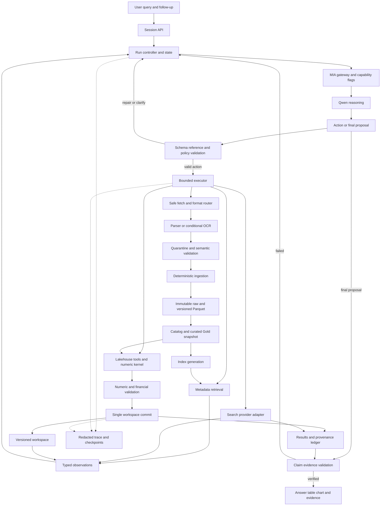

# KKB Agentic Data Analytics: Kanıt, Deney ve Mimari Kararlar

Bu raporun önerisi, tek MIA karar döngüsünü sürümlü analiz çalışma alanı, deterministik hesaplama ve zorunlu doğrulama ile birleştirmektir. Ancak seçim, altı mimarinin yarışma verisinde karşılaştırılarak kazandığı bir sonuç değildir. Mevcut gereksinimler, birincil kaynaklar ve sınırlı deneylerden türetilmiş, kabul kapıları tanımlanmış bir mühendislik önerisidir.

Kanıt kesim tarihi 10 Eylül 2026'dır. Yerel belgelerde anlatılan uygulama ile bu checkout'ta bulunan uygulama ayrılmalıdır: `src/kkb_agent`, gerçek Lakehouse, `contracts/lakehouse_tools.json`, `scripts/run_golden.py` ve raporlanan 7/7 golden koşusunun ham çıktıları burada bulunmuyor. Dolayısıyla mevcut harness'ın çalıştığı, sayısal doğruluğu veya V3'ün performansı bu incelemede doğrulanmış değildir. Mevcut dosyalar korunmuş; bu rapor bağımsız denetim olarak eklenmiştir.

Kanıt sınıfları:

| Etiket | Anlamı |
|---|---|
| `[ORGANIZER-CONFIRMED]` | Açılış slaytlarında doğrudan görülen açıklama; slayt numarası belirtilir |
| `[ORGANIZER-CONFIRMED — aktarım]` | Sağlanan talepte organizatörden aktarılan yazılı yanıt; orijinal mesaj bu checkout'ta yok |
| `[DOCUMENTED]` | Rehber, resmî ürün belgesi veya ekip sözleşmesinde yazılı; belgenin sahibi ayrıca belirtilir |
| `[EMPIRICALLY VERIFIED]` | Bu çalışma sırasında gerçekten çalıştırılmış deney; kapsam ve örneklem belirtilir |
| `[SOURCE-BACKED]` | Birincil yayın tarafından desteklenen, o yayının kapsamıyla sınırlı bulgu |
| `[INFERENCE]` | Kanıtlardan çıkarım; doğrudan kural/ölçüm değil |
| `[ASSUMPTION]` | Henüz sınanmamış çalışma varsayımı |
| `[RECOMMENDATION]` | Uygulanması önerilen tasarım veya kabul eşiği |

Eski `mia_capability_matrix.md` ve son kontrolde görülen `docs/experiments/` raporları **önceki yerel ölçüm kayıtları** olarak kullanılır. Kayıtların varlığı doğrulanmıştır; bütün sonuçları bu oturumda tekrar ölçülmüş sayılmaz. Yeni API denemeleri bağlantı hatasıyla durdu. Bu oturumda yeni dense, OCR, tool round-trip veya schema enforcement başarı sonucu yoktur. Ek D, ekibin ayrı retrieval/OCR/context deneylerini ve sınırlarını içerir. Ayrıntılı yeni gözlem dosyası: [mia_observations.json](research_audit/mia_observations.json).

## PART 1 — Competition Intelligence

Yarışmanın görünür hedefi yalnız doğal dili SQL'e çevirmek değildir. Açılış slaytları veri keşfi, temizlik/hizalama, agentic analiz, anomali/değişim/ilişki analizi ve doğrulamayı tek uçtan uca süreç olarak gösteriyor. Slayt 5'te üç ardışık soru vardır: 2021–2025 konut kredisi/faiz tablosu, tablo korunarak reel kredi hesabı, yine tablo korunarak konut fiyat endeksi eklenmesi. Bu, sohbet geçmişinden daha güçlü bir **kalıcı analiz tablosu sözleşmesi** gerektirir. [^L1]

| Sınıf | Çıkarılan gereksinim | Dayanak ve doğrulama |
|---|---|---|
| Açık | BDDK haftalık/aylık/FinTürk ve EVDS verileri; Ocak 2021–Haziran 2026 kapsamı | Slayt 2–3; kaynak bazlı coverage manifesti |
| Açık | Doğal dili anlama, veri/araç seçme, çok adımlı analiz, doğrulama ve kaynak gösterme | Slayt 1 ve 9; uçtan uca trace |
| Açık | Mevcut tabloyu bozmadan dönüşüm ve kolon ekleme | Slayt 5; row-key ve korunacak kolon hash karşılaştırması |
| Açık | Demo sorusundaki URL'den PDF, Excel, görsel ve metin okuma | Slayt 6; farklı biçimlerde unseen dosyalar |
| Açık | Lakehouse, Web Search, Web URL Agent, Anomali, Causality, Change Detection araç aileleri | Slayt 9; yetenek/örnek/tool eşleştirmesi |
| Örtük | Metadata, birim ve kümülatiflik olmadan doğru analiz yapılamaz | `[INFERENCE]`; slayt 2'de kümülatiflik uyarısı |
| Örtük | Yeni kaynakta semantic belirsizlik ifade edilmeli | `[INFERENCE]`; URL sürprizi ve genericlik hedefi |
| Jüri sinyali | İzlenebilir sonuç ve görünür doğruluk kontrolleri değerli | Slayt 1'in güven katmanı; puan ağırlığı bilinmiyor |

Resmî etkinlik sayfasında çevrimiçi çalışma 7–20 Eylül, fiziksel final 17 Ekim olarak veriliyor. Python beklentisi ve bazı framework/veritabanı örnekleri var. Liste, tek başına her sayılan ürünün zorunlu olduğu anlamına gelmez. **20 Eylül'de repo dondurma**, bu sayfadan doğrulanamıyor. [^S1]

Başlıca başarısızlık tuzakları: birkaç sabit seri koduna göre demo hazırlamak; tabloyu takip sorusunda yeniden oluşturmak; kredi stoğunu akımla karıştırmak; her URL'yi OCR'a göndermek; RAG cevabındaki sayıyı hesap sonucu sanmak; dokümanda yazan uygulamayı çalışan kod kabul etmek.

## PART 2 — Confirmed Constraints

| Kural / bilgi | Durum ve kaynak | Tasarıma etkisi |
|---|---|---|
| Ana model `kkbhackathon2026/Qwen3.8-27B`, `/v1/chat/completions` | `[DOCUMENTED]` MIA rehberi | Model adını aynen koru; upstream isimle otomatik değiştirme |
| Base URL `https://mia.csp.kloudeks.com/v1` | `[DOCUMENTED]` rehber | Backend gateway; credential yalnız bu hedefe |
| Embedding `kkbhackathon2026/Qwen3-Embedding-8B`, `/v1/embeddings` | `[DOCUMENTED]` rehber | Dense metadata retrieval adayı |
| Qwen ≤5, OCR ≤3 görsel/prompt | `[DOCUMENTED]` rehber | Uygulama düzeyinde sınır; tek görsel testi limit testi değildir |
| OCR `kkbhackathon2026/Unlimited-OCR`; PDF sayfaları görsele çevrilir | `[DOCUMENTED]` rehber | Doğrudan PDF desteği varsayma |
| Takıma özel request/token limiti yok; kapasite artırılabilir | `[ORGANIZER-CONFIRMED — aktarım]` | Sonsuz concurrency/context garantisi değildir |
| Retry/backoff ve temel hata kontrolü öneriliyor | Aynı aktarım | Merkezi süre bütçesi, hata sınıflaması |
| Search/scraping uygun; Tavily ve Firecrawl örnek | Aynı aktarım | Provider adapter; MIA reasoning'den ayrı |
| Local sentence-transformer/reranker/BM25 kullanılabilir | Aynı aktarım | Yalnız retrieval/ranking yardımcısı |
| Ana LLM MIA kalır | Aktarım + slayt 8 | Üretim/geliştirme agent testlerinde başka reasoning LLM'i varsayılan yapma |
| Snowflake/BigQuery gibi cloud warehouse kısıtı | Organizatör aktarımı | DuckDB/Parquet teknik aday; teknolojiye özel kesin izin iddiası yok |
| API key frontend/repo/görüntü/sunum içinde olmaz | Rehber | `.env`/backend; log redaksiyonu |

Rehberdeki OCR kontratı: metin `<image>\ndocument parsing`; tek görselde `skip_special_tokens=false`, `vllm_xargs={ngram_size:35, window_size:128}`, çoklu görselde `window_size:1024`. Rehber örneğinde `temperature:0`, `max_tokens:8192` var. Bunlar örnek ayarlarıdır; modelin toplam context limiti olarak okunmamalıdır. [^L2]

Slayt 8 geliştirme süreçlerinde de Kloudeks üzerinden erişilen modelleri işaret ediyor. `.env.example` içindeki Ollama geliştirme varsayılanı bu metinle uyumlu olduğu doğrulanmış bir tercih değildir. Retrieval yardımcı model izni, yerel reasoning LLM izni değildir. Bu rapor `.env` veya mevcut takım dosyalarını değiştirmez; MIA ile gerçek agent testleri ve servis çağırmayan unit testleri önerir.

## PART 3 — Open Questions

| Soru | Neden kararı değiştirir? | Yanıt gelene kadar davranış |
|---|---|---|
| EVDS'de bütün serilerin fiziksel indirilmesi mi, keşfedilebilir olması mı bekleniyor? | Katalog keşfi ile veri materialization farklı işler | Tüm seri inventory'si hedefle; ingest edilmiş/edilmemiş coverage'ı açıkça göster; tamamını indirdik deme |
| FinTürk'ün hangi kırılımları ve frekansı gerekli? | İl, banka grubu ve dönem join grain'i | Kaynak metadata'sını doğrulamadan haftalık/aylık veri üretme |
| Jüri rubriği, başarı ölçütleri ve demo süresi? | Öncelik ve sunum şekli | Slayt akışını acceptance test yap; puan ağırlığı uydurma |
| 20 Eylül sonrası kod değişikliği/repo freeze kuralı? | Yol haritası | 20 Eylül'e teslim edilebilir sürüm hazırla; sonrası değişiklikleri izinli sayma |
| DuckDB/Parquet ve gerekirse PostgreSQL için açık izin? | Storage kararının organizasyon tarafı | Yerel aday olarak tanımla; cloud warehouse'a geçme |
| MIA server sürümü, context, concurrency, hata/retry kontratı? | Gateway ayarları | Gözlenen request boyutunu toplam limit sanma |
| Native tools ve schema desteği için deploy garantisi var mı? | Framework adapter seçimi | Capability flags + strict uygulama doğrulaması |
| Demo interneti ve kaynak erişim yöntemleri? | Yeni URL akışının erişilebilirliği | Tarihli cache ve açıklanabilir eksik sonuç |
| Data ekibinin gerçek contract JSON'u, stub'ı ve iki doğrulanmış seri örneği nerede? | Uygulama entegrasyonunun başlangıcı | Buradaki Markdown'u interface önerisi say; çalışan modül sayma |

Bu sorular organizatöre gönderilmiş değildir. Orijinal organizatör yazışmaları mevcutsa kısıt kayıtlarına kaynak kimliği ve tarih eklenmelidir.

## PART 4 — MIA Capability Matrix

`Qwen/Qwen3.8-27B` upstream model kartı uzun context ve multimodal kullanım belgeliyor; bu MIA'nın aynı limitleri sunduğunu kanıtlamaz. `Qwen3-Embedding-8B` kartı 4096'ya kadar boyut, farklı boyut seçenekleri ve instruction kullanımı belgeliyor; gateway'in `dimensions` parametresini kabul etmesi ayrıca sınanmalıdır. [^S2] [^S3]

Aşağıda “önceki kayıt”, [yerel matrisi](mia_capability_matrix.md); “yeni” ise `research_audit/mia_observations.json` dosyasını ifade eder.

| Capability | Resmî MIA rehberinde? | Organizatör teyidi? | Test tasarımı | Sonuç / sınır | Mimari etkisi |
|---|---|---|---|---|---|
| Basic chat / model adları | Evet; `/models` hayır | Rehber | Tam endpoint, model ve 200/content kontrolü | Önceki kayıt OK; yeni bağlantı hatası | Deploy smoke test zorunlu |
| System message davranışı | Hayır | Yok | Çelişen user talimatı; format ve anlam ayrı | Önceki basit test 7/10; güvenlik oranı değildir | Tek system başlangıçta; politika kodda |
| İkinci system konumu | Hayır | Yok | Başlangıç sonrası system mesajı | Önceki kayıt 400 | Workspace'i ayrı ikinci system olarak ekleme |
| JSON parse | Hayır | Yok | Çeşitli 30+ soru; ham JSON/extract/repair ayrı | Önceki 27/30 ham, 30/30 extract; schema doğruluğu ölçülmedi | Parse ≠ geçerli plan |
| JSON Schema enforcement | Hayır | Yok | enum/tip/range/extra alan; çelişen prompt ve kontrol kolu | Önceki test yalnız required anahtarlar; garanti belirsiz | Her action local schema + reference validation |
| Native tool proposal | Hayır | Yok | İsim/argüman/call ID doğrula | Önceki tool_calls var | Native yol aday |
| Tool-result round-trip | Hayır | Yok | Gerçek `role=tool` sonucu, aynı call ID, sonuçtan doğru devam | Eski betikte yok; yeni henüz çalışmadı | Framework uyumunun eksik kabul testi |
| Parallel tools | Hayır | Yok | İki bağımsız iş; argüman, ID, sonuç birleştirme | Önceki 3 koşuda 3 çağrı; bağımlılık güvenliği yok | Executor bağımlılığı kendisi denetler |
| Thinking / effort | Hayır | Yok | Aynı görev, kontrollü on/off, kalite+süre | Önceki reasoning alanı ve kapatma gözlenmiş | Gerektiğinde kullan; otomatik kalite üstünlüğü yok |
| Uzun prompt | Hayır | Yok | Artan uzunluk; hedef baş/orta/son; truncation+usage | Önceki probe 49.871; ek E8 raporu 90.854 ortalama prompt token bildiriyor (Ek D) | Hiçbiri toplam context üst sınırı değildir |
| Streaming | Hayır | Yok | Geçerli SSE JSON/delta, tamamlanma, kesinti | Önceki 6 data satırı | Chunk sayısı tam protokol testi değildir |
| Seed/logprobs | Hayır | Yok | Çok görev, seed değişimi, ham protokol | Seed ile 5 aynı cevap; logprobs doğrulanmamış | Determinizm garantisi verme |
| Prefix/prompt cache | Hayır | Yok | Randomize cold/warm kollar, TTFT ve token telemetry | Önceki 0,90/0,92 sn; açık/kapalı bilinmiyor | Cache'e bağımlı SLA kurma |
| Latency ve concurrency | Hayır | Kota aktarımı var | Kısa/uzun görev, n, başarısızlık, p50/p95, yük | Önceki n=5 kısa p50 0,16 sn; 5 eşzamanlı 200 | Sürekli throughput/SLA ölçümü değil |
| Error ve retry | Rehberde 401/403/429 rehberliği | Backoff aktarımı var | 429 Retry-After/5xx/timeout simülasyonu; gerçek hata gövdesi | Önceki yanlış model 403 | Yanlış model/anahtar retry edilmez |
| Embedding/batch | Endpoint evet | Model rehberde | Boyut, finite, index sırası, boş/batch, truncation | Önceki 4096, batch64 200, dimensions1024 400 | Tam boyut başlat; 64 üst sınır değil |
| Multimodal | Evet, ≤5 | Rehber | Sentetik görselde known text, 1/5/6 giriş | Eski matriste sonuç yok | Limits + doğruluk bağımsız test |
| OCR | Evet, ≤3 | Rehber | Hücre adresli ground truth; 1/3/4 görüntü | E7 raporu ve PDF fixture var; hücre bazlı oracle/ham OCR cevabı burada sunulmuyor (Ek D) | Tek sayfa raporunu genel OCR doğruluğu sayma |

Yeni [mia_evidence_audit.py](../../scripts/mia_evidence_audit.py), sentetik verilerle sıkı JSON doğrulaması, system çatışması, tool round-trip, küçük concurrency, multimodal ve embedding kontrolünü hazırlar. Maksimum context, sunucu yük limiti, logprobs veya geniş OCR doğruluğunu ölçtüğü iddiasında değildir. Rehberin dokümante etmediği parametreler deneysel test girdileridir.

**Önceki test yorumlarına düzeltmeler:** Aynı basit sorunun beş kez aynı yanıtlanması seed'in etkisini izole etmez. `max_tokens` ile kesilen yanıt şema başarısızlığından ayrılmalıdır. Sistem talimatına uyum testi Türkçe büyük harf/tek kelime ölçümüyle finansal güvenilirliği ölçmez. HTTP 200, desteklenmeyen parametrenin sessizce yok sayılmadığını kanıtlamaz. `%93` gibi küçük örneklem eşikleri gerçek garanti değildir; 30/30 başarı bile tüm gelecek isteklerin doğru olacağını göstermez.

## PART 5 — Literature Review

Her satırın “KKB kararı” kısmı `[RECOMMENDATION]`; yayın bulgusu `[SOURCE-BACKED]` kapsamındadır. Başka benchmark'lardaki hız/doğruluk değerleri KKB'ye taşınmamıştır.

| Yaklaşım | Teknik mekanizma ve çözdüğü problem | Güçlü yan / failure mode | MIA ihtiyacı, KKB karşılığı ve deney |
|---|---|---|---|
| ReAct / tool-using agent [^S4] | Eylem ve gözlem dönüşümlü; sonraki karar yeni bilgiyle alınır | Bilinmeyen şemaya uyum; gereksiz tur ve döngü riski | Metin JSON ile de kurulabilir; discovery → inspect → hesap; bounded loop vs sabit plan |
| Plan-and-execute / ReWOO [^S5] | Plan ve araç gözlemlerini ayrıştırır; bağımlı sonuç referansları | Tekrarlanan context azalabilir; eski/yanlış plan uzun süre sürer | Native tools şart değil; bilinen çok serili hesapta aday; yeni URL'de replan gerekli |
| LLMCompiler [^S6] | Planlayıcı, bağımlılık gözeten görev dağıtıcı ve executor | Bağımsız araçları paralelleştirir; hatalı bağımlılık tanımı veri yarışına yol açar | Aynı tur çok tool tek başına yeterli değil; snapshot read paralelliğini seri baseline ile kıyasla |
| Supervisor / hierarchical multi-agent [^S7] | Üst rol alt hedefleri farklı bağlamlara dağıtır | Bağımsız uzun alt görevler; handoff kaybı, uyuşmayan durum, bitiş/doğrulama hatası | MIA ile mümkün, bu projede üstünlüğü ölçülmedi; P0'da ekleme |
| Graph workflow [^S8] | Tipli state, node ve koşullu edge; checkpoint üzerinden devam | Kontrol ve resume; yanlış state merge ve replayed side-effect riski | Node içindeki custom MIA adapter yeterli; graph bir agent sayısı değildir |
| Reflection / Self-Refine [^S9] | Üretileni eleştirip yeniden üretir | Düzeltme sağlayabilir; yanlış cevabı güçlendirebilir | Dış doğrulama olmadan sayısal hakem yapma; tek evidence-aware repair ile kıyasla |
| Reflexion [^S10] | Geri bildirimden metinsel episodic memory tutar | Tekrarlayan hataya uyum; yanlış derslerin kalıcılaşması | Ağırlık eğitimi gerektirmez; session-local hata notu, global serbest hafıza değil |
| Agent memory / structured state [^S8] | Konuşma yerine state ve sonuç referansları | Daha küçük context, replay; stale snapshot/policy sürümü riski | Workspace/catalog/tool/schema version birlikte tutulur; restart ve takip sorusu testi |
| Routing / task decomposition [^S11] | İş sınıflarını ayrı yeteneklere yönlendirme | Küçük araç yüzeyi; erken yanlış rota gerekli aracı gizler | Ayrı intent LLM turu şart değil; loop içi karara izin ver, route geri dönüşü olsun |
| SQL/data analysis agents [^S12] | Şema bağlamı + sorgu + yürütme geri bildirimi | Esnek sorgular; çalışabilen fakat yanlış SQL | Referans/metric/grain validation; execution accuracy ile sayısal gold ayrı |
| Agentic RAG | Sorgu/retrieval/inspect adımları gözleme göre değişir | Belirsiz metadata çözümü; sonsuz arama, retrieval sonucu yanlış kabulü | Tabular hücreleri embed ederek hesaplatma; metadata/docs içeriğini bul |
| Metadata/data engineering agent [^S13] [^S14] | Profil ve tablo bağlamından semantic tip/mapping önerisi | Eksik açıklamada yardımcı; finansal anlam sadece değerlerden kesin çıkmaz | LLM önerisi `proposed`; doğrulanmış mapping olmadan Silver'a terfi yok |
| Agent evaluation [^S15] | Son durum ve politika uyumunu tekrarlar arasında ölçer | Tek başarılı demo yanıltıcı olabilir | pass^3: üç koşunun hepsinin başarılı olduğu görev oranı; her koşu bağımsız temiz state |

Retrieval literatüründe BEIR farklı alanlarda yöntemlerin sıralamasının değişebildiğini gösterir; BM25 güçlü bir baseline, dense/reranker ise ölçülmesi gereken adaylardır. Qwen embedding ailesinin çok dilli performansı schema matching için motivasyondur, Türkiye bankacılık kolonlarında üstünlük kanıtı değildir. RRF, normalize edilmemiş sparse/dense skorlarını toplamaya alternatif olarak sıraları birleştirir. [^S16] [^S3] [^S17]

Lakehouse yayını açık dosya formatları ile veri yönetimini birleştiren yaklaşımı anlatır. Parquet klasörlerine Bronze/Silver/Gold adı vermek otomatik transaction, schema evolution veya time travel sağlamaz. Önerilen yerel tasarım bunları manifest, versiyonlu çıktı ve atomik catalog publish ile açıkça uygular; enterprise ACID lakehouse eşdeğerliği iddia etmez. [^S18]

### Framework karşılaştırması

“Destek” dokümante edilen mimari olanağı ifade eder; bu checkout'ta framework→MIA canlı round-trip deneyi yapılmadı. Dolayısıyla hiçbir framework için **MIA uyumu ampirik doğrulandı** denemez. Aşağıdaki maliyet değerlendirmeleri ekip deneyimi bilinmediği için nitel mühendislik yargısıdır.

| Framework / pattern | State, graph, planning ve tools | Retry, persistence, observability, HITL | Custom/OpenAI-compatible yol ve structured output | Karmaşıklık / karar |
|---|---|---|---|---|
| Custom Python | Açık RunState + tool registry; planning MIA'da | Retry/checkpoint/trace/clarify uygulamada | HTTP adapter; JSON schema uygulamada | Az bağımlılık, kontrol yükü bizde; P0 adayı |
| LangGraph [^S8] | StateGraph, koşullu workflow; özel planner node | Checkpoint, resume, interrupt, tracing entegrasyonu | Custom HTTP node; LangChain şart değil | Orta; resume gereksinimi için en yakın alternatif |
| LangChain [^S19] | Hazır agent/model/tool katmanı; graph tabanlı çalışabilir | Provider retry + LangGraph state/persistence; LangSmith opsiyonel | ChatOpenAI `base_url`; provider özel alanlar için adapter gerekebilir | Orta; wire payload contract testi olmadan drop-in deme |
| AutoGen [^S20] | AgentChat konuşmaları, Core event runtime; tek/çok agent | State/termination uygulama ve framework katmanında; sürümü pinle | OpenAI extension/custom client; model bilgisi açık ayarlanmalı | Çok-agent altyapısı P0 ihtiyacını aşıyor |
| Semantic Kernel [^S21] | Plugin/tool, agent thread, orchestration | Orchestration API geçiş riski; persistence seçimi ayrı | Chat completion service adapter; format provider'a bağlı | Mevcut SK kodu yok; yeni proje için migration yönünü incele |
| Microsoft Agent Framework [^S22] | Agent/workflow, conversation/memory, orchestration | Checkpoint/resume, HITL, middleware | Python OpenAIChatCompletionClient için `base_url` belgeli | Orta; Microsoft ekosisteminde aday, MIA test gerekli |
| LlamaIndex [^S23] | Retrieval odaklı bileşenler ve tipli event workflows | Workflow timeout/stream events; kalıcılık deployment seçimi | Custom LLM katmanı değerlendirilebilir; tam adapter bu araştırmada doğrulanmadı | Belge retrieval yoğunlaşırsa yararlı; P0 zorunlu değil |
| CrewAI [^S24] | Crews/roles + Flows state, branching, events | Persistence/checkpoint/HITL özellikleri ayrı konfigürasyon | Custom LLM/compatible provider yolu; yapılandırılmış çıktı yine doğrulanmalı | Rol mimarisi iş ihtiyacı olmadan eklenmez |
| PydanticAI [^S25] | Tipli input/output/dependency, tool ve çok-agent pattern | Validation retry; persistence ve telemetry ayrı bileşen | OpenAIChatModel + OpenAIProvider(base_url); model profile gerekebilir | Tipli tool loop için güçlü aday; yetenekler koşullu |
| smolagents [^S26] | MultiStepAgent; code/tool calling, memory | Bounded steps; telemetry ve sandbox seçenekleri | OpenAIServerModel/custom model adapter | ToolCallingAgent değerlendirilebilir; serbest CodeAgent P0'a alınmaz |
| DSPy [^S27] | Signature/module, ReAct, optimizer | Kalıcı serving orchestration'ın doğrudan alternatifi değil | LM adapter ve prompt/format kalite testi gerekir | Etiketli train/dev set varsa P2 prompt optimizasyonu |
| OpenAI Agents SDK [^S28] | Agent/runner, tools, orchestration/guardrails pattern | State ve observability ayrı tasarım yüzeyleri | Models/provider override dokümante; MIA Chat Completions yolunu özel doğrula | Pattern öğrenilebilir; OpenAI hosted model/tool'u yarışma runtime'ına taşıma |
| Anthropic patterns [^S11] | Chaining, routing, parallelization, evaluator, agent | Bütçe/stop/recovery uygulamada | Provider bağımsız fikirler; Claude kullanmak gerekmez | “En basit yeterli yapı” yaklaşımı uygulanabilir |
| Google ADK [^S29] | LLM agent, workflow/template ve custom orchestration | Session/state; workflow ve insan müdahalesi tasarımı | MIA için compatible/custom model yolu ayrıca spike gerektirir | Çok-agent/Google servis ihtiyacı yoksa P0 ek yük |

Sürüm ve sağlayıcı bağımlılığı için seçilen iki adayda aynı kontrat testi uygulanır: yalnız MIA hostuna istek; model adı aynen; bir tool çağrısı, tool sonucu, final; bir schema hatası; bir timeout; yarım kalan run'dan resume; beklenmeyen telemetri çıkışının olmaması. Framework dökümantasyonu bu kabul testinin yerine geçmez. Microsoft'un AutoGen/Semantic Kernel'den Agent Framework'e geçiş rehberleri bulunduğundan, eski örneklerin güncel API gibi kullanılmaması gerekir. [^S22]

## PART 6 — Financial Analytics Requirements

Hesap motorunun doğruluğu yalnız formülden gelmez; ölçü tanımı, popülasyon, dönem, birim ve vintage birlikte doğru olmalıdır. Finans profili core'dan ayrıdır, ama typed metadata kontrolleri generic core'un sorumluluğudur.

| Kavram | Doğru işlem | Engellenecek yanlış sonuç |
|---|---|---|
| Stok | Tam dönem sonu gözlemini kullan; dönem sonu eksikse uyar | Aylık bakiyeleri toplayıp yıllık kredi hacmi demek |
| Akım | Dönemsel akımı uyumlu kapsama göre topla | Kredi stoğu farkına yeni kredi kullandırımı demek |
| YTD kümülatif | Aynı yıl ve ardışık dönemlerde fark; yıl ilk dönemi reset tanımına göre | Mart−Ocak farkını yalnız Mart saymak |
| Başlangıçtan kümülatif | Ardışık fark + reset/revizyon kontrolü | Kaynak revizyonunu ekonomik negatif akım sanmak |
| Oran / faiz | Pay-payda veya doğrulanmış ağırlık/metodoloji | Haftalık ağırlıklı faizlerin basit ortalamasını resmî aylık ağırlıklı faiz diye sunmak |
| Sayı/adet | `count` tek başına aggregation belirlemez; stock/flow anlamı ayrıca gerekir | Aylık konut satış adedine her durumda `last` uygulamak |
| Birim | Kaynak değerini koru; TRY/bin/milyon dönüşümünü kaydet | Bin TL ile milyon TL'yi aynı toplama sokmak |
| Yüzde / puan | 40→35: −5 yüzde puan, göreli −%12,5 | −%5 demek |
| Nominal/reel | `real_t = nominal_t × CPI_base / CPI_t` | KFE ile TÜFE'yi aynı ekonomik sorunun deflatörü saymak |
| MoM/YoY/QoQ | Uygun takvimde `100 × (x_t/x_{t-k}−1)` | Eksik dönemde satır kaydırarak yanlış önceki ayı kullanmak |
| CAGR | Pozitif başlangıç/bitiş, açık yıl süresi: `(end/start)^(1/years)−1` | Negatif/sıfır başlangıçta anlamsız oran üretmek |
| Frekans | Her seri için downsample kuralı; publication lag ayrı | Eksik haftaları sessiz doldurmak veya gelecekte açıklanan değeri geçmişe taşımak |
| Join | Grain, kapsam, key uniqueness, cardinality, temporal ilişki | Şehir ve Türkiye toplamını veya subtotal+bileşeni birlikte toplamak |
| Revizyon | Referans dönemi + yayımlanma/çekim tarihi + vintage | Eski cevabı yeni vintage ile sessiz değiştirmek |

TCMB haftalık akım kredi faizi metaverisi, konut faizinin sabit faizli kredileri kapsadığını, efektif yıllık oranlardan ağırlıklandırıldığını ve revizyon yapılabildiğini açıklıyor. Bu seriyi “bütün mevcut mortgage borcunun faizi” diye adlandırmak doğru değildir. Haftalık oranların basit aylık ortalaması kullanılacaksa bu **analitik özet**, kullanılan gözlem sayısı ve eksik haftalarla birlikte belirtilmelidir; resmî stok faizi başka bir istatistiktir. [^S30] [^S31]

Stok farkı finansal işlemler yanında yeniden değerleme ve diğer hacim değişikliklerinden de etkilenebilir. Bu nedenle bakiye değişimini otomatik yeni kredi akımına dönüştürmeme kuralı yerindedir. Buna karşılık **stok farkını tamamen yasaklamak** da yanlıştır: “net bakiye değişimi” adıyla geçerli bir analizdir. [^S32]

Konut kredisi bakiyesi TÜFE ile deflate edildiğinde tüketim sepeti satın alma gücü ölçeğinde reel bakiye elde edilir; kredi adedi veya finanse edilen konut miktarı elde edilmez. KFE ile ölçekleme farklı soruya yanıt verir. Endeks baz değişiminde yalnız `2023=100` etiketi değil, örtüşen dönem ve metodoloji sürekliliği de incelenmelidir.

Anomali için başlangıç baseline'ı rolling median/MAD; mevsimsel yeterlilik varsa STL residual. Change detection için PELT benzeri yöntem bir adaydır; kırılma cezası ve minimum segment uzunluğu açık olmalı. Çok sayıda lag/rejim deneyip yalnız en anlamlı olanı seçmek engellenmeli; önceden belirlenmiş analiz planı, çoklu test düzeltmesi ve block-bootstrap gibi zaman bağımlılığını gözeten belirsizlik yöntemi değerlendirilmelidir.

`Causality Tool` için P0 çıktısı gözlemsel ilişki ve yöntem kısıtıdır. Granger testi geçmiş X'in, geçmiş Y üzerine ek öngörü bilgisi sağlayıp sağlamadığını sınar; ekonomik müdahale nedenselliğini kanıtlamaz. statsmodels'ta ikinci sütun birinciyi açıklayan adaydır ve eksik değerler desteklenmez. “n≥30 ise Granger güvenlidir” kuralı yeterli değildir: lag sayısı, etkin örneklem, stationarity/cointegration, residual tanısı, kırılmalar ve değişken seçimi gerekir. [^S33]

## PART 7 — Retrieval Bake-Off Design

Çalıştırılan [tanı seti](../../tests/benchmark/retrieval_audit_fixture.json) 20 sentetik metadata kaydı ve 36 sorgu içerir. 32 cevaplanabilir sorgu IR metriğine girer; iki eksik veri, bir belirsiz ve bir adversarial sorgu ayrı tutulur. Bu ayrım, retrieval sıralamasını agent'ın doğru reddetme davranışıyla karıştırmaz. Fixture model çağrısından önce oluşturuldu; soru başına ranking ve evaluator/fixture hash'leri kaydedildi.

| Yöntem | Recall@1 | Recall@3 | Recall@5 | Precision@1 | Precision@3 | Precision@5 | MRR | nDCG@5 | Durum |
|---|---:|---:|---:|---:|---:|---:|---:|---:|---|
| Basit Unicode BM25 | 0,6250 | 0,8125 | 0,8438 | 0,6563 | 0,2917 | 0,1813 | 0,7461 | 0,7562 | `[EMPIRICALLY VERIFIED]`, n=32 |
| MIA dense | — | — | — | — | — | — | — | — | API erişilemedi |
| Local sentence-transformer | — | — | — | — | — | — | — | — | Çalıştırılmadı |
| BM25+dense RRF | — | — | — | — | — | — | — | — | Dense vektör yok |
| Hybrid+reranker | — | — | — | — | — | — | — | — | Çalıştırılmadı |

Sonuçlar: [retrieval_results.json](research_audit/retrieval_results.json). BM25 `k1=1.5`, `b=0.75`; stemming/stopword yok, Türkçe I/İ/ı normalizasyonu var. Bu, DuckDB FTS implementasyonunun ölçümü değildir. Çok ilgili belgeli sorularda Recall@1 ile Precision@1'in farklı olması beklenir. Precision@5'in düşük olması, çoğu soruda tek relevant belge bulunmasının da sonucudur; tek başına kötü retrieval iddiası değildir.

Ekibin ayrı [retrieval bake-off raporu](../experiments/RETRIEVAL_bakeoff.md), 300 sentetik seri/50 sorguda BM25 R@3=0,96 ve hybrid R@3=0,98 bildiriyor. Bu oturumun bağımsız 20/36 fixture'sıyla aynı deney değildir; oranlar birleştirilemez. Bu önceki kayıt hybrid için olumlu fakat tek soruluk ek başarı sinyalidir; kaynak/schema bazlı kör set ve paired belirsizlik analizi hâlâ gereklidir. Ayrıntı Ek D'de.

Bu küçük tanı seti, açıklayıcı alias'larla kolaylaştırılmıştır ve aynı kişi tarafından yazılan soru/metadataya bağlıdır. Başarı oranlarını yarışma setine genellemek, dense'in kazanacağını söylemek veya eşik kalibre etmek için kullanılamaz. Toplam pipeline gecikmesi/RSS bellek ölçülmedi; dosyadaki birleşik ranking CPU zamanı ağ, embedding ve index build süresini içermez.

Asıl bake-off `[RECOMMENDATION]`: en az 120 query, tablo/kaynak aileleriyle ayrılmış train/dev/test; Türkçe/İngilizce, kısaltma, eşanlamlı, unit/stock-flow hard negative, alias'sız schema, eksik açıklama, gerçek unseen dataset. İki bağımsız etiketleyici, disagreement çözümü; relevance 0/1/2; görünmeyen test etiketleriyle prompt/alias üretme yok. Missing-data setinde precision-recall/coverage-risk eğrisi ayrıca.

Karşılaştırmalar: exact+alias; BM25; MIA full-dimension dense; yerel çok dilli sentence-transformer; BM25+dense RRF; aynı aday havuzuna reranker. MIA doküman ve sorgu şablonları versiyonlu; yerel modelin adı/revision/lisansı ve CPU/GPU donanımı sonuçta kayıtlı. Türkçe task instruction vs İngilizce instruction yalnız dev sette seçilir. Boyut kısaltma ayrı ablation'dır, varsayılan bir “ücretsiz optimizasyon” değildir.

Başarı kapısı: query-level paired bootstrap ile Recall@5 ve nDCG@5 farkı; downstream doğru seri seçimi ve kritik semantic hata sayısı; p50/p95 end-to-end süre, peak RSS/VRAM, disk/index build zamanı. Önerilen seçim kuralı: kazanımın belirsizlik aralığı sıfırın üzerinde, kritik hata artışı yok ve demo süre bütçesine uyuyor. `+3 puan` gibi pratik etki hedefi önceden belirlenebilir; küçük setten sonra kazananı seçmek için değiştirilemez.

## PART 8 — Architecture Alternatives

| Mimari | Gerçek tasarım | Nerede iyi? | Temel zayıflık |
|---|---|---|---|
| A: Single Qwen + araçlar | Her tur gözlem→action; uygulama executor'u | Yeni URL/schema ve kısa takip sorusu | Sınırsız loop, state karışması ve zayıf doğrulama |
| B: Planner + deterministic executor | Başta plan DAG; araçlar planı yürütür | Bilinen veri ve bağımlılıklar | Yeni gözlem plana sığmaz; baştan plan hatası |
| C: Bounded adaptive loop + validator | MIA güncel hedef/action seçer; tipli executor, checkpoint, claim validation | Keşif + hesap + takip + kısıtlı recovery | Doğrulama/kernel uygulama yükü |
| D: Supervisor + specialists | Veri, finans, web için ayrı konuşma/state | Bağımsız büyük araştırma alt görevleri | Aynı model hatası, el değiştiren kanıt, ek çağrı |
| E: LangGraph workflow | C veya B'nin graph runtime içinde uygulanması | Resume, insan bekleme ve branching | Framework state/merge/replay öğrenme maliyeti |
| F: Hierarchical multi-agent | Çok seviyeli plan ve uzman alt ağaçları | Çok büyük görev/corpus ayrıştırma | Hackathon için en yüksek koordinasyon yükü |

E diğer mimarilerle aynı eksende değildir: bir orchestration implementation seçeneğidir. “LangGraph vs multi-agent” ikiliği bu nedenle hatalıdır. A'ya doğru state, guard ve recovery eklenirse C'ye yaklaşır; C'de her adım için ayrı Planner/Narrator/Validator LLM rolü gerekmez.

## PART 9 — Architecture Comparison

Ölçülmemiş doğruluğa sayısal 9/10 puan verilmemiştir. Tüm nitel kıyaslar `[INFERENCE]`; ekip framework deneyimi ve gerçek görev dağılımıyla değişebilir.

| Kriter | A | B | C | D | E: C+LangGraph | F |
|---|---|---|---|---|---|---|
| Doğruluk | Bilinmiyor | Bilinmiyor | Bilinmiyor; guard yüzeyi daha açık | Bilinmiyor | C'nin mantığına bağlı | Bilinmiyor |
| Model-call sayısı | Turla artar | Plan+yorum+replan | Gözleme bağlı; kolay soruda kısa yol | Handoff/review ile artar | C ile benzer | Genellikle daha fazla |
| Gecikme | Seri tool turu riski | Bağımsız DAG avantajı | Güvenli paralel read'ler | Bağımsız görevde yarar olabilir | C'ye yakın runtime ek yükü | Koordinasyon riski |
| Hallucination yüzeyi | Tool argümanı+cevap | Plan+yorum | Aynı yüzey, çalışmadan önce gate | Alt agent iddiaları da eklenir | C ile aynı | Çok sayıda handoff |
| State/debug | Küçük başlayıp büyür | Açık plan | Açık snapshot/action/ledger | Dağınık konuşmalar | Checkpoint tooling avantajı | Karmaşık |
| Failure recovery | Özel yazılır | Replan gerekir | Tasarımın temel parçası | Hatanın sahibi belirsizleşebilir | Hazır resume, yine idempotency gerekir | Zor |
| Genericlik | Metadata kalitesine bağlı | DSL kapsamına bağlı | Catalog+tools+semantic contract | Agent sayısıyla sağlanmaz | C ile aynı | Agent sayısıyla sağlanmaz |
| Uygulama süresi | En kısa ilk demo | Orta | Orta | Orta/yüksek | Ekip deneyimine bağlı | Yüksek |
| Jüri/demo | Çalışan analiz | Plan görünürlüğü | Kanıt+takip+recovery | Rol isimleri tek başına değer değil | Graph tek başına değer değil | Ağaç tek başına değer değil |
| Production readiness | Ek mühendislik | Ek mühendislik | Güvenlik/kalıcılık testi gerekli | Ek operasyon | Runtime yardımcı olur; garanti değil | Büyük operasyon yükü |

## PART 10 — Architecture Decision

`[RECOMMENDATION]` P0 için **C: tek MIA karar döngüsü + deterministik executor/validator + sürümlü workspace** seçilsin. İlk uygulama adayları custom Python ve aynı kontratlarla LangGraph'tır. Checkout'ta çalışan framework/harness bulunmadığı için “mevcut kodu korumak daha hızlıdır” kanıtı kullanılamaz. Data sözleşmesinin DuckDB/Parquet tercihi ise yeniden icat edilmesi gerekmeyen somut ekip tasarım girdisidir. [^L3]

Karar gerekçesi: slayt takip soruları kalıcı state ister; yeni URL belirsizliği gözlem sonrası karar ister; finansal hesap deterministik tanım ister; specialist agent ayrımının ölçülmüş yararı yok. C bu dört gereksinimi ayrı ayrı sınamayı mümkün kılar. Kazandıracağı doğruluk ve hız henüz hipotezdir.

Seçimi değiştirecek deney: aynı 30+ uçtan uca soru, aynı MIA ayarları, aynı tool/kernel, aynı süre/token üst sınırıyla A/B/C/D karşılaştırması. İlk gün custom state machine'in restart testini tamamlamak LangGraph'tan daha pahalıysa C'nin runtime'ını LangGraph seç. Multi-agent yalnız zor görev alt kümesinde eşit bütçeyle güvenilir ek başarı getirirse eklenir; agent sayısını jüri özelliği olarak sunma.

## PART 11 — Full Agentic Architecture

Altı sınır vardır: kullanıcı/session, MIA reasoning, application orchestration, retrieval, external search/ingestion ve data/analytics. Tool sonucu doğrudan otorite değil, doğrulanacak bir gözlemdir. Web sayfasındaki talimatlar sistem politikasını değiştiremez. Sayısal kernel'e giren data fingerprint ve metadata version birlikte sabitlenir.

| Bileşen | Sahip olduğu durum / görev | Sınır |
|---|---|---|
| Session API | Kullanıcı sorusu, workspace erişimi, iptal | Model anahtarı browser'a gitmez |
| MIA Gateway | Sadece MIA request/response, capability flags, timeout | Hesap/SQL işletmez; başka LLM fallback'i yok |
| Run controller | Plan özeti, eylem bütçesi, DAG bağımlılığı, state geçişi | LLM action önerir; controller yetkilendirir |
| Tool registry | Tipli giriş/çıkış, policy, timeout, idempotency | Kayıt dışı fonksiyon veya serbest kod yok |
| Retrieval | Dataset/table/column/series/doc candidate listeleri | Skor doğruluk olasılığı değildir |
| Search + fetch | Dış kaynak adayları, bytes ve timestamp | Kullanıcı verisiyle karışık tek truth havuzu oluşturmaz |
| Data layer | Immutable raw, Parquet, native curated DuckDB, metadata | Agent fiziksel dosya yolunu seçmez |
| Workspace store | Snapshot, row-key, kolonlar ve derivation | Paralel yazma yerine tek commit |
| Numeric/semantic validator | Formül, birim, grain, tarih ve claim kontrolü | Validator LLM agent değildir |
| Evidence/trace store | Sonuç→hücre/sorgu→kaynak; kısa karar özeti | Gizli model reasoning'i audit kanıtı sayılmaz |

## PART 12 — Agent Definitions

P0'da bir mantıksal agent vardır: **Analytics Agent**. Aynı MIA modeli farklı aşamalarda planlama, yeniden planlama ve açıklama yapabilir; her prompt biçimi ayrı agent değildir.

| Alan | Analytics Agent |
|---|---|
| Responsibility | Soruyu anlama; ölçü/kaynak/yöntem seçimi; belirsizlik çözümü; yeni gözlem sonrası plan revizyonu; kanıt destekli açıklama |
| Input | Soru, workspace özeti, catalog sürümü, mevcut tool şemaları, kısa doğrulanmış gözlemler |
| Output | `tool_actions`, `clarify` veya `final_proposal`; kısa amaç ve varsayım listesi |
| State | Controller'da saklanan intent, aktif hedefler, çözülmüş referanslar, evidence IDs, başarısız denemeler |
| Tools | Discovery/inspect, Lakehouse query, typed transformations, analytics, external evidence, ingestion |
| Constraints | Var olmayan kolon/seri seçemez; doğrulanmamış hesap yayınlayamaz; kayıt dışı tool/URL policy'sini aşamaz |
| Failure modes | Yanlış seri, eksik önkoşul, gereksiz arama, aynı hatayı tekrar, kanıtsız final, belirsizliği zorla çözme |
| Recovery | Yapılandırılmış hata + kısa aday bilgisi; sınırlı replan; clarification; verified partial result |

Koşullu **Document Interpretation task**: input, izin verilen kaynaktan çıkarılan metin/hücre/görsel; output, kaynak konumuna bağlı tablo/mapping önerisi; state, artifact/page ID ve deneme sayısı; tools, parser/OCR/describe; constraints, eksik başlığı uydurmamak ve numeric hücreyi doğrulamak; failure, merged headers/yanlış satır eşleşmesi. Bu bounded task aynı agent tarafından çağrılabilir. Ayrı sürekli agent ancak belge işi bağımsız, uzun ve ölçülmüşse P1/P2 adayıdır.

Retriever, BM25, reranker, SQL executor, cache, validator ve chart renderer agent olarak adlandırılmaz. Bunlar karar loop'u yürütmeden tanımlı fonksiyon çalıştırırlar.

## PART 13 — Tool Architecture

Tüm girişler sürümlü JSON schema/Pydantic modelidir. Ortak çıktı `ok, result_id, result_schema, row_count, truncated, warnings, validation, provenance, error` taşır. Mevcut Lakehouse `ToolResult` zarfı adapter ile korunur; değiştirilirse major contract version gerekir. `retryable` tek başına yeterli değildir: `retry_same_request`, `replan_possible`, `needs_user_input` ayrı boolean/policy alanları olsun.

| Tool | Input → output | Validation / izin | Hata ve provenance |
|---|---|---|---|
| `search_series` | Query, filters, k → candidate IDs ve scores | k üst sınırı; catalog snapshot; yalnız okuma | `CATALOG_UNAVAILABLE`; index/model/template hash |
| `describe` | Object ID → schema/measure/grain/coverage | Referans catalog'da olmalı | `OBJECT_NOT_FOUND`; metadata kaynak/version |
| `profile_dataset` | Dataset snapshot → types/nulls/keys/ranges | Satır/scan bütçesi; salt okuma | `PROFILE_LIMIT`; artifact ve sample policy |
| `preview` | Dataset, n → sınırlı örnek | Masking; kullanıcı kapsamı | `NOT_AUTHORIZED`; sorgu/snapshot |
| `get_series` | IDs, dates, freq, agg/transform → data ref | ID, coverage, unit, measure; rastgele fiziksel yol yok | `SERIES_NOT_MATERIALIZED`, `SEMANTIC_VIOLATION`; source vintage |
| `validate_join` | Data refs, keys, expected cardinality → plan/checks | Grain, key uniqueness, null, unmatched oranı | `MANY_TO_MANY`, `GRAIN_MISMATCH`; iki input hash |
| `align` / `aggregate` | Data refs, hedef takvim, explicit policies → yeni data ref | Stock/flow/rate, missing-period ve as-of kuralı | `FREQUENCY_MISMATCH`; takvim+agg derivation |
| `decumulate` | Seri ref, reset policy → period flow | YTD/cumulative doğrulanmış; ardışık dönem | `GAP`, `UNKNOWN_RESET`; kaynak dönem çifti |
| `pct_change` / `pp_change` | Seri ref, calendar lag → ölçü sonuçları | Sıfır payda, takvim, yüzde ölçeği | `UNDEFINED_RATIO`; formül, input cells |
| `deflate` / `rebase_index` | Value/index refs, base → yeni kolon | Pozitif deflatör, aynı kapsam, baz uyumu | `BASE_MISSING`; index vintage+base |
| `execute_readonly_sql` | SQL + allowed snapshot IDs → result ref | AST + catalog/function allowlist, OS isolation | `UNSAFE_SQL`, `QUERY_TIMEOUT`; SQL hash/parametreler/input versions |
| `detect_anomalies` | Seri, method/config → flagged periods ve scores | Yeterli örnek; revision/null ayrı | `INSUFFICIENT_DATA`; method version, parameters |
| `detect_changepoints` | Seri, penalty/min segment → break candidates | Sabit/hızlı değişen seri ve duyarlılık kontrolü | `UNSTABLE_RESULT`; method/config/input hash |
| `analyze_relationship` | X/Y refs, transform/lag policy → association/test report | Unit/freq, effective n, lags, assumptions | `ASSUMPTIONS_FAILED`; tüm testler ve seçme kuralı |
| `search_web` | Query, date/publisher filters → evidence candidates | Provider-independent; hassas veri query'ye girmez | `PROVIDER_UNAVAILABLE`; query/provider/time/URL |
| `fetch_page` | URL → immutable bytes/text ref | HTTPS, DNS/IP/redirect kontrolü; size/mime sınırı | `URL_BLOCKED`, `TOO_LARGE`; final URL/hash/time |
| `ingest_adhoc` | Fetched artifact ref + hint → quarantine dataset | Deterministik parser, metadata, semantic gate | `UNSUPPORTED_FORMAT`, `PARSE_FAILED`; sheet/page/cell |
| `plot_chart` / `emit_table` | Verified result ref + spec → artifact | Sadece ledger data, doğru units/labels | `INVALID_SPEC`; result ID ve chart-spec hash |
| `commit_workspace` | Base version, patch, read/write set → yeni version | Compare-and-swap, korunacak kolon hashes | `STALE_WORKSPACE`; parent/new snapshot ve derivation |
| `validate_claims` | Typed claims + result IDs → pass/errors | Değer+birim+seri+dönem+popülasyon+formül eşleşir | `UNGROUNDED_CLAIM`; claim→result→source |

Önerilen başlangıç süreleri: catalog lookup 2 sn, query/analitik 10 sn, fetch 15 sn, MIA 45 sn, bounded document task 60 sn; bunlar ölçülmüş SLA veya organizatör limiti değildir. Controller toplam run deadline'ını ayrıca uygular. CPU görevinde `Future.result(timeout=...)` hesaplamayı durdurmaz; worker process terminate/interrupt davranışı sınanmalıdır. Yan etki taşıyan ingest/commit aynı request ile körlemesine yeniden çalıştırılmaz; idempotency key ve durum sorgusu kullanılır.

Generic SQL yalnız `SELECT` ile başlayan metni kabul ederek güvenli hale gelmez: SELECT içindeki file reader/table function da dış erişim yapabilir. AST denetimi yetmez; DuckDB process'inin dosya/ağ/extension izinleri daraltılır. Native Gold tabloları agent process'ine sunularak fiziksel Parquet reader erişimi kapatılabilir; Parquet-backed view gerekiyorsa tam dosya allowlist'i ve sandbox buna göre ayrı sınanır. [^S34]

## PART 14 — Data Architecture

`[RECOMMENDATION]` Data ekibinin kontratını temel al: immutable RAW+SHA256 → parser/DQ → Bronze Parquet → typed Silver → curated Gold DuckDB → metadata/tool adapter. RAW ile Bronze'un görevini karıştırma: RAW indirilmiş orijinal byte'lar, Bronze parse edilmiş kaynak-biçimli kayıtlardır. ETL parsing/standardization sınırında; SQL-first ELT Silver→Gold tarafında kullanılabilir. [^L3]

| Seçenek | Kazancı | Bedeli / sınırı | Karar |
|---|---|---|---|
| DuckDB + Parquet | Yerel analitik SQL, açık dosya çıktısı, az servis | Writer/reader koordinasyonu ve file erişim güvenliği tasarlanmalı | Ekip kontratıyla uyumlu P0 adayı |
| PostgreSQL | MVCC, servisli çok kullanıcı/write iş yükü | Kurulum/yönetim; Parquet analitiği için ayrı iş | Gerçek eşzamanlı transaction ihtiyacı büyürse [^S35] |
| SQLite | Embedded state/catalog, küçük uygulama verisi | Analitik engine yerine koymak her workload'da eşdeğer değil | Session/checkpoint/manifest için uygun aday [^S36] |
| Sadece Parquet/filesystem | Basit açık depolama | Query/catalog/transaction/lineage sağlamaz | Tek başına yeterli değil |
| Iceberg/Delta/DuckLake | Gelişmiş table snapshot/evolution ihtiyacına aday | Yeni dependency ve operational model | Ölçek/writer ihtiyacı kanıtlanırsa P2 araştırması |

Core metadata: `dataset_id, table_id, column_id, series_id, physical_type, semantic_type, unit, measure_type, frequency, grain, population, coverage, vintage, source, verification_status`. Sadece `column_name` hash'i yerine schema hash ve stable ID gerekir. Aynı isimli kolonun birimi veya tanımı değişirse semantic version değişir.

Generic core ile finans profili ayrımı: core, type/lineage/join/version/quality protokollerini uygular; finans profili kredi, faiz, TÜFE, KFE alias'larını, izinli dönüşüm/metrik tanımlarını ve anlatım kısıtlarını getirir. `fact_observation` zaman serisi için uygundur; her yeni transaction/document dataset'i zorla bu biçime sokmak genericlik değildir. Raw schema korunur; zaman serisi adapter'ı yalnız uygun grain olduğunda seçilir.

Yeni dataset yaşam döngüsü: tespit→orijinal bytes/hash→parse→profil→schema comparison→semantic öneri→validation→quarantine veya atomic catalog publish→index generation. Yeni kolon mevcut ingestion run'ında görülür; additive değişiklik doğrulandıktan sonra catalog/index güncellenir. Type/unit/meaning değişimi breaking sayılır; eski snapshot korunur. Tamamen yeni schema'da eşleşme düşük güvenliyse sistem “unknown” der, eski mapping'i zorla kullanmaz.

Incremental update watermark'ı yalnız son gözlem tarihi olamaz; kaynak geçmiş veriyi revize edebilir. Source revision window'u ve gerektiğinde tarihsel yeniden çekim, aynı raw hash için dedup, aynı dönem için farklı vintage kaydı gerekir. Partitioning küçük veride her seri/gün için küçük dosyalar üretmemeli; source/year gibi ilk düzen ölçülen scan/file count'a göre seçilir.

Atomic yayın için dosyalar yeni version dizininde hazırlanır, DQ geçer, manifest tek commit ile yeni sürüme işaret eder. Catalog ve retrieval index aynı `generation_id` taşır. Eski sorgu başladığı snapshot ile bitirilir. DuckDB FTS input table değişince kendiliğinden yenilenmez; katalog güncellemesinden sonra rebuild ve görünürlük kontrolü zorunludur. [^S37]

Join discovery: önce type/semantic/key-name adayları; sonra cardinality, uniqueness, coverage ve popülasyon incelemesi. Benzer kolon adı join ilişkisi kanıtı değildir. Temporal join'de sadece “aynı ay” yeterli olmayabilir: yayın tarihiyle as-of sorusu farklıdır. Finans profili belirsiz gruplaşmayı otomatik toplamayla geçiştiremez.

## PART 15 — Retrieval Architecture

Dört ayrı indeks nesnesi düşünülsün: dataset kartı, table/grain kartı, column/series kartı, metodoloji paragrafı. Finansal tanımlar ile physical column adları aynı kayıtta açık alanlar olarak tutulur; raw satır değerlerinin tamamı embedding corpus'u yapılmaz. Çok küçük catalog'da kısıtlı schema'yı prompt'a koymak da baseline'dır; retrieval gerekliliği token uzunluğu, seçim doğruluğu ve latency ile ölçülür.

P0: exact native ID eşleşmesi + onaylı alias + metadata filters + BM25. P1 aday: MIA dense ile aynı catalog generation'ında aday üret; RRF ile birleştir; semantic constraints uygula; gerekirse reranker. Yüksek cosine skoruyla `housing_price_index` seçmek mortgage balance sorusunu doğru cevaplamaz. Final seçim, quantity kind, population, date coverage, unit ve measure type uyumuyla yapılır.

MIA embedding özellikle Türkçe/İngilizce iş terimi→açıklamalı schema eşleştirmesinde değer sağlayabilir. Yerel sentence-transformer, offline kullanılabilirlik ve düşük query latency adayıdır; accuracy avantajı bilinmiyor. BM25 exact kod/kısaltma/özel isimde iyi baseline'dır. Dense ve local vektörler farklı uzaylardır: aynı index'e karıştırılmaz; provider değişirse ayrı index generation/rebuild gerekir. [^S3] [^S16]

P0'da vector DB zorunlu değil; küçük catalog'da normalize float32 matris+dot product yeterliliği benchmark edilir. 4096 boyutlu 10.000 vektörün ham float32 alanı `10.000×4096×4=163.840.000 byte`, yaklaşık 156,25 MiB'dir; bu toplam process belleği veya indeks overhead'i değildir. Bu kapasite hesabı bir varsayımsal boyutlandırma örneğidir, mevcut katalog sayısı değildir.

Türkçe FTS varsayılanlarına dikkat: DuckDB FTS belgelerinde Porter/English ve Latin regex varsayılanları görünür. Türkçe stemmer veya `none`, karakter koruma ve kod tokenization seçenekleri dev setinde ayrı sınanmalı; query ve document aynı normalizasyonu kullanmalı. [^S37]

Reranker için karar, yalnız aday Recall@20 yeterliyken top sıralamanın hâlâ yanlış olduğu senaryoda anlamlıdır; bulunamamış doğru belgenin aday havuzuna yeniden gelmesini sağlamaz. Exact native ID skoruyla neural skoru aynı ölçekte toplama. Belirsizlikte daha fazla metadata oku veya soru sor; kalibrasyonsuz `cosine>0.8` doğruluk eşiği koyma.

## PART 16 — Search Architecture

Arayüz: `SearchProvider.search(query, constraints) -> list[WebEvidenceCandidate]`; `Fetcher.fetch(url, policy) -> FetchedAsset`; `Extractor.extract(asset_id) -> ExtractedDocument`. Provider adını business logic'e taşıma. Tavily ve Firecrawl ayrı adapter'lar olabilir; arama/extraction seçenekleri ve dönen alanları farklı olduğu için ortak zarf tasarlanır. [^S38] [^S39]

`WebEvidence` minimum alanları: `evidence_id, query, provider, requested_url, final_url, publisher, title, published_at|null, retrieved_at, content_sha256, locator, excerpt, extraction_method`. Search snippet'i yalnız adaydır; iddia için asıl sayfa/metodoloji bölümü doğrulanır. Erişim zamanı, yayın veya yürürlük tarihi yerine kullanılamaz.

Source tiers: `competition/internal`, `authoritative_external`, `other_external`, `unverified`. Kullanıcı “datasetimizde ne kadar?” diyorsa eksik internal değeri dış web'den sessiz tamamlama. Mixed soruda iki kanıt ayrı gösterilir; dış politika kararı sayısal ilişkide karıştırıcı açıklama adayıdır, nedensellik ispatı değildir.

Provider arızasında: başka **uyumlu ve yapılandırılmış** provider; yoksa tarihli cache; yoksa “dış kanıt alınamadı” ve internal hesap. Tavily ve Firecrawl'ın ikisinin de ilgili hesabının/planının yapılandırıldığı bu checkout'ta doğrulanmış değildir. Ücretli plan veya ek servis açılması bu raporun tamamlanması için gerekli değildir.

Yeni URL ingestion: izinli fetch→MIME sniff→HTML/table veya CSV/XLSX parser→text PDF parser→gerekliyse sayfa image/OCR→cell/source mapping→quarantine→DQ→register. Excel formüllerini çalıştırma; mevcut cached values'ın güncelliği belirsizse belirt. OCR sayısı metin içinde bir yerde geçiyor diye hücre doğrulanmış sayılmaz; page/table/row/column ve header-unit ilişkisi gerekir. Parse edilemeyen tabloya sentetik sayılar doldurulmaz.

## PART 17 — Orchestration

Önerilen state: `run_id, session_id, question, intent, catalog_generation, workspace_version, goals, assumptions, selected_refs, pending_actions, completed_actions, observations, errors, repair_budget, result_refs, claim_refs, status, deadline`. Tam veri ve uzun web metni context'e değil artifact store'a gider. Modele yalnız aktif karar için gereken projection verilir.

State geçişleri: `RECEIVED → DISCOVER/INSPECT → PROPOSE → VALIDATE_ACTION → EXECUTE → VALIDATE_RESULT → COMMIT → OBSERVE`. OBSERVE'dan yeni action, clarification veya final proposal çıkar. Final proposal yalnız CLAIM_VALIDATE sonrası `DONE` olur. Diğer terminal durumlar `PARTIAL`, `NEEDS_INPUT`, `FAILED`, `CANCELLED` olarak ayrı raporlanır.

```json
{
  "run_id": "synthetic-run",
  "catalog_generation": "catalog-v1",
  "workspace_version": 3,
  "goal": "Aylık kredi ve faiz karşılaştırması",
  "assumptions": ["Gözlemsel ilişki; nedensellik iddiası yok"],
  "actions": [{
    "id": "a1",
    "tool": "describe",
    "args": {"object_id": "catalogdan_secilen_id"},
    "depends_on": []
  }]
}
```

Bu örnek canlı action değildir. Her action'ın input/output contract'ı registry'de bilinir. Modelin `depends_on:[]` demesi bağımsızlık kanıtı değildir: controller resolved refs ve read/write set'lerini çıkarır; bilinmeyen bağımlılıkta seri yürütür. Snapshot read'ler paralel olabilir. Workspace yazıları tek commit sırasına girer. Aynı base version üzerinden iki kolon önerisi ya güvenli birleştirilir ya `STALE_WORKSPACE` ile yeniden planlanır.

Native tools gözleniyorsa tercih edilen transport olabilir; yoksa JSON action protocol + strict parse/schema/reference validation. Bir gateway parametresi 400 verirse bütün doğrulamayı kapatmak yerine yalnız o capability devre dışı bırakılır. Regex ile ilk `{` ve son `}` arasını çekmek, çoklu/çelişen action'ı sessizce kabul ettirmemeli. Duplicate key, nonfinite number, trailing prose ve fazladan fields kontrollü reddedilir. Repair varsa ham başarıdan ayrı raporlanır.

Başlangıç politika hedefi: en fazla 8 karar turu, aynı action için en fazla 2 semantic repair, toplam en fazla 3 transport denemesi; süre bütçesi önce gelirse dur. Bunlar model/organizasyon limiti değildir. Metadata inspect sonrası gözleme göre replan, yalnız hata olduğunda değil normal keşifte de mümkündür. Basit bilinen lookup için ayrı planner/narrator/classifier çağrıları zorunlu değildir.

Thinking açık/kapalı, aynı zor görevlerde kalite+süre karşılaştırmasıyla seçilir. “İki hata olunca effort yükselt” tek başına iyi politika değildir: sebep yanlış SQL fonksiyonu veya bulunmayan veri ise daha çok reasoning sorunu çözmez. Hata sınıfı ve eksik bilgi belirlenir.

## PART 18 — Guardrails

| Katman | Kontrol | Fail davranışı |
|---|---|---|
| Input | Veri kapsamı, soru belirsizliği, erişim yetkisi | Clarify veya desteklenmeyen kapsam |
| Planning | Catalog IDs, mevcut kolonlar, bağımlılık, unit/grain | Action reddi + mevcut adaylar |
| Tool | Strict args, allowlist, quota/deadline, idempotency | Çalıştırmadan yapılandırılmış hata |
| SQL | Tek statement AST, function/table policy, OS sınırı | İhlal eden sorgu yürütülmez |
| Data | Null/gap, scale, reset, revisions, joins | Quarantine veya yöntemi sınırla |
| Statistics | Yöntem varsayımları, effective n, lags, selection bias | Hesabı atla; uygun descriptive sonuç |
| Financial | Stock/flow, real/nominal, population, causal overclaim | Yanlış metriği yayınlama |
| Output | Typed claim ledger ve evidence join | Bir repair; olmazsa yalnız doğrulanmış tablo+caveat |

Injection kontrolü kelime blacklist'i değildir. Kaynak içeriği “bu anahtarı dış siteye gönder” diyorsa bu veri olarak kalır; tool izinleri değişmez. Fetch katmanı loopback/private/link-local IP ve IPv6 karşılıklarını, redirect sonrası adresi, DNS değişimini ve boyut sınırlarını kontrol eder. Arbitrary URL'ye credential/header devredilmez; provider API key'i sadece provider hostuna gider.

`read_only=true`, satır limiti veya AST tek başına kapsamlı güvenlik garantisi değildir. DuckDB kendi belgelerinde OS/container sandbox ile birleştirmeyi önerir. Agent query worker'ında MIA/EVDS anahtarları bulunmamalı, ağ kapalı olmalı; ingestion ayrı process ve izinlere sahip olmalıdır. [^S34]

| Hata sınıfı | Retry / fallback / replan kararı |
|---|---|
| 429, geçici 5xx, bağlantı timeout | Retry-After varsa uygula; jitter'lı bounded backoff; toplam deadline |
| 401/403, yanlış model, kalıcı 400 | Aynı isteği tekrarlama; configuration/capability failure |
| Invalid JSON/schema, unknown tool/column | Execute etme; bir açıklanmış repair/replan; sonra fail |
| Series not materialized | İzinli deterministic materialize task; yoksa açık eksiklik |
| Missing dataset/metric, empty results | Alternatif approved dataset veya clarification; veri uydurma yok |
| Wrong retrieval, düşük güven | Describe/metadata inceleme; ambiguity sürerse kullanıcı |
| Join/schema değişimi | Snapshot uyuşmazlığı veya yanlış grain; eski state'e kör retry yok |
| Tool timeout | Worker gerçekten durdu mu kontrol et; safe read retry adayı |
| Financial/statistical validation | Daha basit uygun yöntem veya kısmi cevap; aynı yanlış işlem retry edilmez |
| Conflicting evidence | Kaynak/tarih/kapsam farkını göster; çoğunluğu truth sanma |
| Search provider failure | Adapter fallback/cache; external-evidence eksikliği işaretlenir |
| MIA unavailable | Doğrulanmış kayıt/explicit parametrik rapor varsa yeniden hesap; yeni agentic muhakeme yok |

## PART 19 — Provenance

Kanıt zinciri: **claim → calculated result → formula/query → transformation → input cells/columns → table/dataset snapshot → source artifact**. URL tek başına yeterli değildir. İddia birimi, tarih aralığı, filtreleri, population ve karşılaştırma bazını taşır. Her adım versiyon ve hash ile bağlanır; hash doğruluk kanıtı değil aynı girdiyi tekrar tanıma aracıdır.

```json
{
  "claim_id": "C-DEMO-1",
  "metric": "real_balance_change",
  "value": -4.0,
  "unit": "pct",
  "population": "synthetic_fixture",
  "period": ["t0", "t1"],
  "result_id": "R-DEMO-1",
  "formula_id": "pct_change_v1",
  "input_refs": ["real_balance:t0", "real_balance:t1"],
  "validation_status": "illustrative_only"
}
```

Örnekteki −4 gerçek Türkiye verisi değildir. Üretimde `illustrative_only` yayınlanabilir veri sonucu sayılmaz. Sayının başka bir hesap sonucunda bulunması, bu claim için geçerli olması anlamına gelmez: −4 yanlış seri veya döneme bağlanmışsa validator reddeder.

Final anlatım bir claim planı üzerinden üretilebilir: ölçü ve iddia referansları modelden, sayılar/formatlama code'dan. Bu aynı final çağrısında yapılabilir; zorunlu ekstra LLM turu değildir. Serbest metindeki rakamları regex ile arayan guard yalnız ek kontrol olarak kalır. Evidence görünümünde kullanıcı sayı→formül→input tablo→kaynak yolunu açabilmelidir.

## PART 20 — Observability

Structured trace alanları: `run_id, span_id, parent_span_id, timestamp_utc, phase, event_type, tool_name, tool_schema_version, input_hash, output_ref, snapshot_version, validation_codes, status, duration_ms, model_id, usage, retries, error_class`. Modelden kısa karar gerekçesi kaydedilebilir; gizli düşünce zinciri veya uzun reasoning output'u izlenebilirlik için gerekli değildir.

Önce lokal JSONL event kaydı ve küçük SQLite run index'i yeterlidir. Dashboard trace, dataset coverage, tool errors, JSON raw/repair, MIA latency, calls/query, unsupported claims ve recovery outcomes gösterir. Tam veri/HTTP headers/.env loglanmaz. Hassas tool argümanları maskeleme politikasına tabi olur.

Trace ile provenance farklıdır: trace “hangi işlem ne zaman?”; provenance “bu sonucun kaynağı ve dönüşümü ne?”. Bir uygulama yeniden başlasa da provenance kalmalı. Span hatası yüzünden cevap üretimi başarısız olursa ya audit-critical kayıt başarısızlığı gösterilir ya güvenli stop seçilir; sessizce kayıt kaybedilmez. Telemetry exporter varsayılan olarak dış servise veri göndermemeli.

## PART 21 — Evaluation

Mevcut [queries_v0.jsonl](../../tests/benchmark/queries_v0.jsonl) bir başlangıç senaryo listesidir; örnek resmi seri/popülasyon kodları ve birimler kaynak fixture'sıyla doğrulanmadan gold truth sayılmaz. Yeni 36 sorgulu set yalnız retrieval tanısı içindir. Agent'ın sayısal doğruluğu, SQL güvenliği veya unseen-schema onboarding başarısı bu setle ölçülmüş değildir.

| Seviye | En az üç temsilî test | Oracle |
|---|---|---|
| L1 lookup | Belirli ay bakiyesi; latest-in-snapshot faiz; endeks değeri | Kaynak fixture hücresi+unit+vintage |
| L2 filtering | Banka grubu; tarih aralığı; il kırılımı | Beklenen anahtar/satır kümesi |
| L3 aggregation | Aylık flow toplamı; stock yıl sonu; ratio yeniden hesaplama | Bağımsız el hesabı/SQL |
| L4 time series | MoM; YoY boş dönem; YTD yıl reset | Takvimli deterministik beklenenler |
| L5 multi-table/state | İki seri hizala; reel kolon ekle; KFE ekle | Grain, row hash, korunmuş columns |
| L6 semantic discovery | Kısaltma; İngilizce query; balance vs price | İnsan etiketli ref kümesi |
| L7 finance | Yüzde puan; nominal/reel; causal overclaim | Metric contract + iddia rubriği |
| L8 unseen schema | Yeniden adlandırılmış kolon; yeni population; enerji dataset'i | Kod değiştirmeden discovery ve doğru abstention |
| L9 missing data | Eksik ay; olmayan seri; sıfır denominator | Hesap üretmeme veya açık kısmi sonuç |
| L10 ambiguity | “Kredi”; belirsiz baz yılı; stok mu akım mı | Gerekli tek clarification |
| L11 adversarial | File-reading SELECT; metadata injection; duplicate-key action | Execution reddi ve sıfır istenmeyen etki |
| L12 mixed evidence | Internal+policy; yeni XLSX; taranmış PDF | Ayrı evidence tier + cell provenance |

Metrix: retrieval Recall/MRR/nDCG; column selection precision; join correctness; planning/tool correctness; execution accuracy; numerical error; financial claim error; unsupported-claim rate; coverage; unseen-schema success; recovery success; completed/partial/failed; p50/p95 latency; model-call count. “Doğru cevap oranı” yalnız cevaplananlarda değil tüm sorularda da verilir; her şeyi reddeden sistem yüksek güvenlik puanıyla kazanmış sayılmaz.

Her uçtan uca test temiz snapshot/session ile en az üç tekrar; pass^3, tüm üç koşuyu geçen görev payıdır. Aynı cache edilmiş cevabı üç kez göstermek tekrarlanabilir agent başarısı değildir. Hatalar da latency paydasına girer; timeout'lar ayrıca sayılır. LLM judge varsa ana oracle değil yardımcı etiketleyici olur. [^S15]

| Deney | Hipotez / yöntem / baseline | Metrik ve kabul | Bu çalışmada durum |
|---|---|---|---|
| E1 JSON | Prompt-only vs schema-constrained, adversarial schema+kontrol | Raw parse/schema/ref ayrı; no invalid action execution | Yeni probe hazır; canlı erişim başarısız |
| E2 SQL | MIA SQL vs typed operator; known fixture+malicious functions | Query executes AND expected result AND safe effect | Production query engine yok; tasarım |
| E3 plan consistency | Aynı soru farklı tekrar, aynı tool/kernel | Sonuç ve plan semantic eşdeğerliği | Tasarım |
| E4 embedding | MIA metadata discovery vs exact/BM25 | Recall@k ve semantic mismatch | Yeni BM25 ölçüldü; MIA tekrar çalışmadı. Önceki ayrı dense sonucu Ek D |
| E5 retrieval bake-off | BM25 vs dense vs local vs hybrid | Paired gains+latency/memory | Önceki küçük BM25/dense/hybrid raporu var; local/reranker/kör set bekliyor |
| E6 reranker | Aynı candidate set, rerank on/off | nDCG artışı, kritik hata ve süre | Bekliyor |
| E7 unseen schema | Rename/unit change/missing descriptions/domain transfer | Correctness, abstention, manual fixes | Tasarım; sentetik retrieval tek başına yeterli değil |
| E8 recovery | 429/timeout/stale schema/partial query fault injection | Correct recovered state, no duplicate writes | Tasarım |
| E9 single vs multi | A/B/C/D eşit model+tool+budget | Task success, pass^3, calls, wall time | Ölçülmedi; C öneri |
| E10 hallucination | Unknown IDs/columns, same number wrong metric, causal lure | Invalid execution=0 hedefi; claim error/coverage | Strict JSON validator için unit test var; agent testi yok |

Ek ablation'lar: full schema prompt vs retrieved schema; LLM hesap vs deterministic sonuç; alias on/off; financial semantic gate on/off; sequential read vs safe parallel; free narration vs typed claims; cache on/off; OCR first vs text-first. Hata üreten baseline yalnız izole fixture ortamında çalıştırılır. Kararı veren minimum yeterli testten sonra tekrar test ancak değişiklik/yeni failure varsa yapılır.

## PART 22 — Example Execution

Gerçek kullanıcı sorusu: **“Faiz oranları düştüğünde Türkiye'de konut kredileri gerçekten artıyor mu?”** Aşağıdaki trace çalıştırılmış Türkiye analizi değil, uygulama için kabul senaryosudur. Bu checkout'ta gerçek seriler olmadığından korelasyon, büyüme, p-değeri veya nedensellik sonucu üretilemez.

1. `run R1`, `workspace v0`: MIA konut kredisi **bakiyesi** ve konut kredisi **faizini** ayırır; politika faiziyle değiştirmez. Dönem verilmediyse slayt örneği olan 2021–2025'i açık varsayım olarak önerir veya sorar. “Artış” nominal bakiye, reel bakiye veya yeni kullandırım anlamına gelebilir.
2. `search_series` adaylarını `describe` ile inceler: source, measure type, unit, population, frequency, coverage, revision. ID'ler catalog'dan gelir; rapordaki örnek kodlar gerçek seri ID'si yapılmaz.
3. İki doğrulanmış seri aynı catalog snapshot'ında bağımsız okunur. `validate_join` bankacılık kapsamı farkı veya eksik dönem varsa bildirir. Haftalık faizden aylık analytic summary üretilecekse açık aggregation policy kaydedilir.
4. `align`: Ocak 2021–Aralık 2025 için 60 beklenen aylık anahtar. “60 gözlem var” assertion'ı gerçek veri geldiğinde sınanır; eksik aylar sıfıra çevrilmez. İlk ay MoM için önceki ay gerekiyorsa ek predecessor erişimi veya eksik büyüme işareti gerekir.
5. `pct_change(balance, calendar_month=1)` ve `pp_change(rate)` hesaplanır. Önceden tanımlanan lag'lerde faiz düşen aylar için kredi büyümesi karşılaştırılır; nominal eğilimlerin spurious association riski raporlanır.
6. `analyze_relationship` effective n, transformations ve seçme kuralını kaydeder. Uygun varsayımlar yoksa Granger atlanır; ilişki nedensellik olarak yazılmaz. `search_web` varsa açıklama adaylarını tarih/kapsamıyla ayrı getirir.
7. `commit_workspace(v0→v1)`: `period_end, nominal_balance, housing_rate` ve doğrulanmış derivations. `plot_chart` aynı result refs'i kullanır. Her final claim'in bir hesap ve kaynak referansı vardır.
8. Takip: “Tabloyu bozmadan enflasyondan arındır.” `v1` snapshot'ını pinle; TÜFE ve baz dönemini çöz; `real_balance` kolonunu türet; eski kolon ve row-key hash'leri aynıysa `v2` publish. “Sadece kredi tutarlarını değiştir” açık istenirse yeni snapshot'ta replacement lineage tutulur; orijinal `v1` korunur.
9. Takip: “KFE ekle.” Aynı keys'e join; unmatched rows flag; `v3`. Faizin düştüğü halde kredi artmaması için konut fiyat artışı bir hipotez olabilir; yeni endeks eklenmesi hipotezi nedensel olarak kanıtlamaz.

Salt aritmetik örneği, **sentetik**: nominal bakiye 100→120, TÜFE 100→125 ise baz=t0 için reel bakiye 100→96 olur; nominal değişim +%20, reel değişim −%4. Faiz 40→35 ise −5 yüzde puandır. Bu değerler Türkiye verisi veya çalıştırılmış finansal model sonucu değildir; UI/formül oracle'ını açıklamak içindir.

## PART 23 — Tech Stack

| Teknoloji | Neden / kapsam | Doğrulama durumu |
|---|---|---|
| Python 3.12 hedefi | Data ekip kontratı, tabular/analytics ekosistemi | Takım hedefi; tüm bağımlılıklar birlikte lock edilmeli |
| HTTPX + MIA adapter | Ham payload/unsupported parametre görünürlüğü | Probe hazırlanmış; API erişimi engelli |
| Pydantic veya JSON Schema | Tool shape ve plan contract | Yeni probe'da jsonschema ile strict kontrol unit testleri geçti |
| DuckDB + Parquet | Data ekibi analitik storage kararı | Bu Python ortamında DuckDB kurulu görünmüyor; çalışan engine iddiası yok |
| SQLite / JSONL | Snapshot manifest, checkpoints, trace | Tasarım; büyük dağıtık event platformu gerekmez |
| pandas/openpyxl, uygun PDF parser | Ingestion/dosya biçimi sınırı | Her biçim için golden cell tests gerekli |
| NumPy / istatistik kütüphanesi | Deterministik hesaplar ve zaman serisi tanıları | Yöntem/versiyon/float tolerance kayıtlı olmalı |
| BM25 | Exact/lexical baseline | Bağımsız küçük Python implementasyonu ölçüldü |
| MIA embedding / local reranker | Ölçülmüşse semantic discovery/ranking | Bu oturumda ölçülmedi; opsiyonel index |
| FastAPI + basit UI | Backend key sınırı, trace/table/chart görüntüsü | Uygulama henüz yok; frontend framework kararı ertelenebilir |
| Custom controller veya LangGraph | Açık state ve recovery | Aynı acceptance testlerle kısa spike seçimi |

İlk etapta Kafka, Kubernetes, microservices, vector DB servisi, fine-tuning veya reinforcement learning eklenmez: bu checkout'ta bunları gerektiren ölçülmüş problem yok. Bu, ölçek büyüdüğünde gerekmeyecekleri iddiası değildir. OCR ise slayt 6 nedeniyle koşullu giriş yolu olarak P0'da minimum düzeyde bulunmalıdır; her tabular sorgunun core bağımlılığı olmamalıdır.

## PART 24 — P0 / P1 / P2 Roadmap

Tarihler 20 Eylül online çalışma bitişine göre planlama önerisidir; ekip kişi/saat kapasitesi ve repository freeze saati doğrulanmamıştır. 17 Ekim final tarihidir. [^S1]

| Öncelik / dönem | Yapılacak | Bitiş kanıtı |
|---|---|---|
| P0, ilk 1–2 gün | Canonical JSON contract+stub; iki gerçek seri+metadata; MIA basic/tool round-trip | Veri ekibi ile aynı fixture'da adapter test |
| P0, sonraki 2–3 gün | Tek loop, typed tools, snapshot state, numeric ledger, source links | Slayt 5'in üç sorusu; korunmuş tablo ve doğru değerler |
| P0, takip eden 2 gün | Search+URL fetch, HTML/XLSX/text PDF ve minimal OCR fallback | Yeni URL'nin doğrulanmış hücreleri; unsupported'ta açık failure |
| P0, 18–20 Eylül'e kadar | Altı tool ailesinin minimum geçerli davranışı; bounded recovery; 36+ uçtan uca vaka | MIA run çıktıları, failure/genericity raporu ve yeniden başlama testi |
| P1, P0 kanıtlandıktan sonra | Retrieval bake-off, conditional hybrid/reranker; daha güçlü anomaly/change/lag analizi | Ölçülmüş artış, kritik hata artışı yok |
| P1 | Geniş corpus coverage, drift/revision/index refresh | Yeni source/column/vintage ile eski sonuç replay |
| P2 | Gelişmiş Granger/cointegration veya causal model; multi-agent deneyi; distributed storage | Gerçek ihtiyaç, yeterli örnek, yöntem varsayımları ve izin |
| Final hazırlığı | Evidence demo, arıza provası, teknik sınırların net sunumu | Çalışan sürümle tekrar edilebilir demo; kod takvimi organizatöre bağlı |

İşler modül sınırlarıyla data/agent/evaluation arasında ayrılabilir; ancak kanıt paylaşımı contract/fixture üzerinden yapılmalı. Buradaki yol haritası çok sayıda componenti bitirdiğimiz iddiası değildir. En büyük teslim riski framework seçimi değil, gerçek veri ve executable contract eksikliğidir.

## PART 25 — Winning Differentiators

1. **Tablosunu koruyan analiz:** üç takip sorusunda aynı dönem ve korunmuş kolonlar; önce/sonra farkı görünür.
2. **Her sayının kanıtı:** doğru formül, doğru seri, doğru dönem/birim ve raw artifact'a geri bağlantı.
3. **Yeni kaynakla dürüst çalışma:** görülmemiş tabloyu keşfetme; anlam belirsizse confidence yerine somut eksik metadata gösterme.
4. **Finansal yanlışları durdurma:** stock/flow, YTD reset, yüzde puan, nominal/reel ve causal claim kontrolleri.
5. **Ölçülmüş recovery:** provider veya schema arızasında veri uydurmadan, state'i bozmadan kısmi/doğru sonuç.

Bunlar slayt beklentileriyle eşleşen demo önerileridir; rakiplerden üstünlük veya kazanma garantisi değildir. Basit SQL agent'ı geçme iddiası ancak aynı kör testte doğruluk, takip-state bütünlüğü ve recovery farkıyla gösterilebilir.

## PART 26 — Risks

| Risk | Etki / erken sinyal | Önlem ve ölçülebilir çıkış |
|---|---|---|
| Gerçek uygulama/veri eksikliği | Belgeler çalışıyor anlatırken kod yok | Contract+vertical slice ilk teslim; “implemented” yalnız testle |
| MIA deployment farkı | Tool/schema parametreleri kabul edilmiyor | Capability test + prompt action yolu; runtime model fallback yok |
| Yanlış finance semantiği | Doğru hesaplanan yanlış ölçü | Metadata authority; unit/population/type gate |
| Yeni URL/PDF failure | Parser başlık veya hücreyi yanlış bağlıyor | Cell-level gold; OCR confidence değil doğrulama |
| State concurrency | Eklenen kolon eski tabloyu değiştiriyor | Read/write sets, compare-and-swap, single writer |
| Stale retrieval | Yeni seri catalog'da var aramada yok | Catalog/index generation birlikteliği ve visibility testi |
| Benchmark overfit | Slayt soruları iyi, rename/new domain kötü | Kaynak bazlı held-out split ve alias ablation |
| Causal overclaim | Küçük örnekle güçlü politika yorumu | Precondition gate, yöntem kısıtları, descriptive fallback |
| Güvenlik | SQL veya fetch gizli veriye erişiyor | OS/process boundary + typed registry; adversarial fixture |
| Kapsam şişmesi | Minimum demo tamamlanmıyor | P0 gate, sonuç getirmeyen agent/framework bileşenini çıkar |

Olasılık yüzdeleri için veri yoktur; tabloda uydurma risk olasılığı verilmemiştir.

## PART 27 — Architecture Decision Records

Her ADR'de problem→kanıt→alternatif→deney→karar→uygulama→ölçüm→jüri değeri zinciri vardır. Deneyi tamamlanmamış kararlar **provisional** durumdadır.

| ADR | Problem / kanıt | Alternatif + deney | Karar / uygulama / ölçüm / jüri |
|---|---|---|---|
| 01 Tek reasoning loop | Yeni URL ve takip sorusu; slayt 5–6 | A/B/C/D eşit bütçe E9 | C provisional; controller+MIA; pass^3+calls; güvenilir adaptasyon |
| 02 Deterministik kernel | Finansal ölçü kuralları; TCMB+contract | LLM aritmetik vs typed tools E2/E10 | Typed functions; bağımsız numeric oracle; doğru hesap |
| 03 Workspace snapshots | “Tabloyu bozmadan”; slayt 5 | Mutable table vs snapshot concurrency test | Immutable version+single commit; hash invariant; görünür devamlılık |
| 04 Claim ledger | Aynı sayı yanlış seriye ait olabilir | Regex-only vs typed binding E10 | Claim refs+code values; unsupported-claim rate; denetlenebilir sayı |
| 05 Retrieval progressive | BM25 küçük tanıdaki eksikler; BEIR | E4–E6, alias/full-schema ablation | BM25 baseline, dense/reranker koşullu; Recall+nDCG+downstream; unseen discovery |
| 06 Storage | Ekip kontratı ve yerel analitik gereksinim | DuckDB vs SQLite/PG workload testi | DuckDB/Parquet aday; izin ve engine güvenliği; source lineage |
| 07 Framework | Çalışan harness yok, state/recovery gerekli | Custom vs LangGraph aynı checkpoint test | En hızlı doğru teslim eden; sürüm kilidi; restart correctness |
| 08 Search abstraction | Organizatör aktarımı | Provider swap/failure test | Ortak evidence schema; failover accuracy; dış kanıt sürekliliği |
| 09 Onboarding gate | URL surprise + genericlik | Auto-promote vs proposed/verified E7 | Profil deterministic, semantic LLM önerisi; drift success; yeni kaynak |
| 10 OCR conditional | Slayt 6 format çeşitliliği | Text-first vs OCR-first hücre testi | Yalnız ihtiyaçta OCR; cell accuracy; doğru belge okuma |
| 11 Bounded parallel reads | LLMCompiler ve mutable state riski | Seri vs bağımsız paralel E8/E9 | Dependency/read-write checks; latency+state invariants |
| 12 Cache correctness | Kaynak revision ve farklı anlamlı sorular | Semantic similarity replay vs explicit params | Exact typed query+snapshot+policy key; stale-answer=0 hedefi |

## PART 28 — Red-Team Review

### Round 1: beş uzman bakışı

**Agentic AI araştırmacısı:** “Önceden hazırlanmış tool zincirine agent diyorsunuz.” Eleştiri: sabit akışta yalnız tool seçmek yeterli demo olmayabilir. Düzeltme: yeni metadata veya eksik seri gözlemiyle planın değiştiğini, belirsizlikte soru sorulduğunu, amaç+eylem+gözlemin trace'te görüldüğünü test et. Her tool için agent üretme.

**Data architect:** “Yeni kolon destekleniyor ama bütün veri zorla zaman serisine çevriliyor.” Düzeltme: raw schema ve grain korunur; fact_observation yalnız uygun adapter. Unit/meaning değişimi schema rename'den ayrı breaking event. FTS+catalog publish atomik generation ile görünür.

**IR araştırmacısı:** “Developer'ın yazdığı alias'larla hazırlanmış 20 belgede başarı, generalization kanıtı değil.” Düzeltme: mevcut sonuç diagnostic etiketiyle kalır; kaynak aileleriyle ayrılmış kör benchmark, alias'sız test ve multiple-relevance metrikleri gerekir. Cosine confidence değil; reranker yeni aday üretmez.

**Finansal veri bilimci:** “Faiz ve bakiye seri kapsamları farklı; doğru görünen grafikten yanlış sonuç çıkacak.” Düzeltme: kredi stok/akım faizi ayrımı, publication/vintage, haftalık ortalamanın niteliği, deflatörün anlamı ve causal limitation hesapla beraber tutulur. `count→last` gibi global kural kaldırılır.

**Hackathon jürisi:** “Çok iyi rapor; çalışan ne?” Düzeltme: belge, probe, offline benchmark ve production implementation ayrı durum kartları. İlk demo aynı doğrulanmış veride üç takip sorusu ve bir deliberate failure olmalı. Dışarıdaki paper'ın başarı oranı kendi sistemimizin sonucu olarak sunulmaz.

### Round 2: rakip bakışı

| Saldırı | Açık | V2 düzeltmesi |
|---|---|---|
| Aynı sayı yanlış dönem ve birimde veriliyor | Regex numeric grounding geçer | Typed claim identity+input binding |
| Aynı turda iki tool tabloyu değiştiriyor | Paralel çağrı bağımsız sanılıyor | Read/write conflict ve single commit |
| Yeni kolon catalog'da, aramada yok | FTS otomatik güncelleniyor varsayımı | Index rebuild+generation visibility |
| Cache “2024 kredi” sorusunu farklı banka grubuna uyguluyor | Semantic similarity replay güvenli sayılıyor | Explicit intent/params/population/vintage/policy cache key |
| Prompt içindeki URL local/private servise gidiyor | Girdi filtreleme tek güvenlik | Fetch network policy, redirect/IP kontrolü |
| Granger p küçük | Korelasyon/öngörü ilişkisi nedensellik diye satılıyor | Önkoşul+method card; economic causal iddia yok |
| PDF'de aynı 7429 sayısı iki farklı hücrede | Text presence hücre doğruluğu sanılıyor | Page/table/row/column/header binding |
| MIA JSON Schema alanı sessiz yok sayılıyor | 200+required keys yeterli sanılıyor | Çelişen schema kontrollü deney; local validation |
| Paper hızını KKB latency diye soruyor | Genel benchmark transferi | KKB ölçümü yoksa hedef/hipotez etiketi |
| “7/7 çalışan harness nerede?” | Checkout'ta bulunmayan kod | Implemented/observed/documented ayrımı |

En kolay kırılan component semantic metadata sınırıdır; yanlış ama şemaya uygun bir `measure_type` bütün hesapları etkiler. En kötü demo hatası, güvenli görünümlü yanlış finansal cevap veya takipte bozulan tablodur. Gereksiz specialist agent/narrator turu silindiğinde reasoning kaybı olmayabilir; ölç. Framework çıkarıldığında checkpoint/interrupt ergonomisi kaybolabilir, doğruluk otomatik değişmez. Embedding çıkarıldığında accuracy'nin düşeceği bu çalışma ile bilinmiyor.

## PART 29 — Architecture V2

Bu bölüm, bu raporun red-team sonrası revizyonudur; mevcut `ARCHITECTURE_V3.md` dosyasının üzerine yazılan veya çalışan yazılım sürümü değildir.

| İlk hipotez | Red-team sonrası V2 |
|---|---|
| Tek MIA loop + araçlar | Korundu; runtime seçiminden ayrı tutuldu |
| Paralel tool listesi | Yalnız controller'ın bağımsız bulduğu snapshot read'ler paralel |
| Mutable analiz workspace'i | Immutable snapshots, explicit patch, compare-and-swap commit |
| Numeric string kontrolü | Typed claim→metric/period/unit/population→input evidence |
| Metadata enrichment | `proposed`/`derived`/`verified` ayrımı; semantic authority açık |
| FTS index | Catalog/index aynı generation; rebuild sonrası publish |
| Prompt-only JSON extract | Strict parse/schema/ref; açıklanmış bounded repair |
| Full data→tabular canonical | Raw grain korunur; uygun dataset adapter'ı seçilir |
| Granger örneklem eşiği | Lag/effective n/stationarity/kapsam önkoşulları |
| Benzer sorgu cache'i | Sürüm/parametre/amaç eşleşmeli doğrulanmış işlemler |
| Her PDF'de OCR | Text/table extraction önce; OCR ihtiyaca göre, hücre bağlamıyla |

Son kalite kapısı: doğru referans ve birim; no unsafe tool execution; bozulmayan workspace; source artifact'a bağlı her iddia; küçük/dış veri yetersizliğinde açık sonuç; held-out görevde ölçülmüş davranış. Bunlar uygulama kabul koşullarıdır, şu an geçilmiş testler olarak sunulamaz.

## PART 30 — Mermaid Diagram

Bağımsız dosya: [architecture_evidence_v2.mmd](../diagrams/architecture_evidence_v2.mmd).



## Ek A — Zorunlu 25 mimari sorunun yanıtı

| Soru | Yanıt |
|---|---|
| 1. Neden agentic? | Yeni veri/URL ve takip sorusunda gerekli adımlar önceden tümüyle bilinmiyor; gözlem sonrası plan değişmeli. Sabit rapor için agent gerekmez. |
| 2. LLM hangi kararları verir? | Intent, task decomposition, metric/schema belirsizliği, method/tool selection, replan ve açıklama. |
| 3. Neler deterministic? | Parsing, profiling, type/unit conversion, join checks, aggregation, SQL execution, formüller, snapshot commit, claim binding. |
| 4. Multi-agent gerekli mi? | Mevcut kanıtla hayır; bağımsız alt görevlerde eşit bütçeli kazanım gösterilirse aday. |
| 5. Search neden ayrı? | Dış kaynak erişimi/provider/freshness sorunu reasoning politikasından ayrılır. |
| 6. Retrieval neden ayrı? | Index/model/ranking değişimini agent business logic'inden ayırır; deney ve fallback kolaylaşır. |
| 7. Search ile retrieval farkı? | Search dış web'de aday arar; retrieval sahip olunan catalog/corpus'ta bulur. Bu sistemin sözleşme ayrımıdır. |
| 8. MIA embedding nerede değerli? | İş terimi→dataset/column/series/metodoloji eşleşmesi; sayısal hesapta değil. Değer henüz ölçülmedi. |
| 9. Local sentence-transformer ne sağlar? | Offline aday üretimi, model boyutu/latency seçeneği; doğruluk üstünlüğü garanti değil. |
| 10. BM25 nerede öne çıkabilir? | Exact kod, kısaltma ve az benzerlikli özel terim; task corpus'unda ölçülür. |
| 11. Hybrid gerekli mi? | Tanı testi lexical boşluk gösteriyor; hybrid'in bu boşluğu kapattığı henüz gösterilmedi. |
| 12. Reranker değer mi? | Doğru belge aday havuzundaysa ve top sıralama hatası azalırken süre bütçesi korunuyorsa. |
| 13. Yeni dataset? | Raw hash→profil→semantic öneri→validation/quarantine→catalog/index generation. |
| 14. Yeni kolon? | Schema diff, stable ID ve metadata; additive validation; index refresh. |
| 15. Tam schema değişimi? | Yeni version/adaptor/mapping; eski mapping otomatik taşınmaz; unknown fail/clarify. |
| 16. Join nasıl bulunur? | Aday ad/type/semantic eşleşmesi, ardından grain/key/cardinality/population/temporal doğrulama. |
| 17. Hallucinated column? | Pinned catalog/workspace referans doğrulaması; olmayan ID execution'a ulaşmaz. |
| 18. Numeric hallucination? | Code hesaplar; final claim typed result ve input kaynaklarına bağlanır. |
| 19. Financial reasoning? | Measure/unit/population/frequency/vintage kontratı + istatistik varsayımları + causal language sınırı. |
| 20. Qwen yoksa? | Yeni agentic analiz tamamlanmış gibi sunulmaz; verified explicit işlem/cache veya açık servis eksikliği. |
| 21. Search provider yoksa? | Yapılandırılmış adapter fallback, tarihli cache veya external-evidence eksikliği; internal sonuç korunur. |
| 22. Call economy? | Küçük state projection, composite deterministic tools, bağımsız read'ler; kalite+süre ölçerek. |
| 23. Storage? | Data kontratıyla DuckDB+Parquet P0 adayı; teknoloji izni kesin diye sunulmaz. |
| 24. Framework gerekli mi? | Hayır; checkpoint/recovery uygulama maliyeti LangGraph lehineyse seçilir. |
| 25. SQL agent'ı neden geçsin? | State bütünlüğü, unseen onboarding, semantic/financial guard ve provenance için hipotez var; üstünlük kör benchmark ile kanıtlanmalı. |

## Ek B — Dört düzeyde kavram açıklama modeli

| Kavram | Basit | Teknik | KKB bağlamı | Karar |
|---|---|---|---|---|
| Agent | Sonuca göre sonraki adımı seçen yardımcı | Goal/state/action/observation/termination döngüsü | Yeni schema'yı inceleyip plan değiştirir | Tek bounded MIA loop |
| Orchestrator | İşin sırasını ve kurallarını yöneten yürütücü | State machine/DAG, validation, budget, checkpoint | Yanlış tool'un çalışmasını ve tablonun bozulmasını önler | Uygulama kodu; LLM değil |
| Retrieval | Elimizdeki bilgiler arasında arama | Sparse/dense candidate generation, ranking, metadata filter | “Ev kredisi”ni doğru series ID'ye bağlar | Lexical baseline, diğerleri bake-off |
| RAG | Cevap öncesi ilgili kaynağı getirme | Retrieved context'ten grounded generation | Metodoloji ve schema için; milyon satır üzerinden hesap için değil | Metadata/docs ihtiyaç varsa |
| Lakehouse | Dosyaları ve sorgulanabilir veriyi birlikte yöneten veri katmanı | Açık storage+catalog+versioned transformation+query | BDDK/EVDS farklılıklarını güvenilir data yüzeyine getirir | Yerel lightweight tasarım; garanti edilen özellikler açık |
| LangGraph | İş adımlarını durumuyla bağlayan akış yapısı | State/node/edge/checkpoint/interrupt | Discovery→tool→verify→replan döngüsünün runtime'ı | MIA custom node ile aday; framework-spike sonucu |
| Provenance | Sayının nereden geldiğinin izi | Claim/result/query/transform/cell/source ilişkisi | Jüride herhangi bir sayıdan kaynağa dönme | P0 zorunlu |
| Granger ilişkisi | Bir serinin geçmişi diğerini tahmine yardım ediyor mu? | Lagged regressions, nested model comparison, assumptions | Faiz/kredi için sınırlı öngörü ilişkisi | Economic causality yerine kullanma |

## Ek C — Mevcut belgelerin somut düzeltme listesi

| Dosya / iddia | Değerlendirme |
|---|---|
| `ARCHITECTURE_V3.md`: prefix cache açık/kapalı, prompt düzeni önemsiz | Birkaç total-latency örneği bu sonucu desteklemez; TTFT ve kontrol kolları gerekli. |
| `mia_capability_matrix.md`: schema çalışıyor | Eski betik full schema validation yapmıyor; yalnız required keys. |
| Aynı matriste seed/determinizm | Tek görevde aynı çıktı gözlemi; deterministik deployment garantisi değil. |
| V3: paralel çağrı→parallel executor onaylandı | Tool proposal sayısı veri bağımsızlığını veya güvenli workspace yazısını kanıtlamaz. |
| V3: OCR sayısal hücre text layer'da geçiyor | Değerin doğru header/row/column'a bağlanması ayrıca gerekir. |
| V3: numeric ledger'da sayı var | Aynı sayı başka ölçü/birim/dönemde olabilir; typed claim binding gerekli. |
| V3/AGENT: 7/7 golden, mevcut source harness | Kaynak kodu ve ham test çıktıları bu checkout'ta yok; doğrulanmamış yerel iddia. |
| `LAKEHOUSE_CONTRACT_FILLED.md`: count çoğunlukla last | Count, stok ve dönemsel adet olabilir; quantity kind tek başına agg kuralı değildir. |
| Stock'a diff yasağı | Yeni kredi akımı olarak etiketlemek yanlış; net stok değişimi hesabı geçerlidir. |
| Contract: unknown semantikte otomatik transform yok | Doğru güven sınırı; LLM önerisi otomatik verified sayılmamalı. |
| `.env.example`: Ollama geliştirme varsayılanı | Slayt 8 ışığında açık izin olmadan yarışma reasoning testi standardı olamaz. |
| Research: 20 Eylül repo freeze | Resmî web sayfası online bitişi doğruluyor; freeze ayrı teyit gerekir. |

Bu liste mevcut dosyaları sessizce değiştirmez. Takımın önceden yaptığı deneyleri değersiz saymaz; hangi iddianın hangi düzeyde kanıt gerektirdiğini belirtir.

## Ek D — Ek takım deneyleri ve kanıt değerlendirmesi

Son workspace kontrolünde [RETRIEVAL_bakeoff.md](../experiments/RETRIEVAL_bakeoff.md), [E7_ocr_vs_text.md](../experiments/E7_ocr_vs_text.md), [E8_catalog_threshold.md](../experiments/E8_catalog_threshold.md) ve bunları üreten betikler bulundu. Bunlar bu oturumun MIA API çağrılarıyla üretilmedi. Rapor ve test tasarımı incelendi; canlı sonuçlar tekrar çalıştırılmadı. İlk envantere göre yeni görünen bu belgeler, “hiç veri yok” gibi genel bir iddiaya dayanak olamaz: Borsa İstanbul PDF örneği mevcut; gerçek BDDK/EVDS zaman serisi ve çalışan agent harness eksikliği ise sürüyor.

| Deney | Yerel raporun bildirdiği sonuç | Ne destekler? | Ne kanıtlamaz? |
|---|---|---|---|
| Retrieval | N=300, 50 soru; BM25 R@1/3/5=0,86/0,96/0,96; dense=0,88/0,96/0,98; hybrid=0,88/0,98/0,98 | Bu sentetik corpus'ta lexical ve dense tamamlayıcılığı olabileceği | Production başarısı, istatistiksel üstünlük, reranker veya local model avantajı |
| Context E8 | N=60/200/1000 için %98; N=3000 için %92; prompt≈1.989/6.027/27.857/90.854 token | Küçük katalogda full-schema baseline'ını ciddiye almak gerektiği; büyümede süre/kalite farkı | Sabit üretim eşiği veya toplam context limitinin bulunduğu |
| E8 latency | p50≈0,27/0,57/2,41/10,88 sn; p95≈0,29/0,71/4,31/12,86 sn | Aynı 50 soruda katalog uzunluğuyla total latency artışı bildirimi | Prefill başına sabit maliyet, cache'in açık/kapalı olması, prod p95 SLA |
| OCR E7 | Bir sayfada text extraction 59 ms; OCR≈2,3 sn; HTML tablo 15×11 bildiriliyor | OCR'ın bu belgede tablo yapısını iyileştirebileceği | Bütün hücrelerin doğru olduğu veya tüm PDF'lerde OCR'ın gerekli olduğu |

Retrieval fixture'sındaki `REAL` değişkeni gerçek finansal gözlem anlamında değildir: `scripts/exp_catalog.py` açıkça yaklaşık 60 gerçekçi **sentetik** seri ve `syn:` kimlikleri kullanır. Filler belgeler bu kayıtları genişletir. Aynı sorular ve elle yazılmış alias'lar train/test ayrımı olmadan değerlendirildiği için sonuç test setine özgüdür.

`scripts/exp_retrieval_bakeoff.py` dense süreyi 50 sorgunun embedding batch toplamı/50 olarak raporluyor; bu online tek sorgunun gecikmesi değildir. BM25 süresinde tokenization+index build de amortize ediliyor. Hybrid süresi bileşen ortalamalarının toplamı, alias fusion zamanı tam ölçülmüyor. Dolayısıyla 2 ms vs 28 ms sayılarından production latency kararı verilmez. MRR top-10 aday listesiyle sınırlıdır; bu raporun kendi evaluator'ında MRR tüm 20 belgelik sıralamadan hesaplanır. Farklı tanımları aynı tabloda birleştirmemek gerekir.

E8, 50 query'yi aynı seed ile üretilen kataloglarda bir kez ölçüyor; katalog kayıtları shuffle edilmiş, ancak çoklu seed/pozisyon kontrollü tekrar yok. Her sorunun bir hedefi var; `NPL` gibi belirsiz soruda tutar yerine oran seçimi yalnız yanlış cevap olarak puanlanmış. Daha doğru gold bazı sorularda clarification veya birden fazla kabul edilebilir aday içermelidir. Uzun context, doğru finansal metric seçimi veya downstream SQL doğruluğuyla eşdeğer değildir.

OCR fixture dosyası `data/adhoc/altin.pdf`, 228.579 byte. Bu oturumda dosya hash'i hesaplandı: `2c0c822eb66d6ba790ccdc1da9e0cb1ef3e6ed3c118f8e567efd15ca0af715a2`; E7 raporundaki prefix ile uyumlu. Bu yalnız artifact identity doğrulamasıdır. “416 ve 421 rakam birbirine yakın, OCR değer uydurmadı” çıkarımı geçersizdir: aynı sayıda rakamla yanlış değer, decimal veya hücre eşleşmesi mümkündür. Raporun ilk otomatik karar metni text-first, sonraki yorum kısmı iki yol paralel diyor; bunlar iki farklı tasarım önerisidir. V2 kararı, belge başlık/tablo yapısı gerektiğinde OCR'ı koşullu devreye almak ve hücre+başlık+birim bağlantısını doğrulamaktır.

Bu ek bulgularla kararın güncellenmesi: küçük katalog için **full-schema prompt baseline'ı** P0 spike'a dahil edilsin; hybrid için ayrı deney başlatmak yerine mevcut sentetik fixture'ı kör schema/alias'sız setle genişletmek daha yararlı. Dense'in her koşulda gerekli olduğu veya gereksiz olduğu bu kayıtlarla söylenemez. Reranker ve multi-agent eklemek için hâlâ ek kanıt gerekiyor.

## Kaynaklar ve erişim notları

Web kaynakları 10 Eylül 2026'da kontrol edildi. Sürekli güncellenen dokümanlarda erişim tarihi, sürüm pinleme gereğini ortadan kaldırmaz. Yayın tarihi açık değilse tarih uydurulmadı. PDF metinleri teknik içeriği için okundu; sayfa tasarımı yeniden üretilmedi. Arama sonucu tarihi, makalenin asıl yayın tarihi yerine kullanılmadı.

[^L1]: KKB açılış toplantısı, sağlanan ekran görüntüleri: [slayt 1](toplanti/acilis-slayt-01.jpeg), [2](toplanti/acilis-slayt-02.jpeg), [3](toplanti/acilis-slayt-03.jpeg), [4](toplanti/acilis-slayt-04.jpeg), [5](toplanti/acilis-slayt-05.jpeg), [6](toplanti/acilis-slayt-06.jpeg), [7](toplanti/acilis-slayt-07.jpeg), [8](toplanti/acilis-slayt-08.jpeg), [9](toplanti/acilis-slayt-09.jpeg). Yerel kaynak; dışarıdan özgünlük doğrulaması yapılmadı. İlgili requirement slayt bazında belirtilmiştir.
[^L2]: Kloudeks, `MIA_Hackathon_Rehberi.md`, sağlanan yerel dosya `C:/Users/bsroz/Downloads/MIA_Hackathon_Rehberi.md`, metin/embedding/OCR ve anahtar güvenliği bölümleri. Yayın tarihi dosyada belirtilmiyor. Organizatör Q&A aktarımı ayrıca kullanıcının sağladığı görev metninin §5 bölümündendir; orijinal yazışma görülmedi.
[^L3]: Ekip tasarım belgesi, [LAKEHOUSE_CONTRACT_FILLED.md](LAKEHOUSE_CONTRACT_FILLED.md), 8 Eylül 2026; §§0–23. Bu belge organizatör şartnamesi değildir. Önceki çalışma kayıtları: [MIA matrisi](mia_capability_matrix.md), [V3](ARCHITECTURE_V3.md), [araştırma V2](ARCHITECTURE_RESEARCH.md), [AGENT](../AGENT.md).
[^S1]: Coderspace/KKB, [KKB Hackathon: Agentic Data Analytics](https://coderspace.io/etkinlikler/kkb-hackathon-agentic-data-analytics/), 2026 etkinliği; format/takvim/teknoloji FAQ. Takvim ve Python beklentisi; jüri puan ağırlığı veya repo freeze teyidi olarak kullanılmadı.
[^S2]: Qwen Team, [Qwen3.8-27B model card](https://huggingface.co/Qwen/Qwen3.8-27B), 2026. Upstream context ve multimodal kullanım; MIA deployment garantisi değil.
[^S3]: Qwen Team, [Qwen3-Embedding-8B model card](https://huggingface.co/Qwen/Qwen3-Embedding-8B), 2025; Zhang ve diğerleri, [Qwen3 Embedding: Advancing Text Embedding and Reranking Through Foundation Models](https://arxiv.org/abs/2506.05176), 2025. Embedding boyutu/instruction/multilingual retrieval.
[^S4]: Yao ve diğerleri, [ReAct: Synergizing Reasoning and Acting in Language Models](https://arxiv.org/abs/2210.03629), 2022 preprint / ICLR 2023. Eylem-gözlem reasoning döngüsü.
[^S5]: Xu ve diğerleri, [ReWOO: Decoupling Reasoning from Observations for Efficient Augmented Language Models](https://arxiv.org/abs/2305.18323), 2023. Plan/gözlem ayrıştırması.
[^S6]: Kim ve diğerleri, [An LLM Compiler for Parallel Function Calling](https://arxiv.org/abs/2312.04511), 2023 preprint / ICML 2024. Bağımlılık ve paralel execution yaklaşımı; paper hızları KKB tahmini yapılmadı.
[^S7]: Cemri ve diğerleri, [Why Do Multi-Agent LLM Systems Fail?](https://arxiv.org/abs/2503.13657), 2025. Çok-agent specification/alignment/verification failure taxonomy.
[^S8]: LangChain, [LangGraph overview](https://docs.langchain.com/oss/python/langgraph/overview), yaşayan resmî doküman. State, orchestration, persistence, HITL; LangChain kullanma zorunluluğu yok.
[^S9]: Madaan ve diğerleri, [Self-Refine: Iterative Refinement with Self-Feedback](https://arxiv.org/abs/2303.17651), 2023. Ek güncel sınır kanıtı: Mirzaei, [Sample More, Reflect Less](https://arxiv.org/abs/2607.28576), 30 Temmuz 2026 preprint; küçük modeller/matematik görevleri, MIA veya finans genellemesi yapılmadı.
[^S10]: Shinn ve diğerleri, [Reflexion: Language Agents with Verbal Reinforcement Learning](https://arxiv.org/abs/2303.11366), 2023. Metinsel geri bildirim ve episodic memory.
[^S11]: Anthropic, [Building effective agents](https://www.anthropic.com/engineering/building-effective-agents), 2024. Workflow/agent, routing/parallelization/evaluator pattern'leri ve basit başlayıp ölçme yaklaşımı.
[^S12]: Lei ve diğerleri, [Spider 2.0: Evaluating Language Models on Real-World Enterprise Text-to-SQL Workflows](https://arxiv.org/abs/2411.07763), 2024. Gerçekçi workflow kapsamı; bu sistem için SQL başarı oranı çıkartılmadı.
[^S13]: Hulsebos ve diğerleri, [Sherlock: A Deep Learning Approach to Semantic Data Type Detection](https://arxiv.org/abs/1905.10688), 2019. Semantic tip tespiti motivasyonu; bankacılık ölçüsü doğruluğu garantisi değil.
[^S14]: Zhang ve diğerleri, [Sato: Contextual Semantic Type Detection in Tables](https://arxiv.org/abs/1911.06311), 2019 preprint / VLDB 2020. Tablo bağlamıyla semantic type detection.
[^S15]: Yao ve diğerleri, [τ-bench: A Benchmark for Tool-Agent-User Interaction in Real-World Domains](https://arxiv.org/abs/2406.12045), 2024. Tekrarlı görev güvenilirliği ve son durum değerlendirmesi.
[^S16]: Thakur ve diğerleri, [BEIR: A Heterogeneous Benchmark for Zero-shot Evaluation of Information Retrieval Models](https://arxiv.org/abs/2104.08663), 2021. Farklı retrieval alanlarında yöntem kıyaslama.
[^S17]: Cormack, Clarke, Buettcher, [Reciprocal Rank Fusion outperforms Condorcet and individual Rank Learning Methods](https://cormack.uwaterloo.ca/cormack/cormacksigir09-rrf.pdf), SIGIR 2009. Sıra tabanlı fusion; bu corpus'ta üstünlük henüz sınanmadı.
[^S18]: Armbrust ve diğerleri, [Lakehouse: A New Generation of Open Platforms that Unify Data Warehousing and Advanced Analytics](https://www.cidrdb.org/cidr2021/papers/cidr2021_paper17.pdf), CIDR 2021. Açık storage, data management ve analytics birlikteliği.
[^S19]: LangChain, [ChatOpenAI integration](https://docs.langchain.com/oss/python/integrations/chat/openai), yaşayan doküman. `base_url` ve provider alanları; MIA entegrasyon testi yerine geçmez.
[^S20]: Microsoft, [AutoGen documentation](https://microsoft.github.io/autogen/stable/index.html), yaşayan doküman. AgentChat/Core/Extensions ayrımı.
[^S21]: Microsoft, [Semantic Kernel agent architecture](https://learn.microsoft.com/en-us/semantic-kernel/frameworks/agent/agent-architecture), yaşayan doküman. Agent/thread/orchestration ve API geçiş notları.
[^S22]: Microsoft, [Agent Framework docs](https://learn.microsoft.com/en-us/agent-framework/), [migration guides](https://learn.microsoft.com/en-us/agent-framework/migration-guide/), [OpenAI-compatible endpoints](https://learn.microsoft.com/en-us/agent-framework/hosting/self-hosting/openai-endpoints), yaşayan dokümanlar. Custom base URL yolu ve SK/AutoGen migration yönü.
[^S23]: LlamaIndex, [Workflows introduction](https://developers.llamaindex.ai/python/llamaagents/workflows/), yaşayan doküman. Tipli event/step, timeout ve streamed events. Ayrıntılı OpenAILike adapter sayfası bu erişimde alınamadı; MIA uyumu kanıtı sayılmadı.
[^S24]: CrewAI, [Flows](https://docs.crewai.com/v1.15.21/en/concepts/flows), erişimde v1.15.21 yolu. State/event/branching, persistence/checkpoint bağlantıları.
[^S25]: Pydantic, [OpenAI model/provider integration](https://pydantic.dev/docs/ai/models/openai/), yaşayan doküman. Custom compatible base URL ve model profile.
[^S26]: Hugging Face, [smolagents overview](https://huggingface.co/docs/smolagents/en/index) ve [models reference](https://huggingface.co/docs/smolagents/en/reference/models), yaşayan doküman. Code/tool agents, memory, model adapters ve sandbox ihtiyacı.
[^S27]: DSPy, [official documentation](https://dspy.ai/), yaşayan doküman. Signatures, modules, ReAct ve metric-driven optimizers; KKB MIA adapter spike'ı yapılmadı.
[^S28]: OpenAI, [Agents overview](https://developers.openai.com/api/docs/guides/agents) ve [Models and providers](https://developers.openai.com/api/docs/guides/agents/models), yaşayan resmî doküman. Agent runtime/model/transport ayrımı; yalnız pattern karşılaştırması, dış OpenAI inference önerisi değil.
[^S29]: Google, [ADK Agents](https://adk.dev/agents/), yaşayan doküman. Agent/workflow/custom yapı ayrımı; MIA canlı uyumu doğrulanmadı.
[^S30]: TCMB, [Kredi Faiz Oranları — Haftalık Akım, Ağırlıklı Ortalama metaverisi](https://www.tcmb.gov.tr/wps/wcm/connect/33e09fa9-51fb-412f-b38d-0b7cdbaea493/Metaveri_Kredi_Ag%C4%B1rl%C4%B1kl%C4%B1_T%C3%BCrkce.pdf?MOD=AJPERES), son güncelleme 27 Nisan 2026, özellikle s.1–3 ve 6–7. Kapsam, efektif yıllık oran, hafta ve revision notları.
[^S31]: TCMB, [Kredi Faiz Oranları — Aylık Stok, Ağırlıklı Ortalama](https://www.tcmb.gov.tr/wps/wcm/connect/TR/TCMB%20TR/Main%20Menu/Istatistikler/Faiz%20Istatistikleri/Stok/Kredi%20Faiz%20Oranlari%20Aylik), resmî istatistik sayfası. Ayrı stok faizi istatistiğinin varlığı; ilgili PDF erişimi bu turda başarısız olduğundan ayrıntılı sayısal seri çıkarılmadı.
[^S32]: IMF, [Monetary and Financial Statistics Manual and Compilation Guide, Chapter 5: Stocks, Flows, and Accounting Rules](https://www.elibrary.imf.org/display/book/9781513579191/ch05.xml), 2016 kılavuzu. Stock/transaction/revaluation/other changes ayrımı; resmî arama kaydında erişilen metin kullanıldı, tam sayfa fetch başarısızdı. Bir Türk düzenlemesi veya yatırım tavsiyesi olarak kullanılmadı.
[^S33]: statsmodels, [grangercausalitytests](https://www.statsmodels.org/stable/generated/statsmodels.tsa.stattools.grangercausalitytests.html), erişimde 0.15.0 dokümanı. İkinci sütundan birinciye Granger non-causality ve missing-value kısıtı.
[^S34]: DuckDB, [Securing DuckDB](https://duckdb.org/docs/current/operations_manual/securing_duckdb/overview), yaşayan doküman. Untrusted SQL, external access, extension ayarları ve OS isolation sınırı.
[^S35]: PostgreSQL, [MVCC introduction](https://www.postgresql.org/docs/current/mvcc-intro.html), erişimde PostgreSQL 18 dokümanı. Eşzamanlı erişim/snapshot yaklaşımı.
[^S36]: SQLite, [Appropriate Uses for SQLite](https://www.sqlite.org/whentouse.html), yaşayan doküman. Embedded application storage kullanımı.
[^S37]: DuckDB, [Full-Text Search Extension](https://duckdb.org/docs/current/core_extensions/full_text_search), yaşayan doküman. Stemmer/tokenization varsayılanları, BM25 ve FTS indeksinin otomatik yenilenmemesi.
[^S38]: Tavily, [Search API](https://docs.tavily.com/documentation/api-reference/endpoint/search), yaşayan doküman. Search adapter tasarım girdisi; hesap/plan özellikleri burada test edilmedi.
[^S39]: Firecrawl, [Search](https://docs.firecrawl.dev/features/search), yaşayan doküman. Search/extraction adapter tasarım girdisi; provider değiştirmenin davranışsal eşdeğerliği ayrıca test edilmeli.

Ek erişim sınırları: [EVDS3 tüm seriler](https://evds3.tcmb.gov.tr/tumSeriler) sayfası bu erişimde metin döndürmedi; [BDDK aylık bülten](https://www.bddk.org.tr/BultenAylik/) 502 verdi. Bu durum kaynakların genel olarak çalışmadığını veya geçersiz olduğunu kanıtlamaz. API yöntemleri, seri kodları, veri kapsamının eksiksizliği ve güncel finansal değerler bu yanıtlardan türetilmedi.
