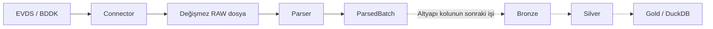

# Source Access Çalışma Özeti

Bu doküman, `feature/lakehouse-source-access` branch'inde geliştirilen **EVDS ve BDDK Aylık veri alma/parsing katmanını** ekip toplantısında hızlıca incelemek için hazırlanmıştır.

## 1. Kısa karar özeti

Bu branch aşağıdaki akışı çalışan ve test edilmiş hale getirir:



Bu branch'in sorumluluğu **`ParsedBatch` üretildiğinde biter**. Bronze, Silver, Gold, DuckDB tabloları, semantik dönüşümler ve Agent sorgu araçları bu branch'in kapsamına alınmamıştır.

### Mevcut durum

| Konu | Durum | Açıklama |
|---|---|---|
| BDDK Aylık Connector | Hazır | Canlı endpoint ve örnek cevap doğrulandı. |
| BDDK Aylık Parser | Hazır | Gerçek fixture ile ağsız test ediliyor. |
| EVDS Connector | Koşullu hazır | Resmî kılavuza göre geliştirildi; HTTP davranışı fake session ile test edildi. |
| EVDS Parser | Hazır | EVDS web uygulamasından alınan gerçek cevap şekilleriyle test ediliyor. |
| EVDS resmî keyed endpoint | Bekliyor | API anahtarı olmadığı için canlı smoke test henüz yapılmadı. |
| Ortak sözleşmeler | Korundu | Shared contract dosyalarında kırıcı değişiklik yapılmadı. |
| Otomatik kontroller | Geçti | `110 passed`; build ve demo-check başarılı. |

## 2. Neler geliştirildi?

### EVDS

- `EvdsConnector`, resmî EVDS3 URL ve istek sözleşmesini kullanır.
- API anahtarını yalnızca ortam değişkeninden okur; dosyaya, loga, metadata'ya veya URL'ye yazmaz.
- İstek tarihlerini `dd-mm-yyyy` formatında gönderir.
- Başarılı cevabın byte'larını değiştirmeden RAW alana kaydeder.
- Timeout, bağlantı hatası, `408`, `429` ve `5xx` cevaplarında kontrollü retry uygular.
- `EvdsParser`, kaydedilen RAW JSON'u ağ erişimi olmadan satır bazlı `ParsedBatch` çıktısına çevirir.
- JSON `null` değerleri sıfıra çevrilmez.
- EVDS'nin 1000 gözlem sınırı ve dönen gözlem sayısı kontrol edilir; şüpheli durumlar uyarı olarak korunur.

### BDDK Aylık

- `BddkMonthlyConnector`, BDDK gelişmiş aylık rapor endpoint'ine form isteği gönderir.
- Başarılı cevabın byte'larını değiştirmeden RAW alana kaydeder.
- Bir `FetchSpec` içinde tam olarak bir `kalemSutun` kabul eder.
- Aynı kavramın farklı tarihsel kalem kimlikleri gerekiyorsa ayrı `FetchSpec` çağrıları yapılır.
- `taraf` alanı gerektiğinde tekrarlanabilir.
- `BddkMonthlyParser`, pozisyonel `cell` dizilerini `colModels` bilgisiyle eşleştirir.
- HTTP 200 altında gelen `success:false` gövdeleri başarılı veri olarak kabul edilmez.
- Arayüzdeki `defaultValue: "0"` değeri gerçek ölçüm sayılmaz ve eksik değerler sıfırla doldurulmaz.
- Seri kimliği, değişebilecek Türkçe etiketten değil kararlı kaynak kalem kimliğinden oluşturulur.

## 3. Connector ve Parser ayrımı

Bu branch ortak takım sözleşmesindeki sınırı korur:

| Bileşen | Yapar | Yapmaz |
|---|---|---|
| Connector | Kaynağa erişir, cevabı indirir, exact byte'ları RAW'a kaydeder. | JSON'u yorumlamaz; temizleme, tarih dönüşümü, birim dönüşümü veya finansal hesap yapmaz. |
| Parser | Daha önce saklanmış RAW dosyayı okur ve kaynağa sadık tablo üretir. | Ağa çıkmaz; Silver/Gold semantiği veya frekans dönüşümü uygulamaz. |

Bu ayrım sayesinde parser testleri internet olmadan, sabit fixture'larla tekrar çalıştırılabilir.

## 4. Üretilen çıktılar

### EVDS `ParsedBatch`

- `schema_version`: `evds_observations.v1`
- Grain: gözlem × seri başına bir satır

Temel kolonlar:

```text
source_id
dataset_id
series_id
series_column
series_name
date_raw
unixtime
value_raw
artifact_sha256
fetched_at
locator
```

### BDDK Aylık `ParsedBatch`

- `schema_version`: `bddk_monthly_observations.v1`
- Grain: ay × ölçü × kurum grubu başına bir satır

Temel kolonlar:

```text
source_id
dataset_id
series_id
measure_column
measure_label
unit_label
entity_label
year_raw
month_raw
value_raw
source_order
artifact_sha256
fetched_at
locator
```

`date_key`, `frequency`, `measure_type` ve kanonik sayısal değer bu katmanda üretilmez. Bunlar Silver dönüşümünün sorumluluğudur.

## 5. Provenance ve RAW güvenliği

- RAW dosyalar indirilen cevabın exact byte'larıdır.
- Dosya kimliği SHA-256 hash üzerinden oluşturulur.
- Aynı içerik ikinci kez fiziksel olarak yazılmaz.
- Kaynak, dataset, locator, indirme zamanı ve hash bilgisi parser çıktısına kadar korunur.
- `requested_at` ile `fetched_at` ayrıdır:
  - `requested_at`: isteğin oluşturulduğu zaman
  - `fetched_at`: başarılı cevabın gerçekten indirildiği zaman
- `fetched_at` başarılı HTTP cevabından sonra alınır ve UTC'ye normalize edilir.
- Gerçek API anahtarı veya başka bir credential fixture'lara ve repoya eklenmez.

## 6. Gerçek kaynaklarda görülen önemli durumlar

### EVDS

- `Tarih` alanının formatı frekansa göre değişebilir.
- Normalizasyon için `UNIXTIME`, ham `Tarih` metninden daha güvenilir adaydır.
- Değerler JSON içinde string veya `null` gelebilir.
- Cevap istenen bitiş tarihinden sonraki bir gözlemi içerebilir.
- EVDS tek istekte en fazla 1000 gözlem döndürür ve büyük aralıkları sessizce kesebilir.
- Çeyreklik, altı aylık ve yıllık `Tarih` biçimleri henüz doğrulanmadı.

### BDDK Aylık

- HTTP 200 her zaman uygulama başarısı anlamına gelmez; gövde `success:false` olabilir.
- Satırlar kolon adlarını kendi içinde taşımaz; `colModels` ile birlikte okunmalıdır.
- Birim ayrı alanda değil kolon etiketinin içinde bulunabilir.
- Satırlar yeniden eskiye doğru gelebilir.
- Bir kavram farklı bülten şema dönemlerinde farklı kalem kimliklerine sahip olabilir.
- Çoklu tarihsel `kalemSutun` değerleri aynı istekte gönderilmez; ayrı ayrı alınır.

## 7. Test kapsamı

Toplam **110 test** geçmektedir. Bunların içinde:

- Connector URL, header ve form üretimi
- API anahtarının hiçbir çıktıya sızmaması
- Exact RAW byte saklama ve SHA-256 tekrar önleme
- Retry ve tipli hata davranışları
- Parser'ların tamamen ağsız çalışması
- Gerçek fixture'lardaki null, tarih ve kolon anomalileri
- BDDK `success:false` gövdesinin reddedilmesi
- Birden fazla `kalemSutun` değerinin istekten önce reddedilmesi
- `fetched_at` değerinin cevap sonrası alınması
- UTC dışındaki timezone değerlerinin UTC'ye çevrilmesi
- Ortak contract regresyon testleri

Yerel doğrulama komutları:

```bash
uv sync
make test
make build
make demo-check
```

Testleri çalıştırmak için EVDS API anahtarı veya internet bağlantısı gerekmez.

## 8. EVDS doğrulama seviyesi

EVDS tarafında şu ayrım özellikle korunmalıdır:

| İddia | Kanıt seviyesi |
|---|---|
| EVDS3 base URL, key header, tarih biçimi ve 1000 gözlem sınırı | Resmî EVDS kılavuzundan doğrulandı. |
| Connector'ın istek, retry ve secret güvenliği | Fake HTTP session ile otomatik test edildi. |
| Parser'ın mevcut JSON cevap şekillerini işlemesi | Web uygulamasının `/fe` ucundan alınan fixture'larla test edildi. |
| Resmî keyed endpoint'in gerçek cevap zarfı | Henüz canlı doğrulanmadı. |

`/fe` yalnızca cevap şeklini keşfetmek için kullanılmıştır; production endpoint veya fallback değildir.

API anahtarı elde edildiğinde `docs/sources/evds.md` içindeki dar smoke test uygulanmalıdır. Anahtar hiçbir koşulda komuta, ekran görüntüsüne, fixture'a veya Git geçmişine yazılmamalıdır.

## 9. Altyapı koluna entegrasyon notları

Altyapı kolu bu branch'teki `ParsedBatch` çıktılarını kullanarak şu sırayla ilerleyebilir:

1. EVDS ve BDDK `ParsedBatch` çıktılarını Bronze tablolara yazmak.
2. Ham tarihleri kanonik `date_key` alanına çevirmek.
3. Ham değerleri null bilgisini koruyarak kanonik sayısal değere dönüştürmek.
4. BDDK konut kredisi bakiyesini `stock` olarak tanımlamak.
5. EVDS konut kredisi faiz serisini `rate` olarak tanımlamak.
6. Haftalık faiz verisini kurallı biçimde aylık ortalamaya indirmek.
7. İki seriyi ay grain'inde birleştirip Gold tabloya materyalize etmek.
8. Gold tabloyu salt-okunur DuckDB sorgusuna açmak.

İlk ortak vertical slice hedefi:

```text
BDDK aylık konut kredisi bakiyesi
                 +
EVDS konut kredisi faiz serisi
                 ↓
     Aylık Gold karşılaştırma tablosu
                 ↓
          Salt-okunur DuckDB sorgusu
```

## 10. Bilinçli olarak yapılmayanlar

Kapsamın kontrol altında kalması için bu branch'e şunlar eklenmedi:

- Bronze, Silver veya Gold materyalizasyonu
- DuckDB veritabanı ve SQL modelleri
- Frekans hizalama ve finansal semantik dönüşümler
- BDDK Haftalık veya FinTürk Connector'ları
- Genel CSV, Excel, PDF veya URL ingestion
- EVDS metadata/katalog ingestion
- Agent tool'ları ve güvenli SQL yüzeyi
- Embedding, LanceDB, Kloudeks veya OCR
- Ortak `ParsedBatch.warnings` sözleşmesinde kırıcı değişiklik

## 11. Açık konular ve riskler

| Öncelik | Konu | Etki / yapılacak işlem |
|---|---|---|
| P0 | EVDS resmî keyed endpoint canlı test edilmedi | API anahtarı gelince dar smoke test çalıştırılacak. |
| P1 | EVDS 1000 gözlemde sessiz kesebilir | İstek pencereleme ve tamlık kontrolü ingestion orchestration aşamasında eklenecek. |
| P1 | EVDS çeyreklik/altı aylık/yıllık tarih biçimi bilinmiyor | Bu frekanslar kullanılmadan önce gerçek cevapla doğrulanacak. |
| P1 | BDDK boş dönem cevabı görülmedi | İlk örnek elde edildiğinde fixture ve regresyon testi eklenecek. |
| P1 | `ParsedBatch.warnings` yalnız string listesi | İlk sürümde değiştirilmedi; iki kolun ortak kararı olmadan contract değiştirilmeyecek. |

## 12. Toplantıda ekipten beklenen inceleme

Ekip şu sorulara karar vermelidir:

- `ParsedBatch` kolonları Bronze/Silver dönüşümü için yeterli mi?
- EVDS `UNIXTIME` alanı kanonik tarih üretiminde ana kaynak olarak kabul edilecek mi?
- BDDK tarihsel kalem kimliklerinin kanonik seri eşlemesi nerede tutulacak?
- 1000 gözlem riski için pencereleme Source Access orchestration'a mı, ayrı pipeline katmanına mı konacak?
- String uyarılar ilk vertical slice için yeterli mi, yoksa daha sonra kodlu warning modeli gerekli mi?

## 13. Kabul önerisi

Bu branch için önerilen karar:

- **Kod ve ağsız testler:** kabul edilebilir.
- **İlk vertical slice entegrasyonu:** fixture'larla başlayabilir.
- **EVDS production-ready kabulü:** canlı keyed smoke test sonrasına bırakılmalı.
- **Ortak sözleşme değişikliği:** şu anda yapılmamalı.

Daha ayrıntılı kaynak kanıtları için:

- `docs/sources/evds.md`
- `docs/sources/bddk_monthly.md`
- `docs/team-contract.md`

