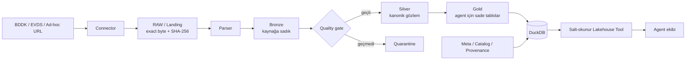
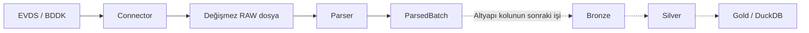

# Data/Lakehouse Kararları ve Source Access Çalışma Özeti

Bu doküman yalnızca son kod değişikliklerini değil, `feature/lakehouse-source-access` branch'ine gelmeden önce yapılan **gereksinim analizi, araştırma, mimari kararlar, kapsam kesintileri, ortak base hazırlığı ve görev paylaşımını** da anlatır. Amaç, ekip toplantısında hem “ne yaptık?” hem de “neden böyle yaptık?” sorularını tek yerden cevaplamaktır.

Dokümanın ilk bölümü bütün Data/Lakehouse çalışma alanının ortak kararlarını; ikinci bölümü bu branch'te geliştirilen **EVDS ve BDDK Aylık veri alma/parsing katmanını** açıklar.

## 1. Toplantı için üç dakikalık özet

1. Kick-off sunumu, tam toplantı transkripti, ekran görüntüleri, ekip konuşmaları ve ilk Data/Lakehouse araştırması birlikte incelendi.
2. Organizatörün kesin talepleri, güçlü beklentileri ve bizim teknoloji tercihlerimiz birbirinden ayrıldı.
3. İlk planlardaki DuckLake, dbt ve LanceDB gibi bileşenler P0'dan çıkarılarak üç günlük ilk sürüm sadeleştirildi.
4. Nihai P0 mimarisi **Python + değişmez RAW + Parquet + DuckDB + Bronze/Silver/Gold + Meta** olarak belirlendi.
5. Connector, Parser ve ortak veri sözleşmeleri kod yazmadan önce kilitlendi.
6. Sena ortak repo/base ile altyapı-depolama-güvenlik kolunu; bu branch'in sahibi ise Source Access kolunu üstlendi.
7. Ortak base 22 testle doğrulandıktan sonra iki paralel branch açıldı.
8. Bu branch'te EVDS ve BDDK Aylık Connector/Parser'ları, gerçek fixture'lar, kaynak dokümanları ve testler geliştirildi.
9. Mevcut sonuç: **110 test geçiyor**. BDDK canlı erişimi doğrulandı; EVDS resmî keyed endpoint smoke testi API anahtarı bekliyor.
10. Sonraki ortak hedef, iki kaynağı RAW → Bronze → Silver → Gold üzerinden geçirip DuckDB'de tek SQL ile birleştirmek.

## 2. Hazırlık ve araştırma sürecinde neler yapıldı?

### 2.1 Kullanılan bilgi kaynakları

Kararlar tek bir araştırma raporundan alınmadı. Aşağıdaki girdiler birlikte değerlendirildi:

- KKB Hackathon 2026 kick-off sunumu
- Kick-off toplantısının video kaydı ve tam zaman damgalı transkripti
- Organizatör açıklamalarının yer aldığı ekran görüntüleri
- Ekip içi konuşmalar ve görev paylaşımı
- Sena'nın hazırladığı ilk Data/Lakehouse uygulama planı
- Aynı gereksinimler üzerinden yapılan bağımsız mimari araştırma
- İki planı karşılaştıran nihai hakem/karar çalışması
- BDDK, TCMB/EVDS ve kullanılan teknolojilerin resmî dokümantasyonları

### 2.2 Tam transkript neden önemliydi?

Kısmî transkriptte mimariyi etkileyen bazı ifadeler hatalı çözümlenmişti. Tam kayıt incelendiğinde şu kritik noktalar netleşti:

- Organizatör lakehouse'u anlatırken doğrudan **Bronze / Silver / Gold** terimlerini kullandı.
- Lakehouse Tool'un kullanıcı sorusunu **SQL'e çevirmesi ve join yapabilmesi** açıkça söylendi.
- Demo sırasında yeni veya bilinmeyen veri kaynağı/URL gelebileceği anlaşıldı.
- Kod repolarının yalnız teslim alınmadığı, güvenlik ve okunabilirlik açısından **puanlandığı** netleşti.
- Sunumdaki bilinmeyen kaynak örneklerinin Borsa İstanbul olabileceğine dair güçlü sinyal görüldü; yine de bu kesin gereksinim sayılmadı.
- Kloudeks tarafında LLM yanında embedding, reranker, VLM ve OCR seçeneklerinden söz edildi; kota ve kesin servis sözleşmesi ise açık kalmaya devam etti.

Bu yüzden dokümanlarda her ifade şu sınıflardan biriyle ele alındı:

- **Kesin gereksinim:** organizatör açıkça istedi.
- **Güçlü beklenti:** sunum ve konuşma bunu işaret ediyor ama mutlak şart değil.
- **Çözüm kararı:** teknoloji veya uygulama tercihi bize ait.
- **Teyit gerekli:** yeterli kanıt yok; mentor cevabı veya gerçek kaynak testi gerekli.

### 2.3 İki araştırma nasıl birleştirildi?

Amaç Sena'nın raporunu olduğu gibi uygulamak veya ikinci raporu onun üzerine eklemek değildi. İki çalışma tartışmalı kararlar üzerinden karşılaştırıldı:

- Hangi öneri organizatör gereksinimini gerçekten karşılıyor?
- Hangisi üç günlük çalışan ilk sürüme sığıyor?
- Hangisi yeni öğrenme ve entegrasyon riski yaratıyor?
- Hangisi veri doğruluğu, provenance, güvenlik veya demo gücüne doğrudan katkı sağlıyor?
- Bir bileşen çıkarılırsa daha basit fallback nedir?

Korunan başlıca fikirler:

- Önce küçük ama uçtan uca bir vertical slice çıkarma
- Connector ve Parser sorumluluklarını ayırma
- Immutable RAW, SHA-256, vintage ve revision yaklaşımı
- `stock`, `flow_periodic`, `flow_ytd`, `rate`, `ratio`, `index` gibi ölçü semantiğini açık taşıma
- Kalite hatalarında veriyi sessizce silmek yerine quarantine etme
- Agent'ın fiziksel dosya yollarını bilmemesi
- Satır seviyesine kadar provenance taşıma

Değiştirilen veya ertelenen başlıca fikirler:

- DuckLake P0'dan P1'e alındı; ilk sürümde düz Parquet + DuckDB seçildi.
- dbt P2'ye alındı; ilk sürüm için sıralı ve küçük bir SQL runner kararlaştırıldı.
- LanceDB ve embedding P1'e alındı; P0 araması exact/alias/metadata ve gerekirse DuckDB FTS olacak.
- Java gerektiren `tabula-py` çıkarıldı; genel PDF yolu `pdfplumber → camelot → Kloudeks VLM/OCR` olarak tasarlandı.
- Borsa İstanbul'a özel Connector yazılmaması, dosyalarının genel ingestion yolunda golden test olarak kullanılması kararlaştırıldı.
- Büyük orkestrasyon platformları, streaming ve ağır katalog ürünleri kapsam dışına çıkarıldı.

### 2.4 Source Access sahibinin kod öncesi katkısı

Source Access geliştirmesine başlamadan önce yalnızca hazır bir görev alınmadı; görevin doğru tanımlanması için aşağıdaki hazırlık ve karar çalışmaları yürütüldü:

- Kick-off materyalleri, video, transkript, ekran görüntüleri ve ekip konuşmaları tek çalışma alanında toplandı.
- Toplantı kaydının tam transkripti çıkarıldı ve kısmî transkriptte mimariyi etkileyen hatalar tespit edildi.
- Hackathon'un bütün gereksinimleri Data, Agentic, güvenlik, demo ve teslim başlıklarında derlendi.
- Çalışmanın yalnız Data/Lakehouse sınırında kalacağı; Agentic tarafa yalnız kontrat seviyesinde temas edileceği netleştirildi.
- Sena'nın ilk teknik raporu bağımsız bir araştırmayla karşılaştırıldı; teknoloji tercihleri kesin gereksinim gibi kabul edilmedi.
- Claude'dan mevcut önerileri tekrar etmek yerine sıfırdan alternatifleri değerlendirmesi, resmî kaynaklarla doğrulaması ve uygulanabilirliği sorgulaması istendi.
- Tam transkript sonrası değişen gereksinimler mimari karar dosyasına geri işlendi.
- İki araştırmanın çelişkilerini çözen nihai karar dokümanı hazırlandı.
- İlk kez bu alanda çalışan ekip üyeleri için Data/Lakehouse terimler sözlüğü oluşturuldu.
- Gün/saat bağımsız, kontrol kapılarına dayalı `progress.md` takip sistemi kuruldu.
- Üç günlük ilk sürüm hedefi için önce ortak base, sonra iki paralel kol yaklaşımı belirlendi.
- Infrastructure ve Source Access sınırları birlikte kararlaştırıldı; bu branch için Source Access sorumluluğu alındı.

Bu hazırlık sürecinin başlıca artefaktları şunlardır:

| Artefakt | Amaç |
|---|---|
| `KKB_Agentic_Data_Analytics_Hackathon_Uctan_Uca_Proje_Rehberi.md` | Organizatör gereksinimlerini ve bütün proje sürecini derlemek |
| `KKB_Hackathon_2026_Kick_Off_Tam_Transkript.md` | Kararların toplantıdaki gerçek ifadelere dayanmasını sağlamak |
| `lakehouse-mimari-karar.md` | Gereksinim, varsayım ve teknoloji seçeneklerini ayırmak |
| `lakehouse-nihai-karar.md` | Çelişen iki araştırma arasında tek uygulanabilir mimari karar vermek |
| `KKB_Data_Lakehouse_Terimler_Sozlugu.md` | Mimariyi öğrenilebilir ve ekip içinde ortak konuşulabilir hale getirmek |
| `progress.md` | İşleri bağımlılık, sahiplik ve kabul kapıları üzerinden takip etmek |

Bu nedenle Source Access branch'i yalnız dört Python dosyasından oluşan izole bir kod işi değildir; öncesindeki gereksinim analizi ve mimari sadeleştirmenin ilk somut uygulama sonucudur.

## 3. Organizatör gereksinimlerinden Data/Lakehouse'a düşenler

| Konu | Statü | Bizim karşılığımız |
|---|---|---|
| Backend'in Python olması | Kesin gereksinim | Python 3.12 kullanılıyor. |
| BDDK Aylık, Haftalık ve FinTürk verileri | Kesin gereksinim | Aylık P0 başladı; Haftalık dar P0, FinTürk sonraki kapsam. |
| EVDS günlük/haftalık/aylık verileri | Kesin gereksinim | Observation Connector/Parser başladı; metadata ve geniş kapsam sonraki aşama. |
| 2021-01–2026-06 veri aralığı | Kesin gereksinim | Kaynak istekleri ve completeness kontrollerinde uygulanacak. |
| Kümülatif veriyi dönemsele çevirme | Kesin gereksinim | Silver semantik dönüşümünde ölçü tipine bağlı uygulanacak. |
| Farklı frekansları hizalama | Kesin gereksinim | Stock/rate/flow kurallarına göre ve uydurma veri üretmeden yapılacak. |
| SQL üretme ve join yapma | Kesin gereksinim | Gold/Meta üzerinde güvenli DuckDB SQL yüzeyi sağlanacak. |
| Modüler ve jenerik mimari | Kesin gereksinim | Connector/Parser protokolü ve ortak kanonik Silver modeli kullanılıyor. |
| Repo güvenliği ve okunabilirliği | Kesin gereksinim | Secret'lar environment'ta; modüller küçük; fixture ve test kanıtı var. |
| Hazır/lisanslı bulut lakehouse kullanmama | Kesin gereksinim | Local-first açık kaynak bileşenler ve kendi katmanlarımız kullanılıyor. |
| Demo günü URL/PDF/Excel/görsel/metin | Kesin gereksinim | Genel `ingest_adhoc` P0 planında; gelişmiş OCR yalnız gerektiğinde. |
| Bronze/Silver/Gold adları | Güçlü beklenti | Katmanlar organizatörün kullandığı adlarla kurulacak. |
| Kloudeks dışı üçüncü taraf LLM API'si kullanmama | Kesin gereksinim | Data P0 dış servise bağımlı değil; ileri AI özellikleri Kloudeks sınırında kalacak. |

SQL organizatör gereksinimidir; **DuckDB bizim çözüm kararımızdır**. Benzer biçimde Bronze/Silver/Gold güçlü beklentidir; Landing ve Meta katmanları izlenebilirlik ve operasyon için bizim eklediğimiz katmanlardır.

## 4. Kilitlenen nihai mimari kararlar

### 4.1 Büyük mimari



### 4.2 Teknoloji kararları

| Alan | P0 kararı | Neden |
|---|---|---|
| Dil | Python 3.12 | Organizatör gereksinimi ve veri ekosistemi |
| Ham saklama | Immutable RAW + SHA-256 | Kaynağın exact kanıtını korumak, tekrar yazmayı önlemek |
| Analitik dosya | Parquet | Kolon bazlı, taşınabilir, DuckDB ile doğrudan okunabilir |
| Sorgu motoru | DuckDB | Lokal, kurulumu kolay, Parquet ve SQL desteği güçlü |
| Dönüşüm | SQL-first küçük runner | İkinci bir ağır toolchain olmadan okunabilir dönüşüm |
| Parsing | pandas | Kaynak cevabını tabloya ayırmak için sınırlı kullanım |
| Şema doğrulama | Pandera + SQL assertion + pytest | Her kalite problemini doğru katmanda yakalamak |
| Arama | Exact/alias/metadata + DuckDB FTS | P0 için dış servissiz ve yeterince basit |
| Provenance | Satır + artifact + run/vintage | Her sayının kaynağına geri dönebilmek |
| SQL güvenliği | Salt-okunur bağlantı + allowlist + timeout + audit | LLM'in SQL'i güvenilir girdi değildir |

### 4.3 Katmanların anlamı

| Katman | Görevi | Temel kural |
|---|---|---|
| RAW/Landing | Kaynaktan gelen exact byte ve istek kanıtı | Değiştirilmez. |
| Bronze | Kaynak yapısını okunabilir tabloya çevirir | İş semantiği uygulamaz. |
| Silver | Kaynakları ortak `fact_observation` modelinde birleştirir | Tarih, değer, birim ve ölçü tipi kanonikleşir. |
| Gold | Agent ve demo için sade, amaca yönelik tablolar/view'lar üretir | Güvenli ve anlaşılır sorgu yüzeyidir. |
| Meta | Dataset, seri, run, version, quality ve provenance bilgisini tutar | Verinin ne olduğunu ve nereden geldiğini açıklar. |
| Quarantine | Kalite kontrolünden geçmeyen kayıtları saklar | Hatalı veri sessizce kaybolmaz veya Gold'a çıkmaz. |

### 4.4 Zaman serisi güvenlik ilkeleri

- `stock`: dönem sonu/son geçerli değer; fark almak onu otomatik olarak flow yapmaz.
- `flow_periodic`: dönem içinde oluşan değer; dönemler toplanabilir.
- `flow_ytd`: yıl başından döneme kadar kümülatif; yıl reseti gözetilerek fark alınır.
- `flow_cumulative`: başlangıçtan beri kümülatif; ancak açık semantik varsa ayrıştırılır.
- `rate`: faiz/oran; çoğunlukla ortalama veya kaynağın beyan ettiği yöntem kullanılır.
- `ratio`: pay/payda ilişkisi; basit ortalama yasaktır, ağırlık bilinmiyorsa sistem durur.
- `index`: baz yılı ve eklemleme bilgisi olmadan farklı bazlar birleştirilmez.
- `count`: adet; toplama davranışı grain ve döneme göre tanımlanır.
- Düşük frekanslı veri yüksek frekansa sessizce çoğaltılmaz.
- Eksik değer varsayılan olarak interpolate edilmez ve sıfırla doldurulmaz.
- Semantik güvenli değilse sistem veri uydurmak yerine hata/caveat üretir.

## 5. Ownership ve çalışma paylaşımı

### 5.1 Data/Lakehouse sınırı

Data ekibi şunların sahibidir:

- Kaynak erişimi ve ingestion
- RAW/Bronze/Silver/Gold katmanları
- Parquet ve DuckDB fiziksel tasarımı
- Veri ve metadata sözleşmeleri
- Zaman serisi semantiği ve frekans hizalama
- Quality, provenance, versioning ve quarantine
- Agent'a açılan güvenli sorgu/tool kontratı

Agent ekibi şunların sahibidir:

- Kullanıcı niyetini anlama ve planlama
- NL → SQL üretimi
- Tool seçimi ve çok adımlı akış
- Analitik yorum, anomali/nedensellik anlatısı
- Kullanıcı arayüzü ve raporlama

Sınırdaki ortak teslim, Agent'ın yalnızca güvenli Gold/Meta yüzeyini gördüğü; her sonucun provenance ve caveat taşıdığı Lakehouse Tool kontratıdır.

### 5.2 İki kişilik Data/Lakehouse paylaşımı

| Kol | Ana sorumluluk |
|---|---|
| Infrastructure / Sena | Ortak repo ve runtime, depolama, DuckDB, katman materyalizasyonu, metadata/provenance tabloları, güvenli SQL ve altyapı testleri |
| Source Access / bu branch | BDDK ve EVDS kaynak keşfi, endpoint/parametre doğrulaması, Connector, Parser, gerçek fixture, kaynak anomalileri ve ağsız testler |

Bu ayrımın ortasındaki ortak sözleşmeler birlikte kilitlendi; iki branch'in bağımsız olarak bunları değiştirmemesi kararlaştırıldı.

## 6. Source Access'ten önce kurulan ortak base

Paralel geliştirmeye kod yazarak değil, önce ortak dil ve kontrol kapısı kurarak geçildi.

### 6.1 Ortak çalışma standardı

- Python 3.12
- `uv` ile bağımlılık ve lock dosyası
- Tekrarlanabilir `uv sync`
- Ortak `make test`, `make build`, `make demo-check` komutları
- `.env` ve gerçek verinin Git dışında tutulması
- Fixture'ların küçük, secretsız ve ağsız çalışması
- Ortak hata kodları ve kimlik adlandırma kuralları

### 6.2 Önce kilitlenen sınır sözleşmeleri

```text
FetchSpec → Connector → FetchedAsset → RAW → Parser → ParsedBatch
```

- `FetchSpec`: kaynaktan ne istendiğini tarif eder; secret değerini değil yalnız referansını taşır.
- `FetchedAsset`: indirilen exact artifact'ın yolu, hash'i, zamanı ve kaynak metadata'sıdır.
- `ParsedBatch`: parser'ın kaynağa sadık tablo çıktısı ve uyarılarıdır.
- `LakehouseError`: bütün kaynak ve parser hatalarının ortak, tipli zarfıdır.

### 6.3 Base kontrol kapısı

Paralel branch'lere ayrılmadan önce aşağıdakiler doğrulandı:

- Repo iki bilgisayarda kurulabiliyor.
- Aynı komutlarla aynı testler çalışıyor.
- Fake `FetchSpec → FetchedAsset → ParsedBatch` zinciri çalışıyor.
- RAW dosyası SHA-256 ile içerik-adresli ve idempotent saklanıyor.
- Ortak ID, tarih, hata ve minimum Silver kolonları yazılı.
- Provenance fake pipeline boyunca kaybolmuyor.
- Ortak contract dosyalarının tek taraflı değiştirilmeyeceği belgeli.
- Base aşamasındaki **22 test**, build ve demo-check geçti.

Bu kapı geçtikten sonra ortak base commit'inden Infrastructure ve Source Access branch'leri ayrıldı.

### 6.4 Üç günlük ilk sürüm stratejisi

Amaç ilk günden bütün BDDK/EVDS evrenini çekmek değil, Agent'a verilebilecek tam bir küçük zincir üretmekti:

```text
BDDK aylık konut kredisi bakiyesi
                 +
EVDS konut kredisi faiz serisi
                 ↓
RAW → Bronze → Silver → aylık Gold → DuckDB → tek SQL join
```

İlk vertical slice tamamlanmadan tam EVDS, gelişmiş katalog, embedding, OCR veya ek kaynaklara yayılmama kararı alındı. Bu sıra entegrasyon hatalarını erken bulmak ve “çok parça var ama çalışan ürün yok” riskini azaltmak için seçildi.

## 7. Source Access uygulama özeti

Bu branch aşağıdaki akışı çalışan ve test edilmiş hale getirir:



Bu branch'in sorumluluğu **`ParsedBatch` üretildiğinde biter**. Bronze, Silver, Gold, DuckDB tabloları, semantik dönüşümler ve Agent sorgu araçları bu branch'in kapsamına alınmamıştır.

### Mevcut durum

| Konu | Durum | Açıklama |
|---|---|---|
| BDDK Aylık Connector | Hazır | Canlı endpoint ve örnek cevap doğrulandı. |
| BDDK Aylık Parser | Hazır | Gerçek fixture ile ağsız test ediliyor. |
| EVDS Connector | Koşullu hazır | Resmî kılavuza göre geliştirildi; HTTP davranışı fake session ile test edildi. |
| EVDS Parser | Hazır | EVDS web uygulamasından alınan gerçek cevap şekilleriyle test ediliyor. |
| EVDS resmî keyed endpoint | Bekliyor | API anahtarı olmadığı için canlı smoke test henüz yapılmadı. |
| Ortak sözleşmeler | Korundu | Shared contract dosyalarında kırıcı değişiklik yapılmadı. |
| Otomatik kontroller | Geçti | `110 passed`; build ve demo-check başarılı. |

## 8. Source Access branch'inde neler geliştirildi?

### EVDS

- `EvdsConnector`, resmî EVDS3 URL ve istek sözleşmesini kullanır.
- API anahtarını yalnızca ortam değişkeninden okur; dosyaya, loga, metadata'ya veya URL'ye yazmaz.
- İstek tarihlerini `dd-mm-yyyy` formatında gönderir.
- Başarılı cevabın byte'larını değiştirmeden RAW alana kaydeder.
- Timeout, bağlantı hatası, `408`, `429` ve `5xx` cevaplarında kontrollü retry uygular.
- `EvdsParser`, kaydedilen RAW JSON'u ağ erişimi olmadan satır bazlı `ParsedBatch` çıktısına çevirir.
- JSON `null` değerleri sıfıra çevrilmez.
- EVDS'nin 1000 gözlem sınırı ve dönen gözlem sayısı kontrol edilir; şüpheli durumlar uyarı olarak korunur.

### BDDK Aylık

- `BddkMonthlyConnector`, BDDK gelişmiş aylık rapor endpoint'ine form isteği gönderir.
- Başarılı cevabın byte'larını değiştirmeden RAW alana kaydeder.
- Bir `FetchSpec` içinde tam olarak bir `kalemSutun` kabul eder.
- Aynı kavramın farklı tarihsel kalem kimlikleri gerekiyorsa ayrı `FetchSpec` çağrıları yapılır.
- `taraf` alanı gerektiğinde tekrarlanabilir.
- `BddkMonthlyParser`, pozisyonel `cell` dizilerini `colModels` bilgisiyle eşleştirir.
- HTTP 200 altında gelen `success:false` gövdeleri başarılı veri olarak kabul edilmez.
- Arayüzdeki `defaultValue: "0"` değeri gerçek ölçüm sayılmaz ve eksik değerler sıfırla doldurulmaz.
- Seri kimliği, değişebilecek Türkçe etiketten değil kararlı kaynak kalem kimliğinden oluşturulur.

## 9. Connector ve Parser ayrımı

Bu branch ortak takım sözleşmesindeki sınırı korur:

| Bileşen | Yapar | Yapmaz |
|---|---|---|
| Connector | Kaynağa erişir, cevabı indirir, exact byte'ları RAW'a kaydeder. | JSON'u yorumlamaz; temizleme, tarih dönüşümü, birim dönüşümü veya finansal hesap yapmaz. |
| Parser | Daha önce saklanmış RAW dosyayı okur ve kaynağa sadık tablo üretir. | Ağa çıkmaz; Silver/Gold semantiği veya frekans dönüşümü uygulamaz. |

Bu ayrım sayesinde parser testleri internet olmadan, sabit fixture'larla tekrar çalıştırılabilir.

## 10. Üretilen çıktılar

### EVDS `ParsedBatch`

- `schema_version`: `evds_observations.v1`
- Grain: gözlem × seri başına bir satır

Temel kolonlar:

```text
source_id
dataset_id
series_id
series_column
series_name
date_raw
unixtime
value_raw
artifact_sha256
fetched_at
locator
```

### BDDK Aylık `ParsedBatch`

- `schema_version`: `bddk_monthly_observations.v1`
- Grain: ay × ölçü × kurum grubu başına bir satır

Temel kolonlar:

```text
source_id
dataset_id
series_id
measure_column
measure_label
unit_label
entity_label
year_raw
month_raw
value_raw
source_order
artifact_sha256
fetched_at
locator
```

`date_key`, `frequency`, `measure_type` ve kanonik sayısal değer bu katmanda üretilmez. Bunlar Silver dönüşümünün sorumluluğudur.

## 11. Provenance ve RAW güvenliği

- RAW dosyalar indirilen cevabın exact byte'larıdır.
- Dosya kimliği SHA-256 hash üzerinden oluşturulur.
- Aynı içerik ikinci kez fiziksel olarak yazılmaz.
- Kaynak, dataset, locator, indirme zamanı ve hash bilgisi parser çıktısına kadar korunur.
- `requested_at` ile `fetched_at` ayrıdır:
  - `requested_at`: isteğin oluşturulduğu zaman
  - `fetched_at`: başarılı cevabın gerçekten indirildiği zaman
- `fetched_at` başarılı HTTP cevabından sonra alınır ve UTC'ye normalize edilir.
- Gerçek API anahtarı veya başka bir credential fixture'lara ve repoya eklenmez.

## 12. Gerçek kaynaklarda görülen önemli durumlar

### EVDS

- `Tarih` alanının formatı frekansa göre değişebilir.
- Normalizasyon için `UNIXTIME`, ham `Tarih` metninden daha güvenilir adaydır.
- Değerler JSON içinde string veya `null` gelebilir.
- Cevap istenen bitiş tarihinden sonraki bir gözlemi içerebilir.
- EVDS tek istekte en fazla 1000 gözlem döndürür ve büyük aralıkları sessizce kesebilir.
- Çeyreklik, altı aylık ve yıllık `Tarih` biçimleri henüz doğrulanmadı.

### BDDK Aylık

- HTTP 200 her zaman uygulama başarısı anlamına gelmez; gövde `success:false` olabilir.
- Satırlar kolon adlarını kendi içinde taşımaz; `colModels` ile birlikte okunmalıdır.
- Birim ayrı alanda değil kolon etiketinin içinde bulunabilir.
- Satırlar yeniden eskiye doğru gelebilir.
- Bir kavram farklı bülten şema dönemlerinde farklı kalem kimliklerine sahip olabilir.
- Çoklu tarihsel `kalemSutun` değerleri aynı istekte gönderilmez; ayrı ayrı alınır.

## 13. Test kapsamı

Toplam **110 test** geçmektedir. Bunların içinde:

- Connector URL, header ve form üretimi
- API anahtarının hiçbir çıktıya sızmaması
- Exact RAW byte saklama ve SHA-256 tekrar önleme
- Retry ve tipli hata davranışları
- Parser'ların tamamen ağsız çalışması
- Gerçek fixture'lardaki null, tarih ve kolon anomalileri
- BDDK `success:false` gövdesinin reddedilmesi
- Birden fazla `kalemSutun` değerinin istekten önce reddedilmesi
- `fetched_at` değerinin cevap sonrası alınması
- UTC dışındaki timezone değerlerinin UTC'ye çevrilmesi
- Ortak contract regresyon testleri

Yerel doğrulama komutları:

```bash
uv sync
make test
make build
make demo-check
```

Testleri çalıştırmak için EVDS API anahtarı veya internet bağlantısı gerekmez.

## 14. EVDS doğrulama seviyesi

EVDS tarafında şu ayrım özellikle korunmalıdır:

| İddia | Kanıt seviyesi |
|---|---|
| EVDS3 base URL, key header, tarih biçimi ve 1000 gözlem sınırı | Resmî EVDS kılavuzundan doğrulandı. |
| Connector'ın istek, retry ve secret güvenliği | Fake HTTP session ile otomatik test edildi. |
| Parser'ın mevcut JSON cevap şekillerini işlemesi | Web uygulamasının `/fe` ucundan alınan fixture'larla test edildi. |
| Resmî keyed endpoint'in gerçek cevap zarfı | Henüz canlı doğrulanmadı. |

`/fe` yalnızca cevap şeklini keşfetmek için kullanılmıştır; production endpoint veya fallback değildir.

API anahtarı elde edildiğinde `docs/sources/evds.md` içindeki dar smoke test uygulanmalıdır. Anahtar hiçbir koşulda komuta, ekran görüntüsüne, fixture'a veya Git geçmişine yazılmamalıdır.

## 15. Altyapı koluna entegrasyon notları

Altyapı kolu bu branch'teki `ParsedBatch` çıktılarını kullanarak şu sırayla ilerleyebilir:

1. EVDS ve BDDK `ParsedBatch` çıktılarını Bronze tablolara yazmak.
2. Ham tarihleri kanonik `date_key` alanına çevirmek.
3. Ham değerleri null bilgisini koruyarak kanonik sayısal değere dönüştürmek.
4. BDDK konut kredisi bakiyesini `stock` olarak tanımlamak.
5. EVDS konut kredisi faiz serisini `rate` olarak tanımlamak.
6. Haftalık faiz verisini kurallı biçimde aylık ortalamaya indirmek.
7. İki seriyi ay grain'inde birleştirip Gold tabloya materyalize etmek.
8. Gold tabloyu salt-okunur DuckDB sorgusuna açmak.

İlk ortak vertical slice hedefi:

```text
BDDK aylık konut kredisi bakiyesi
                 +
EVDS konut kredisi faiz serisi
                 ↓
     Aylık Gold karşılaştırma tablosu
                 ↓
          Salt-okunur DuckDB sorgusu
```

## 16. Bilinçli olarak yapılmayanlar

Kapsamın kontrol altında kalması için bu branch'e şunlar eklenmedi:

- Bronze, Silver veya Gold materyalizasyonu
- DuckDB veritabanı ve SQL modelleri
- Frekans hizalama ve finansal semantik dönüşümler
- BDDK Haftalık veya FinTürk Connector'ları
- Genel CSV, Excel, PDF veya URL ingestion
- EVDS metadata/katalog ingestion
- Agent tool'ları ve güvenli SQL yüzeyi
- Embedding, LanceDB, Kloudeks veya OCR
- Ortak `ParsedBatch.warnings` sözleşmesinde kırıcı değişiklik

## 17. Açık konular ve riskler

| Öncelik | Konu | Etki / yapılacak işlem |
|---|---|---|
| P0 | EVDS resmî keyed endpoint canlı test edilmedi | API anahtarı gelince dar smoke test çalıştırılacak. |
| P1 | EVDS 1000 gözlemde sessiz kesebilir | İstek pencereleme ve tamlık kontrolü ingestion orchestration aşamasında eklenecek. |
| P1 | EVDS çeyreklik/altı aylık/yıllık tarih biçimi bilinmiyor | Bu frekanslar kullanılmadan önce gerçek cevapla doğrulanacak. |
| P1 | BDDK boş dönem cevabı görülmedi | İlk örnek elde edildiğinde fixture ve regresyon testi eklenecek. |
| P1 | `ParsedBatch.warnings` yalnız string listesi | İlk sürümde değiştirilmedi; iki kolun ortak kararı olmadan contract değiştirilmeyecek. |

## 18. Toplantıda ekipten beklenen inceleme

Ekip şu sorulara karar vermelidir:

- `ParsedBatch` kolonları Bronze/Silver dönüşümü için yeterli mi?
- EVDS `UNIXTIME` alanı kanonik tarih üretiminde ana kaynak olarak kabul edilecek mi?
- BDDK tarihsel kalem kimliklerinin kanonik seri eşlemesi nerede tutulacak?
- 1000 gözlem riski için pencereleme Source Access orchestration'a mı, ayrı pipeline katmanına mı konacak?
- String uyarılar ilk vertical slice için yeterli mi, yoksa daha sonra kodlu warning modeli gerekli mi?

## 19. Kabul önerisi

Bu branch için önerilen karar:

- **Kod ve ağsız testler:** kabul edilebilir.
- **İlk vertical slice entegrasyonu:** fixture'larla başlayabilir.
- **EVDS production-ready kabulü:** canlı keyed smoke test sonrasına bırakılmalı.
- **Ortak sözleşme değişikliği:** şu anda yapılmamalı.

Daha ayrıntılı kaynak kanıtları için:

- `docs/sources/evds.md`
- `docs/sources/bddk_monthly.md`
- `docs/team-contract.md`
